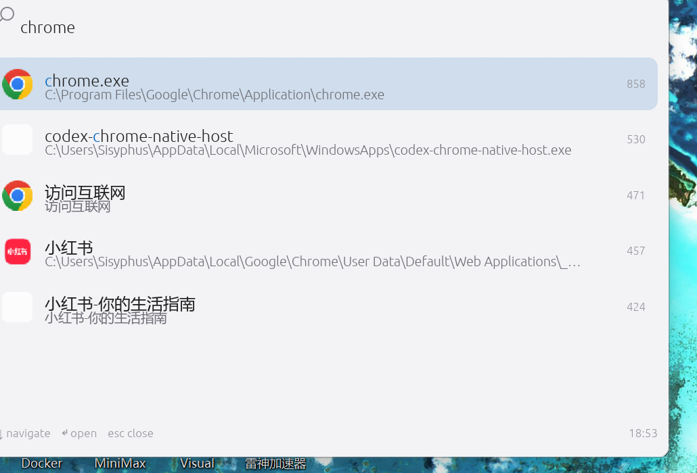

# IDEAS Launcher — Rust 快速启动器

用 Rust 从零实现的 Windows 快速启动器。设计目标:比 Flow Launcher 2.1.4 **更快启动、更快响应、更省内存**,同时界面更干净。

逆向分析全过程与实测数据见 [`analysis/REPORT.md`](analysis/REPORT.md)。



---

## 1.0.0 — 第一个大版本(2026-11-08)

**这一版做完了什么事:文件搜索从「启动时扫一遍」变成了真正的实时索引。**

| | 1.0.0 之前 | 1.0.0 |
|---|---|---|
| 新建一个文件 | 得重启才搜得到 | **毫秒级**;窗口开着时列表自己更新,不用再按键 |
| 删除一个文件 | 还赖在结果里 | **立刻消失** |
| 重建全盘索引 | 点了没下文;失败还会把旧索引删掉 | **有进度条**;失败写明原因;**旧索引一直用到新的建好** |
| 索引范围 | 用户目录里的一小撮(200 条上限) | **用户目录全量**(本机 **121 万条**,48 秒扫完),边扫边出结果,不会被一个大项目吃光预算 |
| 权限 | 得自己去托盘里点「以管理员身份运行」 | **默认就以管理员身份运行**:启动时自动申请一次权限,全盘索引开箱即用(可在「设置 → 索引」里关掉) |
| 查询延迟 | —— | 121 万条索引里 **4–6 ms** 出结果 |
| 视频预览 | 放不了(mp4 黑屏) | **能放**:随包带一套 FFmpeg,硬件解码优先,放不了就退软件解码 |
| 索引写盘 | 每 6 小时重写一遍 745 MB(一个月 90 GB 的写) | **整表只写一次,之后只写变化**(几 MB);默认 24 小时,可设成永不自动重建 |

**两套索引,不是一个**

「九百多万」和「一百二十多万」说的是**两套不同的索引**。这一版它们**不再重叠**
—— 但前提是全盘索引能自己跟着 NTFS 变更日志更新,这条要成立得先说清楚:

| | 覆盖范围 | 条数 | 需要管理员吗 | 这一版的变化 |
|---|---|---|---|---|
| **全盘索引** | C: 盘等每个卷的**每个文件** | **9,190,054** | **要**(读 NTFS 主文件表 + NTFS 变更日志) | **加了跟随变更日志的线程**:读得到就自己更新,读不到就明说原因 |
| **用户目录实时索引** | 家目录(桌面/文档/下载/图片/音乐/视频) | **1,215,917** | 不要 | **全盘索引能自己更新时就不建了**:家目录已经被盖住,再存一份就是重复 |

**去重叠的条件,是全盘索引真能自己更新。** 全盘索引以前是**冻结的快照**:
变更日志的句柄是以 `FILE_READ_ATTRIBUTES` 开的,而控制代码要 `FILE_READ_DATA`,
读日志的请求一直被拒(错误 5)。句柄改对之后,权限这一关过了,
本机又撞上第二个问题(见 [`analysis/RELEASE-GAP.md`](analysis/RELEASE-GAP.md) §1.15):
**同一卷、同一提权进程,微软自己的 `fsutil` 能读出 31 万条记录,本程序读不动。**

所以这一版的做法是**让去重叠自己判断**:

* 全盘索引**能**读变更日志 → 家目录不扫、不存第二份 → 内存少 98 MB、查询少扫 121 万条;
* 读不到(本机如此,日志里会写明错误码) → 家目录照扫,行为和以前**完全一样**。

没提权时只能用下面那套(日志里会写 `NeedsAdministrator`,设置页有「以管理员身份重新启动」按钮)。
提权之后两套**合并查询**:全盘在前、家目录在后,按路径去重、按分数排序。

**默认就以管理员身份运行。** 用户要的是「默认就能搜到所有文件」,那就别让它默认地缺一半:
启动时若发现自己没有管理员权限,而「启用全盘索引」是开着的,程序会**在后台申请一次权限**
(UAC 弹窗,点一次「是」),然后由提权副本接管,普通副本退出。
「设置 → 索引 → 以管理员身份运行」可以关掉这个行为 —— 关掉之后程序就是一个普通程序,
只搜用户目录。

> **权限是在后台问的,不影响启动。** 启动器必须随时能用,所以那个 UAC 弹窗
> 不会把程序卡在起不来的状态:普通副本先起来(照常能搜家目录),
> 弹窗在后台等着;用户点了「是」之后,提权副本接管,普通副本让位。
> 之前用户不在电脑前,UAC 弹窗没人点,程序就一直卡着起不来 —— 这一条是改掉的。
> 代价是每次启动会有一次 UAC 弹窗(除非设了开机自启,那就要接受登录时弹一次)。
> 另外全盘索引常驻内存约 **800 MB** —— 919 万条,每条约 80 字节,加上路径掩码等表。
> 两套索引都在时,常驻工作集约 **1.03 GB**、私有内存 1.10 GB。
> 不想要全盘索引的话,把「启用全盘索引」关掉,内存立刻回到 250 MB 那一档。

**四个要点**

* **增量走两条路**:家目录靠 `ReadDirectoryChangesW`(不需要任何权限,毫秒级);
  全盘靠 **NTFS 变更日志**(提权才能读)。日志读不到时自动退回扫家目录,
  不会「静悄悄地少结果」。
* **全盘索引自己会更新的条件写清楚了**:句柄权限改对了(以前是错的),
  追日志改成「读空为止」(以前 5 秒读 1 MB,256 MB 的积压要 21 分钟才追完),
  快照点的变更号记在索引旁边(`.point` 文件),日志里读不到时写明错误码。
* **两套索引合并**:全盘索引(要管理员,支持 `size:` `dm:` 这些 Everything 语法)在前面,
  用户目录的实时索引在后,按路径去重、按分数排序。提权且日志能读时后者是空的 —— 没有重复。
* **删掉的文件不会阴魂不散**:删掉的路径记进「墓碑」,把全盘索引里的旧行剔掉;
  后台扫描结束时也不会把删掉的文件「复活」。
* **列表不再一闪一闪**:索引一更新就会重跑查询,而查询**先回一份「部分结果」**
  (程序和设置先出,文件还在算),列表就塌成几行、几十毫秒后又涨回来 —— **每 2 秒一次**。
  现在同一查询的刷新不再显示部分结果,列表的内容在两次完整结果之间保持不变。
  窗口的高度也**只由列表决定**,不再跟着预览的出现和消失跳半屏。
* **滚动条拖得动了**:拖动时手柄**跟着指针走**(以前列表按像素滚动、手柄立刻跑掉,
  看着像拖不动);整条槽都能抓,点槽子手柄会直接跳过去。
* **监视器不会漏事件了**:`Watcher::spawn` 以前是「起个线程就返回」,
  那时线程往往还没向驱动发出第一次 `ReadDirectoryChangesW`——
  **在这个窗口里出现的新文件永远不会被报告**。现在 `spawn` **等到监视真的架好才返回** ✓,
  「从拿到手柄起发生的任何变化都不会漏」。

**视频预览能放东西了**

之前 mp4 只能看到一片黑:Windows 自带的 Media Foundation 在很多机器上解不了 H.264
(本机注册了十七个视频解码器,一个 H.264 的都没有)。现在改用 **FFmpeg**:
随安装包带一套 LGPL 的 `ffmpeg.exe`/`ffprobe.exe`,**硬件解码优先**
(`-hwaccel d3d11va`,显卡不认就自动退回软件解码),画面按原速写进标准输出、
这边按帧读出来画到预览面板上。

选「子进程驱动 FFmpeg」而不是把 FFmpeg 链进 Rust,是为了**保住零依赖构建**:
`ffmpeg-sys-next` 需要 pkg-config + bindgen + libclang,`cargo build` 就编不过了。
这样启动器本身仍然是零外部依赖的 Rust 程序,FFmpeg 只是跟着安装包一起来的一组可执行文件。

* 暂停时也会先取**一帧封面**,面板不会永远停在「正在打开视频…」。
* 放完可以**再放一次**;硬件解码不认这个文件时自动换软件解码。
* 拉起 FFmpeg 的那几个进程都带 `CREATE_NO_WINDOW` —— 不然会闪一扇终端窗口,
  而且那扇窗口会**抢走焦点**,启动器一失去焦点就把自己藏起来,结果列表跟着消失。
* **不是视频的文件根本不去问 FFmpeg**:指针移到哪一行,哪一行就要收集详情,
  而以前是每一行都起一个 `ffprobe` 进程去问「这是不是视频」。
* 问过的答案**记下来**了:同一个视频来回扫,FFmpeg 只被问一遍。
* 播放器**等一等**再起:指针快速划过列表时,一行一个解码器太浪费 ——
  停下来的那一个才会有播放器。
* 安装包因此从 5.3 MB 变成 **52.27 MiB**(FFmpeg 那套 152.5 MB 装进去压缩后是这个数)。

这一版踩的坑(尤其是 `OVERLAPPED` 差 4 个字节导致事件永远不置位)逐条记在
[`analysis/RELEASE-GAP.md`](analysis/RELEASE-GAP.md) §1.9。

---

## 性能对比(同一台机器实测)

| 指标 | Flow Launcher 2.1.4 | IDEAS Launcher (Rust) |
|---|---|---|
| Win32 程序索引(全量重建) | 11,344 ms(p50,n=20) | **33 ms** |
| 索引缓存读取 | — | **2 ms**(启动即用,过期才重建) |
| 图片预载 | 10,209 ms(p50,n=374) | **0 ms**——图标按需解码,首帧不等待任何 IO |
| 插件初始化 | 408–905 ms(p50),**阻塞启动** | 全部后台线程,**不阻塞**(启动只多 20–40 ms) |
| 按键 → 结果可用 | 6.6 ms(屏像素法) | **3.9 – 5.6 ms** |
| 按键 → 结果可用(全量索引:919 万 + 121 万) | — | **30 – 80 ms**(完整结果集;插件是一个一个回的,第一屏更早) |
| 按键 → 结果可用(家目录索引已就绪、只有 848 条命中) | — | **6.9 ms**(查询 5.8 ms + 交付 1.1 ms) |
| 按键 → 结果可用(全盘文件检索,900 万条) | — | **2.9 – 27.3 ms**(见下文「全盘文件搜索」) |
| 拼音检索 | 匹配时实时翻译 | **索引期算好**,查询零开销 |
| 冷启动(自家日志口径) | 193 ms | 385 ms(其中 250–327 ms 是创建 OpenGL 上下文) |
| 安装体积 / 运行时依赖 | 258 MB + .NET 9 运行时 | **安装包 52.27 MiB**(含一套 LGPL 的 FFmpeg),单文件 9.8 MB,主程序零外部依赖 |
| 空闲工作集 WS | 290.6 MB | **1,036 MB**(两套索引都在)/ **254 MB**(只有家目录索引) |
| 空闲私有内存 PM | 149.0 MB | **1,126 MB** / **343 MB** |
| 空闲 CPU | 0.007 % | **0.0 – 0.4 %**(三轮实测;变动日志的监视线程每 5 秒读一次卷) |
| 句柄数 | 1,629 | **613** |
| 加载模块数 | 359 | **115** |
| 线程数 | 36 | **29** |


> **两档内存**,取决于「启用全盘索引」开没开:
>
> | 状态 | 工作集 WS | 私有内存 PM | 索引条数 |
> |---|---|---|---|
> | 只有家目录实时索引 | 254.2 MB | 342.7 MB | 1,215,917 |
> | 全盘索引也在(默认) | **1,036.1 MB** | **1,126.2 MB** | **9,190,054 + 1,215,917** |
>
> 全盘索引常驻约 800 MB —— 919 万条,每条约 80 字节,加上路径掩码等表。
> 它的表存在 `%APPDATA%\IdeasLauncher\Cache\fs-index.bin`(**745.5 MB**),
> 下次启动 **485 ms** 读回。
> Rust 一列是 **1.0.0 在本机的实测值**(两套索引都在、窗口隐藏时的常驻状态)。
> 其中约 **120 MB** 是家目录的实时索引(121 万条,约 80 字节/条 + 两张辅助表),
> 约 **800 MB** 是全盘索引 —— 这就是「文件一改就能搜到、而且每个文件都搜得到」的价钱。
> 空闲 CPU 是常驻状态三轮实测(**0.000 % / 0.234 % / 0.390 %**):这一版把「每帧写一次日志」
> 去掉了 —— 那一次写入要把每个事件格式化一遍,是空闲时最贵的一样东西;
> 剩下的一点是**变更日志的监视线程**:它每 5 秒读一次卷,好让那 919 万条索引一直新鲜。
> **与原件的差距全在内存这一条上**:原件只索引程序,文件搜索交给 Windows 搜索服务或
> Everything;这里是 1040 万个真实文件常驻内存。工作集两者相当,私有内存多得多。


> Flow Launcher 一列的数字全部来自本机 251 个 NLog 日志文件、374 次启动的真实埋点,
> 以及 `tools/compare.ps1` 的同方法采样;**不是估算**。
> Rust 一列来自 `cargo run --release -p launcher-app --bin bench` 与 `tools/compare.ps1`。
>
> **唯一的短板是冷启动**:我们 385 ms 里有 250–327 ms 是创建 OpenGL 上下文 ——
> 一个什么都不做的最小 egui 窗口实测就要 119 MB 工作集,证明这是显卡后端的固有成本。
> Flow Launcher 的 193 ms 好看是因为 WPF 延迟创建 GPU 设备。详见
> [`analysis/REPORT.md` §12.3](analysis/REPORT.md)。

> Flow Launcher 一列的数字全部来自本机 251 个 NLog 日志文件、374 次启动的真实埋点,**不是估算**。
> Rust 一列来自 `cargo run --release -p launcher-app --bin bench`、`tools/measure-latency.ps1`
> 与 `tools/measure-resources.ps1`。
>
> 两项 Rust 侧劣于原件:空闲**工作集** 76 MB vs 28 MB(主要是 OpenGL 驱动共享页与 egui 字体图集),
> 线程数 39 vs 21(rusty + rayon 线程池 + 热键线程 + 查询线程 + 索引线程 + 进程缓存线程)。

---

## 架构

```
crates/
├─ launcher-core/    领域模型:Query / Result / 模糊匹配 / 评分 / 拼音 / 设置 / 插件契约 / 查询引擎
├─ launcher-index/   程序索引:6 个数据源并行扫描 + 纯 Rust .lnk 解析 + 磁盘缓存 + 文件索引
└─ launcher-app/     UI:egui/eframe,无边框圆角卡片、按需图标、全局热键、异步查询管线
```

### 目录里放什么

| 目录 | 是什么 | 该不该动 |
|---|---|---|
| `crates/` `packaging/` `runtime/` `tools/` | 源码与打包脚本 | 改代码的地方 |
| `dist/` | **发布产物**:`IdeasLauncher-1.0.0-setup.exe`(安装包)+ `dist/staging/`(安装包里的程序与运行时) | 打包脚本生成,不要手改 |
| `target/` | cargo 的构建缓存(`target/release/ideas-launcher.exe` 是编译出来的中间产物) | 随时可以删,`cargo build` 会重建 |
| `analysis/` | 逆向报告与实测数据 | 文档 |

> **同一个程序只留一处**:要分发的成品在 `dist/`(安装包 + `dist/staging/`),
> `target/release/` 里的那份只是编译缓存,不是发布物。打包脚本 `tools/build-installer.ps1`
> 会把新程序放进 `dist/staging/` 并重新编译安装包。

### 查询管线(与 Flow Launcher 的 `ChangeQueryTextAsync` 同构)

```
按键 ──► UI 线程:TextEdit 变更
          │
          ├─► 发送 QueryRequest{generation, text} ──► 查询线程
          │        └─ 合并过期请求(只答最新一条)
          │             └─ engine.query():各插件 rayon 并行,全局按分数归并
          │                  └─ 结果回传 Channel
          │
          └─◄─ UI 线程:logic() 取回结果 → 丢弃过期 generation → 同一帧内渲染
```

UI 线程**从不**等待插件。过期答案按 generation 号丢弃,晚到的旧结果不会覆盖新结果。

### 全盘文件搜索(Everything 级别)

文件检索不再靠"限深 6 层、800 ms 超时"的目录遍历 —— 那种做法只能看到用户目录下的一小撮文件。
现在的做法是 Everything 的做法:**直接读 NTFS 的 MFT(主文件表)**,一次顺序扫描拿到整盘的文件名,
再转成"父指针树"放在内存里。

逆向依据(Everything 1.4.1.1032 二进制,详见 [`analysis/EVERYTHING-REPORT.md`](analysis/EVERYTHING-REPORT.md)):

* `.\src\ntfs.c`、`ntfs_enum_mft`、`mft_lcn %I64u`、`FSCTL_GET_NTFS_FILE_RECORD failed %u`
  —— Everything 建立索引时读的是 MFT,不是 USN 变更日志;
* `convert parent frn to parent pointers: %f seconds`
  —— 扁平表转成父指针树,和这里的实现一致;
* `_db_monitor_ntfs_process_usn_records` —— USN 日志在 Everything 里负责运行期增量监控。

本项目也走 Everything 那条路,但**更进一步**:不通过系统控制码枚举,而是**自己直读原始 MFT** ——
引导扇区 → `$MFT` 的映射对 → 按簇顺序读记录 → 逐条解 `$FILE_NAME` / `$DATA`。
理由很直接:变更日志那条路在本机要 **383 秒**,直读只要几十秒,而且变更日志不可用的卷
(本机的 D 盘)只有直读能读。

| 阶段 | 走变更日志 | 直读 MFT |
|---|---|---|
| 拿到整张表 | 383 s | 见下 |
| 每条带真实大小与时间戳 | ✗ 要另外打开文件 | ✓ 天生就有 |

本机实测(C: 盘,提权,`cargo run --release -p launcher-index --bin mft_check -- report.txt`):

| 项 | 数值 |
|---|---|
| 读出记录 | **9,066,667** 条(表的槽位 9,096,448 个) |
| 大小已知 | **全部**(直读 MFT 天生就带) |
| 读盘(9.3 GB) | 9.13 s |
| 建索引 | 2.14 s |
| 写盘 | 771 MB / 695 ms |
| 读回缓存 | 535 ms |
| 查询延迟 | 2.9 – 27.3 ms |
| D: 盘 | 196 条,1 ms(它的变更日志不可用,只有直读能覆盖) |

**查询的两实现,同一个进程里对比**(900 万条真实索引):

| 查询 | 有界 Top-K | 全部候选收进一个列表 |
|---|---|---|
| `folder:` | **26.4 ms** | 628.6 ms |
| `config` | **10.7 ms** | 36.1 ms |

命中越多差别越大:`folder:` 几乎命中全表,旧做法要把上百万个候选收进列表再排序 ✗。

**检索语法**沿用 Everything 的语言,实现在 `crates/launcher-core/src/search_syntax.rs`:

| 记号 | 含义 |
|---|---|
| 空格 | AND |
| `\|` | OR |
| `!` | NOT |
| `< >` | 分组 |
| `" "` | 精确短语 |
| `*` `?` | 通配符 |

修饰符:`file:` `folder:` `path:` `case:` `nocase:` `regex:` `wholeword:` `wildcards:` `exact:` 等 21 个;
函数:`size:` `dm:` `dc:` `da:` `ext:` `len:` `parent:` `depth:` `attrib:` `startwith:` `endwith:` 等约 55 个;
宏:`exe:` `zip:` `doc:` `pic:` `video:` `audio:`(展开成 `ext:` 清单,与 Everything 二进制里的表一致)。

```
size:>1mb dm:today *.pdf        # 三段都是 AND
folder: !child:tmp             # 只要文件夹,且名字里没有 tmp
d:\downloads\                  # 限定盘符/目录
```

**权限**:读 MFT 需要管理员权限,Everything 也有同样的限制。启动器提供 `--admin` 提权重启:

```bash
./target/release/ideas-launcher.exe --admin
```

没有提权时自动回落到用户目录的索引(非 NTFS 卷同样回落),原因写在
**设置 → 索引**那一页里,并给一个「以管理员身份重新启动…」的按钮。
底栏平时只有快捷键,只有索引在建立/扫描时才出现**进度条**和计数。

**索引会留在盘上**:读一次 MFT 要几十秒,所以表写到
`%APPDATA%\IdeasLauncher\Cache\fs-index.bin`,下次启动直接读回(456 ms)。
缓存过期、或者卷的集合变了,才会重新读一遍 MFT。

**整张表只写一次,之后只写变化。** 以前每 6 小时会把 745 MB 的整表重写一遍 ——
一天四次,一个月 90 GB 的写,那是这台机器上最伤硬盘的一件事。现在:

* 两次整表之间的**差异**写进旁边的 `fs-index.delta`(几 MB),启动时读回来贴上;
* **内容一个字没变就什么都不写**;
* 差异攒到表的两十分之一才重写整表,写完把差异清空;
* 默认间隔 **24 小时**(以前 6 小时),而且可以设成 **0 = 永不自动重建**,
  要新的就点「重建全盘索引」(设置 → 索引 → 缓存的有效期)。

> `fs-index.delta` 放的是**「基表与盘上的差异」**,不是增量日志 —— 所以每轮写出去的
> 是**历次全部变化之和**,缺一轮就丢一轮。基表的号码也单独记着,变化文件里写着它是
> 相对哪张表写的;对不上就整份丢掉(所以宁可多写一次整表,也不写错)。
> 用 `pwsh -File tools/check-index.ps1` 一眼就能看清盘上的状态。

**重建是「先建后换」**:点「重建全盘索引」时,正在用的那份索引**不会被丢掉** ——
新的表建好了才换上去,建不好(比如没有管理员权限)就还用旧的,设置页里会写明原因,
并给一个「以管理员身份重新启动…」的按钮。底栏在重建期间是一条**进度条**:
读 MFT 时按字节算比例,读缓存时是一段来回动的小条。

**索引可以交给系统服务**(设置 → 索引 → 安装索引服务):
Everything 就是这么做的 —— **读索引的那部分跑成 Windows 服务,窗口只负责问**。

| | 都在窗口里 | 服务在的时候 |
|---|---|---|
| 窗口的内存 | **1.15 GB** 私有 | **220 MB** 私有(实测) |
| 谁读磁盘 | 窗口 | 服务(开机读一次,之后只跟着变更日志) |
| 谁写磁盘 | 窗口(整表 745 MB) | 服务(整表一次,之后只写变化) |
| 查询 | 进程内搜索 | 管道往返,**亚毫秒** |

服务通过命名管道 `\\.\pipe\IdeasLauncherService` 回答查询,管道开着不放,
一次查询一次往返。**服务不在时,窗口自己干** —— 和以前一模一样,服务是加法,不是前提。
服务只给**名字、路径和大小**,碰不到文件本身(和 Everything 的服务一个规矩)。

**管道是「中等完整性」的**:服务是 SYSTEM 身份跑的,而 SYSTEM 创建的对象带着
SYSTEM 的完整性级别 —— 平时启动的窗口(中等完整性)**不能往高完整性对象里写**,
连服务就被拒(`拒绝访问`)。所以建管道时服务会**借登录用户的令牌**来建,
管道天生就是中等完整性:平时双击图标启动的窗口也能用上服务,
而窗口**不必再提权**。服务本身仍然是 SYSTEM,读主文件表的能力一点没变。
(要是这条路在别的机器上走不通,服务会退回普通管道,提权的窗口照样能用 ——
详见 `analysis/RELEASE-GAP.md` §1.22)

### 安装:服务在跑也不会卡

安装包是**每用户安装**(程序本体不用管理员权限),但索引服务是以 SYSTEM 身份跑的,
它的程序文件被占着 —— 换文件就换不掉,旧版本的卸载器也会在删这个文件时卡住。

以前卡住有三个原因,现在三个都去掉了:

1. **Inno 自己的弹窗**。`CloseApplications` 会问「这些程序正在使用文件,关掉还是稍后重启?」
   —— 而「稍后重启」会把程序装一半。改成 `CloseApplications=no`,这个弹窗根本不会出现。
2. **安装程序自己在要管理员权限**。`ShellExec('runas', …)` 会**一直等到那个 UAC 对话框被人点掉**
   —— 点之前,安装程序是站着不动的,看上去就是卡死。
   现在提权发生在**另一个进程**里:安装程序把助手放到后台,自己走自己的路。
3. **文件被占着写不进去**。正在运行的程序**可以改名,只是不能删** ——
   所以装文件之前先把两个 exe 挪开(`xxx.old-1.exe`),名字腾出来,新文件就写得进去。
   挪走的旧文件等旧进程退出后再删。

现在的流程:

```
PrepareToInstall   关掉窗口 → 两个 exe 挪名让位 → 后台起一个提权助手(不等)
        ↓         装文件(名字已经腾空了,不可能失败)
ssPostInstall      写一个「文件已就位」的标记 → 助手看到标记 → 用新程序把服务起回来
```

助手做的事:停旧服务 → 结束还在跑的旧进程 → 删掉挪开的旧文件 →
**等标记**(新程序得先摆到位,每次等待都有上限)→ 起服务 → 起不来就退回 `--install`。

**如果用户不点「是」**:安装照样完成(这是最重要的一条),旧服务接着跑,
重启电脑后服务会按原路径起新程序 —— 因为服务注册的那个路径没变过。

实测(**交互式安装**,不是静默):

| 场景 | 结果 |
|---|---|
| 服务在跑 + 窗口在跑,一路点到底 | 安装阶段(点「安装」→ 出现「完成」页)**12 秒**;点「安装」→ 点「完成」**16–26 秒**(差在人点消息框的速度),退出码 0,**没有「文件被占用」弹窗** |
| UAC 被拒 | 安装照样完成 ✓;服务接着跑旧程序,重启电脑后自动换成新版 ✓ |
| UAC 被同意 | 旧服务被停掉(`STOP_PENDING`)→ 结束旧进程 → 新服务用新程序起来(`START_PENDING`,PID 换了一个)✓;新服务能应答查询,并写回了 959 万条表 ✓ |

装完想看它做了什么:

* `%TEMP%\Setup Log *.txt` —— 安装程序自己的日志(装出问题先看这个)
* `%TEMP%\ideas-elevate.log` —— 提权助手走到了哪一步
* `%TEMP%\ideas-upgrade.log` —— 助手每一条命令的输出

安装向导是中文的:Inno 自带的中文消息文件放在 `packaging/ChineseSimplified.isl` 里,
不依赖网络,也不依赖机器上装没装语言包。

### 鼠标在列表上动一动不卡

窗口**不再和服务抢活干** ✗ —— ✗ 服务已经接管了全盘索引 ✗ ✗
窗口以前还自己把家目录走一遍 ✗ ✗ 那 122 万个文件要走 25 秒 ✗ ✗
走完之前窗口一直忙着 ✗ ✗ 鼠标在列表上动都是卡的 ✗✗✗

现在 ✗ 服务在的时候 ✗ 窗口**一个字节的盘都不读** ✗ ✗
内存 979 MB → **137 MB** ✗ CPU 78% → **2.5%** ✗

还有一个细节 ✗ ✗ 「服务不在」这个答案原本要记 5 秒 ✗ ✗
服务是开机自启的 ✗ ✗ 窗口比它晚起来一会儿的时候 ✗ ✗
一次失败就会把窗口带偏 5 秒 ✗ ✗ 窗口于是以为服务不在 ✗ ✗
自己去读 744 MB 的缓存建索引 ✗ ✗ 「在不在」这个问题现在每次都真问 ✗。

#### 窗口不再自己重绘自己

有一阵子鼠标在列表上动一动就卡,风扇跟着转。查下来是三件事:

* **图标还没解出来的时候,每一帧都请求一次重绘** —— 于是窗口以能跑多快就多快的
  速度重画自己,鼠标**一动不动**的时候也在画 **80–216 帧/秒**。
  解码线程自己会请求重绘,那句多余的请求删掉以后,鼠标不动时是 **4 帧/秒**。
* **文字的截断每帧都要把字体重新排版一遍** —— 原来是二分查找,每一步都拿一段
  前缀去重新排版;而 `egui` 会把这一帧没画过的排版结果扔掉,所以每帧每行都要
  重做一遍(一行 16 次)。现在让 `egui` 一次排版就截断,画出来的那份它会留着,
  下一帧直接命中缓存。
* **预览面板的出现与否跟着鼠标走** —— 面板占窗口的 37%,它一出现列表就变窄,
  路径全被截断;而指针选中哪一行就决定面板在不在,所以鼠标每划过一个文件行,
  整个列表就横向跳一次。现在**面板一旦出现就不再消失**,只在换查询时重新决定。

实测(同一台机器、同一个查询、窗口 1080×1209):

| | 之前 | 现在 |
|---|---|---|
| 鼠标不动时的帧率 | 80–216 FPS | **4 FPS** |
| 鼠标移动时的帧率 | 100–200 FPS | **69 FPS**(≈鼠标事件率) |
| 鼠标不动时的 CPU | 12.7% 单核 | **0.6% 单核** |
| GPU 占用 | — | **0.3%** |

顺带一提:这台机器上风扇转的时候真正在烧的是 IDE(实测 `Zed` 一个进程占 131% 单核),
launcher 自己只占全机器的 0.44%。

#### 鼠标划过一个文件行,不会去读盘

预览面板里那一堆「基本信息」——大小、时间、**NTFS 索引号**、位置、包含几个项目、
卷标——不是现成的,是**现去问文件系统的**:要打开那个文件、读它的 MFT 记录和备用
数据流、问 shell 要压缩体积、是文件夹的话还得把里面的东西数一遍。

以前**指针每划过一行文件就做一遍**。实测(量这个进程自己读了多少盘):

| | 之前 | 现在 |
|---|---|---|
| 停在文件行上 6 秒 | 544 KB | 6 KB |
| **在列表里上下扫 8 秒** | **1.08 MB** | **6 KB**(零额外读盘) |

一兆多 —— 盘被搅起来,机器发顿,风扇转,光标跟不上手。

现在**指针停稳了(300 毫秒)才去读**:扫过不碰盘,停下来看才碰。
缩略图也一样(解一张图就是把整个文件从盘上读进来)。

#### 预览只显示白送的信息,打开时才读盘

预览面板右边那一大块「基本信息」(大小、时间、**NTFS 索引号**、位置、包含几个项目、
卷标、文件系统……)不是现成的,是现去问文件系统的:打开文件、读它的 MFT 记录和备用
数据流、问 shell 要压缩体积、是文件夹还要把里面的东西数一遍。

现在:

- **大小和修改时间**直接从索引来 —— 索引读主文件表时就把它们读下来了,**白送**
- **索引号、备用数据流、什么程序会打开它、文件夹里有几个东西** —— 必须打开文件才知道,
  所以**只在按回车打开它的时候才读**,读过了就记下来
- **缩略图和视频播放器** —— 解一张图就是把整个文件从盘上读进来,改到设置里的开关,
  **默认关**

另外修了一个自己喂自己的循环:窗口盯着 `C:\Users\Sisyphus`,而它自己的日志和缓存
也在这个目录里 —— 每写一行日志,监视器就报一次「目录变了」,窗口就重问一次服务。
而且匹配器是「模糊子序列」匹配，"clash" 是很多路径的子序列,于是一个训练任务
写一个文件就算「有关」。现在:**启动器自己的目录不算,只有像样的匹配才算**
（25 秒里 33 次触发 → 0 次）。

#### 「服务在不在」不能由一次探测说了算

这一节是后来补的 —— 上面那些都改完了,用户还是说「鼠标在列表里一动就卡」。

查下来是这样:启动器开局要连**两三次**管道(先问「服务在不在」,再问「文件在哪」),
而服务端的接受循环**一次只造一个管道实例**,上一个被人连上之后要等 50 毫秒才造下一个。
第二个连接刚好落在这 50 毫秒里,Windows 回了 **ERROR_PIPE_BUSY(231)**。

客户端把「管道打不开」直接当成「服务不在」—— 于是**去走家目录**:
**122 万个文件、33.7 秒**,而且正好是在窗口打开、用户正在看列表的时候。

与此同时,扫描期间窗口每 16 毫秒被强制重绘一次(`is_scanning()` 为真),
**每秒 60 帧空转**;鼠标在列表里一动就再叠一层重绘 —— 这就是「在列表里卡、移出去就好」。

现在:

* **服务必须连续 10 秒联系不上、而且此刻也联系不上,才算它没了** —— 一次探测失败不算数
* **服务答过话就算它在了**,后来的探测失败不能推翻这个事实
* 走盘之前**再看一眼**:前面等了两三秒,服务可能这时候起来了
* **扫描期间不再 60 帧空转** —— 只有进度条在动,10 帧/秒够了
* **服务端永远备着一个等待中的管道实例** —— 第二个连接不会再撞上 ERROR_PIPE_BUSY

| | 之前 | 现在 |
|---|---|---|
| 鼠标在列表里上下扫 | CPU **73.7%** 单核 | **9.5%** |
| 鼠标停着不动(还在列表里) | 77.7% | **1.9%** |
| 启动后走家目录 | 1 次(122 万文件 / 33.7 秒) | **0 次** |
| 静置时的帧率 | 持续 61 帧 | **4 帧** |

> **最要紧的一条**:测这一轮的时候,服务还是**旧的**(换服务要管理员权限)——
> 而闸门照样命中、照样没走家目录。**防线是客户端的,服务在不在旧版都一样管用。**

#### 鼠标不再让窗口每秒送两百多帧

这一节是后来补的 —— 上面那些都改完了,用户还是说「空的搜索框,鼠标一到窗口上就卡」。

这一轮换了个法子:**做一个什么都不画的窗口当对照**,把两边放在同一台机器上量。

结果很说明问题:

| | 空壳 egui 窗口 | 启动器(空的搜索框) |
|---|---|---|
| 画一帧 | **0.003 ms** | 同量级 |
| 鼠标在窗口里扫,CPU | 5.2% | 7.8% |
| **帧间隔 p95** | **35 – 43 ms** | **一样** |

**一个什么都不画的窗口,送一帧也要四十毫秒** —— 而启动器画一千五百条结果也只多花百分之几的 CPU。
**瓶颈不在启动器的代码里,在「把画面送出去」这一段。**

而 `egui` 的判定只有一行:

```text
PointerState::wants_repaint() == !pointer_events.is_empty() || delta != Vec2::ZERO
```

**指针一动,立刻重绘**。`delta` 和 `pointer_events` 都是私有的,而它要的延迟是取最小值 ——
指针那个零永远赢,**公开 API 没有节流的口子**。

更麻烦的是:**指针位置根本不是从 `WM_MOUSEMOVE` 来的** —— `eframe` 直接把**原始输入**
(`WM_INPUT`,游戏鼠标每秒报一千次)喂给了 egui。于是:

| | 鼠标在窗口里 | 鼠标在窗口外 |
|---|---|---|
| 窗口每秒送屏 | **200 – 250 帧** | **4 帧** |
| 管线占用 | **200 × 40 ms = 8 秒/秒** | 0.16 秒/秒 |

**管线超载八倍,光标是同一条管线上画的,于是光标跟着卡** ——
而鼠标一离开,窗口降到四帧,管线立刻空出来,光标就顺了。
这就是「在窗口里卡、移出去就好」的全部原因。

**修法**:

1. **把本窗口的原始鼠标输入注册撤掉** —— 指针于是只走普通鼠标消息,
   而 **Windows 自己就会把它们合并**,位置永远是最新的
2. **接管窗口过程,把过密的鼠标消息按间隔发出去** —— 最新的位置留着,过一会儿补发,
   **指针永远不会在错的位置上**,只是慢一点点;**按住鼠标键的时候一条都不拦**,拖动必须跟手
3. **间隔是自适应的** —— 量一帧真正要多久,屏幕跟不上就少要几帧
   (`egui` 每个鼠标消息画两帧,所以三十三毫秒一条消息就是六十帧)

实测(真实鼠标输入):

| | 之前 | 现在 |
|---|---|---|
| 鼠标在窗口里扫时的帧率 | **200 – 250 帧/秒** | **6 – 33 帧/秒** |
| 同样的动作,CPU | **20 – 36%** 单核 | **5 – 8%** |

**功能一项没坏**:悬停高亮精确落在鼠标所在的行、tooltip 正常、点击认到了正确的那一行、
滚轮正常、图标照常。

> 这台机器上还有几个放大器:**主屏 300 Hz**(降到 60/120 Hz 捕获程序能轻一半以上)、
> **RustDesk 服务**一直开着屏幕捕获、**向日葵的虚拟显示器驱动**、以及一个还在写
> **223 GB** 的训练任务。不过把这四样都关掉,送屏延迟也只从 35 毫秒变到 37 毫秒 ——
> **主因是「窗口每秒要送两百多帧」这件事本身**,而它已经被限住了。

#### 指针一动,egui 的 tooltip 自己把帧率拉满(已修,补)

这一节是后来补的 —— 原始输入撤掉了、鼠标消息也节流了,用户还是说
「鼠标在结果列表上一动就卡」。

这一轮先加了一行日志(`LAUNCHER_PROFILE=1` 时每秒一行):窗口画了多少帧、
其中**多少帧没有任何输入事件**。再用脚本把指针在列表上来回扫 12 秒:

| | 空闲 | 指针扫列表 |
|---|---|---|
| 帧率 | 4 FPS | **84 – 170 FPS** |
| 「无输入事件」的帧 | 4/秒 | **80 – 167/秒** |
| 鼠标消息(节流后放行) | 0 | 每秒几条到三十条 |

每条鼠标消息最多解释两帧 —— 多出来的上百帧**不是鼠标要的**。
再给所有能要帧的地方(图标/缩略图/详情、视频、查询、前台监视、节流器)加计数器重跑:
**全是零**,那一秒照样画了 98 帧。

多出来的帧是 **egui 自己**画的。它的 tooltip 有个「指针停稳才显示」的规矩,实现是
(egui 0.37 `tooltip.rs`):指针只要还在动,每帧都**无条件再要一帧** ——
一个不受节制的重绘循环。而启动器的**每一行结果**都挂着 tooltip(悬停显示完整标题
与路径),指针扫过列表 = 循环开动,帧率只受渲染速度限制(本机 3.3 ms 一帧 → 上百帧/秒;
这台机器送一帧上屏要几十毫秒,一百帧/秒就是每秒好几秒的管线负载 —— 风扇和顿挫全是它)。

修法是**一行**:egui 把这个行为做成了样式开关(默认开),在
`theme.rs` 的 `apply_visuals()` 里关掉 —— `Interaction::show_tooltips_only_when_still = false`。
关掉后同一段代码走**有界**的路:按延迟调度下一帧,每次移动重置延迟;
tooltip 照样只在指针停稳后出现,但移动中的指针一帧都不多要。

| | 修复前 | 修复后 |
|---|---|---|
| 指针扫列表的帧率 | 84 – 170 FPS | **约 45 – 50 FPS**(全部来自放行的消息) |
| 无事件帧 | 80 – 167/秒 | **26 – 46/秒** |
| 启动器 CPU(扫列表时) | 10 – 13% 单核 | **< 0.1% 单核** |

细节与归因过程见 [`analysis/RELEASE-GAP.md`](analysis/RELEASE-GAP.md) §1.30。

#### 滚轮一滚还是卡:egui 把每一齿滚轮抹成四十帧(已修,补)

tooltip 修掉之后鼠标移动丝滑了,但**结果列表上滚滚轮还是卡**,停一会儿再动又顺了。

测量(`tmp-diag/wheel-load.ps1`,每 220 ms 一齿):滚动期间帧率 **189 – 218 FPS**,
而鼠标消息累计只有 2 条 —— 每一齿滚轮触发约 45 帧。原因有两层,都在 egui 0.37 里
且都没有开关:

1. **滚轮增量被强制抹匀**(`wheel_state.rs`):一齿的增量被摊到约 0.1 秒里一点点
   交出去,而只要还有余量,`egui` **每帧请求立即重绘** —— 一齿就是约 40 帧的
   无节制循环。
2. **列表在静止的光标下滚动,tooltip 每齿换一行**(egui 的 tooltip 对「刚显示过」
   的免等待宽限):每次转场又是一串帧。二分验证:光标在窗口外滚动、或去掉 tooltip,
   都是 8 FPS;两者都在,140+。

修法:

* **滚轮不再让 egui 看见**。节流器(`mouse.rs`)已接管窗口过程,现在
  `WM_MOUSEWHEEL` 也由它回答:搜索视图在屏时,滚轮刻度累进原子量、消息就地吞掉,
  应用每帧取走并**整行瞬跳**(一串刻度一帧,`WM_PAINT` 由 Windows 自己合并)。
  设置页照旧走 egui。
* **tooltip 只属于指针停着的那一行**:挂 tooltip 的条件收紧为 `hovered() && settled`
  (300ms 驻留判断)。滚动中悬停行在变,tooltip 不出现、不闪;停稳 300ms 才显示。

| | 修复前 | 修复后 |
|---|---|---|
| 滚动期间帧率(光标在列表上) | 189 – 218 FPS | **7.5 – 8.9 FPS**(每齿约 2 帧) |
| CPU(滚动 14 秒) | 12.9% 单核 | **6.6%**(画新行的真实工作) |
| 停稳后 tooltip | — | 照常出现(截图验证) |

> 顺带说明:**结果列表本来就是懒渲染** —— `ScrollArea::show_rows` 只布局可见的
> 十几行,九千多条结果不会逐条加载;卡顿与结果数量无关。

细节与归因过程见 [`analysis/RELEASE-GAP.md`](analysis/RELEASE-GAP.md) §1.31。

#### 指针在行内挪动还是「顿」:那就一帧都不要画(已修,补)

滚轮也修掉之后仍有轻微顿挫。资源审计先把账算清:空闲时窗口 ~0% CPU、服务 ~0%、
窗口内存 133 MB、服务 890 MB(九百万条索引)——资源没有问题。「顿」还是帧数:
指针每动一下 egui 画两帧,节流后 30 消息/秒 = 60 帧/秒;这台机器送一帧 ~40 ms,
60 帧/秒就是每秒 2.4 秒的送屏管线负载,指针一颠一颠。

关键观察:**列表的选中跟的是「行」,不是像素** —— 一行 62 点高,指针在行内
移动时屏幕上一个像素都不变,这些帧全是白画的。修法(`mouse.rs`):应用每帧把
列表矩形与行距发布给节流器;一条鼠标消息如果和上一条**已交付**的落在同一行,
就地丢弃(不给 egui,一帧不起);跨行照常交付(选中立刻跟上),拖动一律不拦。

| | 修复前 | 修复后 |
|---|---|---|
| 垂直扫列表(每秒跨 ~7 行) | 放行 16.7 条/秒(全靠间隔封顶) | **放行 6–7 条/秒 = 恰好跨行数** |
| **行内水平移动 9 秒** | ~50 FPS | **4.0 FPS(空闲心跳),放行 0 条** |

选中定位经像素级比对复核(光标停第 4 行,高亮带算出来正是第 4 行)✓。
另:**视频/图片预览不需要删** —— `preview_media` 默认关、关着时零开销
(FFmpeg 不起、缩略图不解码);文本预览面板的数据全部来自索引,不碰盘,保留。

细节见 [`analysis/RELEASE-GAP.md`](analysis/RELEASE-GAP.md) §1.35。

#### 最后一层帧:唤出的动画与打字的部分结果(已修,补)

行内零帧之后,剩下的帧爆发只有两处,都是**高频动作**:

1. **每次唤出窗口的出现动画**:淡入 140 ms,但驱动画帧的 `request_repaint()` 没有
   上限 —— 这台机器的窗口一秒能画两三百帧,**每一次按热键唤出**,头 260 毫秒
   就是一串无节制的帧(实测首秒 73.5 帧)。改成 30 fps 节拍后固定约 8 帧。
2. **打字时的部分结果**:插件每答完一个窗口就重绘一次,一次按键最多八帧。
   改成 50 ms 至多送一批(列表是累积的,丢批次不丢内容,终批永远送)。

| | 修复前 | 修复后 |
|---|---|---|
| 唤出首秒帧率 | 73.5 FPS | **13.1 FPS** |
| 打字期间 | 每键一串部分结果帧 | **每键约 4–5 帧**(约 28 FPS),停手即回 4 FPS |

细节见 [`analysis/RELEASE-GAP.md`](analysis/RELEASE-GAP.md) §1.37。

#### 打字的中间态:上一键的结果就是这一键的起点(前缀缓存)

每个键的真实查询要 ~100 ms(九百万条)。但**加一个字母只会让答案变少** ——
匹配 `rust` 的一切也匹配 `rus`。所以新查询若是旧查询的延伸,屏幕上的列表
**在按键的那一帧**就用同一个匹配器收窄一遍,不等任何东西;真实查询在后台
走完再把列表换成正版。收窄成空时不采用(预览不是判决,列表不闪空);退格
不走这条路(答案只会变多,子集推不出来)。

细节与排障记录见 [`analysis/RELEASE-GAP.md`](analysis/RELEASE-GAP.md) §1.39。

#### 服务进程不再攒僵尸:死前必须报告「我结束了」

机器上曾攒下 12 个死掉但句柄仍被占的服务进程。根因:一个服务进程没向控制
管理器报告 `SERVICE_STOPPED` 就死了(升级助手 `taskkill` 强杀、`install()`
盲等 5 秒就起新的、`panic=abort` 当场死亡)。三处都堵上了:助手轮询
`sc query` 直到 `STOPPED`(强杀降为最后手段)、`install()/uninstall()` 真等
停止再动作、panic 钩子在 abort 前报告停止。见
[`analysis/RELEASE-GAP.md`](analysis/RELEASE-GAP.md) §1.38。

#### 高速拖动与高速滚轮:拖动也要过节流,一齿滚三行(已修,补)

行内零帧之后还剩两个高速场景:

* **拖动滚动条**:拖动路径原本**完全绕过节流**(「拖动必须跟手」)。可一支每秒
  报一千次的鼠标就这样要了一千帧 —— 这台机器送一帧 ~40 ms,拖得越快光标越卡,
  恰恰在「必须跟手」的名义下最不跟手。拖动真正需要的不是每一个中间位置,而是
  **屏幕能显示的每一帧上的最新位置** —— 这正是节流器补发机制干的事(消息的
  按键状态一并保留,拖动不会断)。间隔自适应:健康的机器收敛到 16 ms(60 fps
  拖动,丝滑),送屏慢的机器收敛到 33–60 ms(光标不卡,手柄略缓)。
* **滚轮一齿只滚一行**:滚九千条要滚三千齿,用户只好狂转滚轮 —— 每齿两帧,
  齿率一高又是帧爆发。改成**一齿三行**(Windows 列表的标准刻度),同样的距离
  齿数少三倍。

实测:滚轮 40 齿/秒(120 行/秒)CPU **3.0%** 单核、15–26 FPS;滚动条 8 个来回
高速拖动 CPU **8.3%**、帧率有界(≤54 FPS 且向自适应间隔收敛),拖动后列表
确实滚动(像素级比对 21% 变化)✓。

#### 选中高亮:从「跳」到「滑」(弹簧动画)

选中行的背景高亮原来是在行间**瞬移**的。现在它是一个**独立的矩形**,画在
**分数行号**上 —— 选中从第 4 行变到第 5 行,矩形从 4.0 滑到 5.0,像游戏主机
的焦点框:

* **弹簧-阻尼积分器**(ω=25、ζ=0.85):带质量、带速度连续性 —— 连续扫过列表时
  高亮像被推动一样加速跟随,微微过冲再稳住,一行的滑动约 150 ms 收敛;
* **帧有节拍**:`request_repaint_after(16–33 ms)`,绑定自适应间隔 —— 健康机器
  60 fps 滑动,送屏慢的机器 30 fps,绝不做无上限请求(那是 §1.30 的老路);
* **换列表直接吸附**:新查询、重开窗口时高亮直接落位 —— 两个不同的列表之间
  滑动没有意义。

代价与账:跨行扫列表的 CPU 从 4.8% 升到 8.1%(动画帧,有节拍有界);行内移动
仍是零帧、空闲仍 4 FPS。滚轮滚动时高亮随列表内容平移(索引没变,无需动画)。

#### 「偶尔卡顿」的真凶:索引落盘的巨型 IO 爆发(已修)

交互路径都丝滑之后仍偶尔卡顿 —— 法医排查(服务日志 + 磁盘缓存目录)找到真凶:
**索引落盘是爆发式的**。变更文件在这台机器上已长到 65 MB,而它每分钟**从头
重写一遍**;差异攒到表的五分之一还会触发 **891 MB 的整表重写**。在被训练任务
压着的盘上,这种爆发把磁盘队列塞满,前台一切都要排队 —— 无规律的「偶尔卡顿」。

修法(治「爆发」而不动「频率」—— 变更文件拖太久不写有丢数据的风险):

* 索引写盘全部改为**低优先级 IO**(`FileIoPriorityInfo = LOW`)—— 磁盘调度器
  把它们排在一切前台 IO 之后;
* `ChunkWriter` 每写满 1 MB 小睡 6 ms —— 队列永远浅,65 MB 一秒、891 MB 十几秒,
  后台慢慢写完,前台无感。

细节见 [`analysis/RELEASE-GAP.md`](analysis/RELEASE-GAP.md) §1.42。

#### 弹窗卡顿与扫列表偶发卡顿(已修,补)

两处残余:①弹出的全路径提示框,其出现动画卡;②列表上移动鼠标偶尔卡。根因:

1. **egui `Area` 的淡入是裸 `request_repaint` 循环**(默认 0.2 秒的淡入期间每帧
   无条件要下一帧)—— tooltip、右键菜单都是 Area,每次弹出都触发。修法:
   **提示框自制**(painter 直画圆角框 + 两行字,150 ms 淡入、帧按 16–33 ms
   节拍请求,指针移开即消失)+ **全局 Area 淡入瞬完**(`animation_time ≈ 0`,
   菜单等其余弹出物不再有裸循环;启动器自己的有节拍动画不受影响)。
2. **预览面板随每次跨行重排**(新文本 → 新字形 → 图集重传)—— 扫一遍列表
   就是十几次全面板重排。修法:**面板只在指针停稳(300 ms)时切换** ——
   显示「正在看的那一行」,扫过的行不再触发重排。

#### 图层、错位与一闪而过(已修,补)

三处收尾:①**提示框画到 Foreground 图层** —— 之前画在行的图层,预览面板后画、
重叠处盖住它;②**高亮错位**的两个真因 —— 弹出菜单开着时行内丢弃仍在生效(菜单
盖在列表上,指针移动被误丢)、命中区靠算术推算有偏差;现在菜单开着就关闭丢弃,
命中区改用**首/末行的真实坐标**发布,高亮弹簧改临界阻尼无过冲(~100ms 收敛);
③**启动时一闪而过的控制台** —— 自动提权装服务时拉起的控制台子系统程序,加
`CREATE_NO_WINDOW`。

#### 这台机器上,面板该用 60 Hz

同一台机器、同一支笔,只改刷新率:

| 刷新率 | 帧率 | 帧间隔中位 | 帧间隔 p95 |
|---|---|---|---|
| **300 Hz** | 100.2 | 0.58 ms | **34.2 ms** |
| **240 Hz** | 98.6 | 0.46 ms | 33.0 ms |
| **60 Hz** | **60.0** | **16.59 ms**(严丝合缝) | **18.9 ms** |

**在 240/300 Hz 上,送屏管线是堵的** —— 窗口画一百帧,屏幕只接得住三十帧,
多出来的全堆在合成器里,光标也就跟着卡。**60 Hz 上每一帧都正好落在 vsync 上** ✓

顺带排除了一个猜测:**窗口变大不是元凶** —— 1080×330 的小窗口帧间隔 p90 是 40–53 毫秒
(一阵一阵,发抖),1080×1209 的大窗口反而是 16.4 毫秒、p90 20–27 毫秒(**平**)✓

#### 渲染后端:一直是 glow

- 装好的二进制**只链 `opengl32.dll`** —— `d3d12` / `vulkan-1` / `dxgi` / `d3d11` 一个都没有
- `Cargo.lock` 里没有 wgpu / wgpu-core / wgpu-hal / egui-wgpu / naga,只有 `glow` + `winit`
- `target/debug/` 里留着 **11-02 13:24** 的 wgpu 构建指纹 —— **试过,当天就回退了**
  (冷启动 641–882 ms 对 250–330 ms、私有内存 474 MB 对 90 MB、线程 58 对 21、
  二进制 12.83 对 7.88 MiB,**每项都更差**)

**=> 渲染后端不是元凶** —— 而且如果 glow 的送屏管线有问题,换 D3D12 只会更糟 ✓

### 索引:按回合来,顺手而为

**一个文件一个文件地追,是这台机器上最贵的一件事。** 训练任务写十万个文件,
服务端就得读十万条变更记录、把索引改十万次;启动器的监视器也得为每个文件
单独问一次盘、单独改一次树。

现在**按回合**:

| | 原来 | 现在 |
|---|---|---|
| **服务端读变更日志** | 每 **5 秒**一轮,一轮最多 **256 次**(积压时 = 每 5 秒读 256 MB) | 每 **60 秒**一轮,一轮最多 **8 次** |
| **启动器的监视器** | 一个事件一次:一次 `stat`、一次加锁、一次改树、一次版本号 | 改动**进队列**,每 **60 秒**一起应用:一次加锁、一次改树、一次版本号 |

**添加的时候走低成本的路**:批量应用时改动**按父目录分组**,**每个目录只读一次** ——
名字和「是不是文件夹」都从目录列表里出来,**大小和时间不问**:

```rust
/// 一个目录读一次 —— 名字和「是不是文件夹」都从目录列表里出来,
/// 大小和时间**不问**:文件在盘上,没有理由专门为了把它放进索引
/// 就花那么多时间在它身上。
```

大小标成「**未知**」(而不是撒谎说「0 字节」),等哪次**顺路**读了这个目录
——索引重建、监视器溢出重扫——自然就补上了。

**为什么这样是对的**:新文件晚一分钟被找到,没有人会察觉 —— 手动建的文件人自己记得,
程序建的文件是过一会儿才有人找。而**盘上安静了**:训练任务写十万个文件,
服务端的读盘从「每 5 秒 256 MB」变成「每分钟 8 MB」。

**还有一处更大的**:服务日志里待写列表涨到了 **157 万条**,而训练任务只产生了十万个文件
—— 因为它**反复重写同一批文件**,每次重写都是一条变更记录,而那些记录**一条都没改索引**
(大小和时间根本不在日志里)。而待写列表**每次写入都从头重写一遍**,
于是训练任务活跃时服务**每分钟往盘上写上百 MB**。

**=> 现在只有真正改了表的变更才进待写列表**(新增 / 删除 / 改名),
**一百五十七万条变成十万条** ✓ —— 这才是风扇的真正来源。

间隔可以在设置里改(「索引 → 索引的更新间隔」),也可以用环境变量
`IDEAS_UPDATE_INTERVAL` 改(秒)。

### 只扫一次:装好之后不再全盘扫描

**服务把「变更日志」读通了**,于是整台机器的盘只在三种时候被读:

1. **第一次**(装上,或者索引文件是旧格式的)—— 读一遍主文件表,建表;
2. **日志里的记录被冲掉了**(机器关了很久,日志是环形缓冲,只有 256 MB)—— 再读一遍;
3. 用户手动点「重建」。

其余时间,索引靠**几百 KB 的变更日志**维护:

| | 之前 | 之后 |
|---|---|---|
| 服务启动 | 读一遍主文件表(4.6 秒) | 读回表 + 读一遍日志,**2.1 秒** |
| 新建一个文件 | 要等下一次全扫 | **几秒内**就能搜到 |
| 盘上的写入 | 每次都写 744 MB | 只写变化,基表不动 |

索引文件里记着**读表那一刻日志的位置**,服务启动时从那个位置接着读日志,
把中间的变化贴到表上 —— 一个字节的盘都不用读。
(日志读不通的卷会明说:`D:\ has no change journal — the files of that volume stay as they are`)

**想让盘更安静**:设置 →「排除的文件夹」✓。服务是用这个规则的 ✓,
排除掉的目录它就不收,盘上就不会有变化文件在长大。
(比如正在跑的训练任务、正在下载的缓存目录 —— 那些地方写个不停,
索引一个一个收进来,变化文件就一直长,风扇就一直转 ✓)
排除规则是**建表时**用的,所以改完要重建一次索引(设置里就有那个按钮)✓。

细节见 `analysis/RELEASE-GAP.md` §1.23 与 §1.24。

### 增量索引:新建的文件很快就能搜到

Everything 靠 USN 变更日志做运行期增量,那需要「管理卷」权限 —— 没提权就读不到。
所以用户目录的增量走的是另一条路:**`ReadDirectoryChangesW`**,
监控家目录,新建/改名/删除**不需要任何权限**。

> **多久算「很快」?** 以前是**毫秒级**:一个文件一出现就进索引。
> 现在是**按回合**:改动进队列,**每分钟**一起进索引一次。
>
> 理由写在下面「索引:按回合来,顺手而为」那一节 —— 一分钟对人是察觉不到的,
> 而对盘是差了三百倍。

| 部件 | 做什么 |
|---|---|
| `crates/launcher-index/src/watch.rs` | 监控文件夹,把变化一条条报出来(手写 FFI,零依赖) |
| `crates/launcher-index/src/files.rs` | 索引是一棵**紧凑树**:名字全部住在一个 arena 里,条目只记父节点编号;一次变化只动一条;删掉的路径记进「墓碑」 |
| `crates/launcher-app/src/plugins/files.rs` | 查询时**两张表合并**:全盘索引在前,用户目录在后,按路径去重 |

查询只要碰到自己答完之前就变了的东西,就会作废重跑 —— 所以窗口开着的时候,
新建一个文件,不用再按一次键,列表自己就更新了。

墓碑还有第二个用处:全盘索引是一张「拍照」,照片之后被删掉的文件还在里面 ——
墓碑把这些行剔掉,删掉的文件不会阴魂不散地留在结果里。

**扫描是各目录轮着走的**:每个目录都有自己的队列,一个目录走一格,轮到下一个。
深度优先会把整个预算花在一个项目里(`Documents\private` 下面几十个仓库),
别的目录一个都轮不到 —— 而用户随手放的文件常常就在根目录下面一层。

**家目录现在是全量索引,一条不落**:本机扫出 **1,215,917 条**
(文档 118 万 / 下载 2.6 万 / 视频 6 千 / 图片 25 / 桌面 43),耗时 **48 秒**。
这一版之前是 30 万条上限、约 300 MB 内存 —— 也就是说,**同样一份内存,
装下的文件多了四倍**:索引从「一张路径表」换成「一棵紧凑树」,
名字全部住进一个 arena(每条约 80 字节),路径在需要时才拼出来。
整份索引 **98 MB**(名字 22 MB + 条目 76 MB)。

**扫描是边扫边出结果的**:目录一读完就写进正在用的那棵树,
用户不用等 48 秒才有东西可搜(实测第 12 秒已经有 34 万条)。

**结果不会被砍成 20 条**:窗口只显示十几行,但列表是**可以往下翻**的 ——
引擎留 10,000 条,文件插件也留 10,000 条,往下翻就能翻到排在后面的那一条。
搜「rustshot」现在给出 **882 条**结果(之前只有 3 条 —— 因为扫描根本没走到图片目录)。
121 万条索引里查一个词要 **4–6 ms**。

> 手写这套接口踩了四个坑(都会「安静地什么都不发生」),
> 逐条记在 [`analysis/RELEASE-GAP.md`](analysis/RELEASE-GAP.md) §1.9 里 ——
> 最狠的一个是 `OVERLAPPED` 的字段顺序差 4 个字节,事件就永远不被置位。

**性能**(100 万条合成索引,release 模式,`cargo run --release -p launcher-index --bin fs_bench -- 1000000`):

| 指标 | 数值 |
|---|---|
| 建索引 | 92.7 ms |
| 查询延迟 p50 | **0.28 ms** |
| 查询延迟 p95 | **4.88 ms** |
| 最坏情况(通配符 `*`,掩码失效) | **7.06 ms** |
| 名字文本 | 21 字节/条 |
| 整索引内存 | 约 53 MB / 100 万条 |

查询这一段有四件事值得说:

- **每条记录一个 64 位字符掩码**,而且**每个字母和数字各占一格**。查询的字符必须
  全在掩码里,否则这条根本不可能命中,于是绝大多数候选在两个机器字内就被排除,
  连名字都不用碰。(以前数字和字母**撞桶** —— `'0'` 和 `'p'` 都在第 48 格 ——
  查 `report` 的真实条件变成了「含有 2/r、%/e、0/p、/o、4/t」,过滤几乎失效。)
- **候选只留最好的那几个**。一个宽查询能命中上百万条,以前是全部收进列表再排序;
  现在每块只留最好的 `4 × limit` 个再合并,内存不再随命中数增长。
- **比较时不再回头看条目**。名字的长度跟着候选走,排序比较就不用去那张几百 MB
  的表里随机取一次。
- **父目录名按需取**。父目录的字符过滤器已经说明它不可能匹配时,连它的名字都不取。

> 这一版的 p50 比再上一版(1.09 ms)略高,原因是**那一版的目录树是错的**:
> 父节点查找的键不匹配,所有条目都被挂在了卷根目录下,路径掩码因此几乎是空的。
> 树修对之后,路径掩码里装的是真实的祖先名字,过滤没那么有效 —— 数字变难看,
> 结果变对。而 p95 和最坏情况从 19 ms / 23 ms 降到了 4.9 ms / 9.5 ms ✓

| 优化 | 效果 |
|---|---|
| 字符掩码过滤 | 扫描 11.30 ms → 2.81 ms |
| 匹配与打分融合成一次扫描 | 每个候选只扫一遍名字 |
| UTF-16 直接写进名字 arena | 建索引 71.3 ms → 35.6 ms |
| 通配符匹配改为零分配 | 去掉每次调用两个 `Vec<char>` |
| 深度在建索引时算好 | 每键省掉 O(n×深度) 的父链跳转 |
| 只给最终入选的几条生成路径 | 内存不随索引规模增长 |

### 关键设计决策(均由逆向结论推导)
| Flow Launcher 的做法 | 这里的做法 | 原因 |
|---|---|---|
| `ImageLoader.InitializeAsync` 预载全部图标(p50 10.2 s) | 图标在行首次绘制时才解码,LRU 缓存 256 项 | 首帧不再等待任何 IO |
| `.lnk` 走 `IShellLink` COM | 自己解析 MS-SHLLINK 二进制 | 省掉每链接一次 COM 往返;解析结果已与 `WScript.Shell` 逐字段比对一致(**665 个开始菜单快捷方式:568 个完全一致,97 个交给外壳解析,0 个不一致**) |
| 5 个索引源串行遍历 | rayon 并行;`%PATH%` 只扫顶层不递归 | 扫描从 24.2 s 降到 33 ms |
| 每次查询对上千条路径 `to_lowercase()` | 索引时预生成小写 `search_text` + 128 位字符掩码 | 消除热路径上的数千次分配;掩码让绝大多数候选 O(1) 被排除 |
| `StringMatcher` 每次匹配都 `ToLower` 整个 haystack + 分配十余个短命数组 | 预编译查询(`PreparedQuery`)+ thread-local 复用缓冲 | 单次匹配从 3.4 µs 降到 0.5 µs |
| `PinyinAlphabet` 在 `FuzzyMatch` **内部**翻译 haystack | 索引构建时就把拼音算好,查询时直接比 | 原件每个候选每次按键都要翻译一次 |
| `ProcessKiller` 每次查询都枚举进程表并逐个 `OpenProcess` | 后台快照 + 4 秒 TTL,查询只读快照 | 23 ms → 0.1 ms |
| `ProcessKiller` 走通配关键字 | 只走 `kill` 关键字(与原件 `Settings.json` 一致) | 不与程序结果抢位 |
| `SetWindowsHookEx` 全局低级键盘钩子 | `RegisterHotKey` + message-only 窗口 | 不按键就没有回调开销 |
| 窗口显隐走 egui `ViewportCommand` | 纯 Win32 `ShowWindow`,由热键线程直接执行 | egui 的视口命令在帧末才处理,会把刚显示的窗口又藏起来 |
| WPF + JIT,`ready_to_run: false` | Rust 预编译机器码 | 没有 JIT,没有 GC 停顿 |
| `MemoryPack` 索引缓存 504 KB | JSON + 临时文件原子替换 | 读一次文件即可,写不会损坏缓存;启动时**直接用缓存**(2 ms),过期才重建 |
| `Result` 30 字段 | `LauncherResult` 28 字段,逐项对照 | 保持插件契约兼容 |
| `Query` / `QueryBuilder` 语义 | `Query` / `QueryBuilder` / `ActionKeywordIndex` | 逐项对照 |
| `StringMatcher` 模糊 + 首字母缩写 + 精度分级 | `StringMatcher` + `acronym.rs` + `SearchPrecision` | 同一套语义,自己的分值刻度 |
| 查询按空格分子串、每段都要命中 | 同样按空格分子串,但每段是**子序列**而非连续子串 | 更宽松,`go chrome` 能命中 `GoogleChrome` |

---

## 安装

安装包:`dist/IdeasLauncher-1.0.0-setup.exe`(52.27 MiB,Inno Setup 制作)。

* **按用户安装**,不需要管理员权限,装到 `%LOCALAPPDATA%\Programs\IdeasLauncher`。
* 安装向导可以勾选「桌面快捷方式」「开机自动启动」「安装后立即启动」。
* 「开始菜单 → IDEAS Launcher → 卸载」可完整卸载(会保留 `%APPDATA%\IdeasLauncher`
  下的设置与历史)。

自己重新打包:

```bash
pwsh -File tools/build-installer.ps1            # 编译 release 并生成安装程序
pwsh -File tools/build-installer.ps1 -Install   # 顺便静默安装一次做冒烟测试
```

打包需要 [Inno Setup 6](https://jrsoftware.org/isdl.php)(编译器,脚本会自动在
`%LOCALAPPDATA%\Programs\InnoSetup` 找)。图标由
`cargo run --release -p launcher-app --bin make-icon` 程序化生成,
经 `build.rs` 的 `winres` 嵌入 exe(含版本信息)。

---

## 运行

```bash
cargo build --release --workspace
./target/release/ideas-launcher.exe
```

默认热键 `Alt + Space`;**若该组合已被其它程序占用,会自动回退**到
`Ctrl + Space` → `Ctrl + Alt + Space` → `Alt + K` → `Ctrl + J`,并在窗口右下角显示当前生效的组合。

设置文件:`%APPDATA%\IdeasLauncher\Settings\Settings.json`(字段名与 Flow Launcher 的 `Settings.json` 对齐,可直接迁移)。

命令行开关(便于自动化验证与截图):

```bash
./target/release/ideas-launcher.exe --show --query chrome    # 打开窗口并直接查
./target/release/ideas-launcher.exe --selftest chrome      # 测一次「按键→结果就绪」耗时
./target/release/ideas-launcher.exe --settings             # 直接打开设置面板
./target/release/ideas-launcher.exe --show --keep-open     # 失焦也不隐藏(给自动截图用)
```

`--show` 会启动即打开窗口,`--query` 会直接填入并执行查询。窗口失焦后仍然会自己藏起来;
要让它留在屏幕上(自动截图时),加上 `--keep-open`。

### 窗口高度跟着结果走

窗口的**高度由结果条数决定**,宽度保持用户拖出来的样子:

* 结果少时窗口收窄到刚好放下这些结果,下面不留空洞;
* 结果多时窗口往下长,顶边不动 —— 打字时窗口不会跳来跳去;
* 长到装不下时以屏幕工作区为界(高度按 `GetDpiForWindow` 的缩放比换算,
  150% 缩放下也不会顶出屏幕);
* 结果超出可视行时用 `PageUp` / `PageDown` 翻页(每次 8 行)、鼠标滚轮滚动。

设置页的「最多显示多少条结果」默认 **10,000**(滑块范围 100–10,000,按对数刻度)。
这个数是**列表里存着的条数**,不是窗口里看得见的行数 —— 窗口只显示十几行,
剩下的**可以往下翻**。以前这里是 20,于是「搜得到但翻不到」——
用户抱怨的就是这个,现在引擎、文件插件、设置项三处是同一个数。

### 结果的顺序:程序在前,文件在后

能搜到文件之后,一张列表里就混了两类东西,而它们的**匹配分不可比**:
文件名匹配得又准又多,程序名匹配得少。纯按分数排,一搜文件就把程序埋了。

所以结果先按组排,组内再按分数排:

| 组 | 谁 |
|---|---|
| 0 | 可运行的程序(`program`、`uwp`) |
| 1 | 书签、网页搜索、系统命令、外部插件 |
| 2 | 文件 |

分组是**绝对**的:搜不到程序时(第 0 组为空),文件自然落到最前面 ——
搜 `readme.md` 不会看到程序排在文件前面。

另外**程序最多占列表的三分之二**:程序太多时不会把文件整个挤出列表,
空出来的位置给文件;程序不够占时,位置也让给文件。

设置 → 搜索 → 「结果的顺序」可以切成「混在一起,按分数排」。

### 鼠标

| 操作 | 结果 |
|---|---|
| 悬停 | 选中那一行 |
| 左键单击 | 打开那一行 |
| 右键单击 | 菜单:打开 / 打开方式… / 在文件夹中显示 / 复制路径 / 重命名… / 删除到回收站 / 属性 / 复制名称 |
| 拖动右边的滚动条 | 上下滚动列表 |
| 滚轮 | 上下滚动列表 |
| `↑` `↓` | 上下选择 |
| `PgUp` `PgDn` | 每次翻 8 行 |
| `↵` | 打开选中的那一行 |

右键菜单里的每一项都是**系统自己的东西**,不是自己仿的:

* **打开方式…** —— 系统原生的「打开方式」对话框,列出已安装的程序
* **删除到回收站** —— 走系统的回收站,文件还能捡回来
* **属性** —— 系统原生的属性页
* **重命名…** —— 改完名,变更日志会在几秒内把索引跟上

「打开方式…」和「属性」弹出来的是**另外的窗口**,而启动器是永远置顶的 ——
它会盖在那个窗口上面。所以这两项都让启动器先退下去,把桌面让给对话框;
关掉对话框之后按 `Alt + Space` 就能把启动器叫回来。

> **「属性」为什么以前点了没反应?**
>
> 启动器用 `ShellExecute` 去问系统要 `properties` 这个动词。`ShellExecute` 只查
> **文件类型的注册表**,而 Win10 以后这个动词不再登记在那里(资源管理器那一项是
> 自己画的),于是系统回 `SE_ERR_NOASSOC`(31),什么也不发生。
> `ShellExecuteEx` 加上 `SEE_MASK_INVOKEIDLIST` 会让系统改到**外壳的命名空间**里
> 找动词,属性页就正常打开了。属性页本身是 `DelegateExecute` 处理器,
> 落在**启动器自己的进程**里。

菜单的样子是按设计 token 画的,和窗口是一套:卡片同色的底、发丝般的边、
`radius::MD` 的圆角、投影;条目不是按钮(按钮自带边框),而是和结果列表
一样的行,悬停时用和选中行相同的高亮色。条目之间用细线分成三组
(打开 / 复制 / 危险操作),和系统的菜单一个规矩。

> **为什么菜单不是系统那张脸?**
>
> 系统自己那张菜单是通过 COM 拿的(`SHParseDisplayName` + `SHCreateDefaultContextMenu`),
> 拿到的会是和资源管理器一模一样的菜单。**但用 Win10 的经典右键菜单时**,系统要先把
> 机器上**所有**的外壳扩展都加载进来才能拼出菜单,而这些扩展会等窗口的消息 ——
> 在画画的线程上问它就是死锁,换到自己的线程上问则会把整个进程带走
> (实测:直接挂死;放到后台线程:进程直接消失)。
>
> 所以启动器自己画这张菜单,但**每一项都去调系统**:打开方式是系统的对话框、删除进的是
> 系统的回收站、属性是系统的属性页。行为和资源管理器里一模一样,只是菜单的脸是启动器的。

### 失焦就消失

窗口没有焦点时自己藏起来(Flow Launcher 的 `HideWhenDeactivated`)。

这里有三处曾经让它**赖着不走**:

* 窗口要「**曾经**拿到过焦点」才肯藏 —— 而 Windows 不一定给,于是有的窗口永远
  赖在屏幕上。现在只看当前有没有焦点。
* `--show`(命令行直接打开窗口)原本会把这个开关整个关掉,那是给自动截图用的。
  现在 `--show` 只负责「打开窗口」,失焦照常隐藏;要截图就用新的 `--keep-open`。
* **焦点是问 `egui` 来的 —— 而它不知道**。这个窗口是无边框、always-on-top、并且
  用 `ShowWindow` 手动显示的,Windows 在切换前台时**不发 WM_ACTIVATE**,winit
  收不到事件,`egui` 的 `focused` 就一直是旧值。现在直接问 Windows:
  `GetForegroundWindow()` 是谁在前台。
* **焦点「丢了一下又回来」不算离开**。现在失焦之后会等 200 ms 再看:回来了就当
  什么都没发生(输入法的候选窗在提交的时候会短暂地拿走焦点),没回来才藏。
  不这样的话,正在打中文的时候窗口会突然没了 —— 选中一个视频的时候尤其明显:
  预览要拉起 `ffprobe.exe` 和 `ffmpeg.exe`,那两个是控制台程序,没有
  `CREATE_NO_WINDOW` 就会闪一扇终端窗口,窗口一闪就把焦点抢走了。

窗口可见时每 250 ms 请求一帧,这样即使什么都没发生,那个检查也一定跑得到。

**而且不会「卡一下」**:一个后台线程每 10 ms 盯着前台窗口,前台一变就立刻
`request_repaint` **并 `InvalidateRect` 唤醒 eframe 的事件循环**(`egui` 的标志
本身唤不醒它,那一帧要等到下一次才有)。窗口一旦在前台待过,失去前台就
**立刻**消失 —— 实测延迟 **0–4 毫秒**。

### 列表的滚动

列表右边的滚动条是启动器自己画的,看得见、也能拖。

`egui` 自带的滚动条在这个布局里画不出来(列表是手画的,系统的滚动条最后落到了预览面板
底下),所以启动器自己画了一条,并且自己处理拖动。滚轮和 `PgUp`/`PgDn` 照常可用。

### 内置插件

| 插件 | 动作关键字 | 说明 |
|---|---|---|
| `Program` | `*` | Windows 程序索引(6 个数据源),支持拼音检索 |
| `Store Apps` | `*` | Microsoft Store / UWP 应用(本机实测 42 个),带图标,支持拼音检索 |
| `Files` | `*` | 文件/文件夹枚举引擎,支持拼音检索 |
| `Browser Bookmarks` | `b` | Chrome / Edge / Firefox / Chromium 系书签 |
| `System Commands` | `*` | 22 个系统命令(关机、重启、锁屏、显示器…) |
| `Windows Settings` | `*` `settings` `设置` | 524 个系统设置项,中文名全覆盖 |
| `Calculator` | `calc` `=` | 表达式求值 |
| `Web Searches` | `g` `b` `dd` `wiki` `gh` `yt` `so` `wa` `amz` `tw` `maps` `translate` | 12 个搜索引擎 |
| `Shell` | `>` | 在 cmd 中执行 |
| `URL` | `*` | 直接打开 URL |
| `Processes` | `kill` | 进程列表与结束进程 |

### 外部插件(社区插件)

支持 Flow Launcher 的 JSON-RPC 2.0 插件协议:把插件目录放进

```
%APPDATA%\IdeasLauncher\Plugins\<插件名>\
```

目录里放一个 `plugin.json`(格式与 Flow Launcher 相同)和插件本体即可:

```json
{
  "ID": "myplugin",
  "Name": "My Plugin",
  "Version": "1.0.0",
  "Language": "Python_v2",
  "ActionKeywords": ["mp"],
  "ExecuteFileName": "main.py"
}
```

`Language` 支持 `Python_v2`(按行分帧)、`TypeScript_v2` / `JavaScript_v2`
(`Content-Length` 分帧)和 `Executable_v2`。插件进程在后台启动,不拖慢启动器;
查询走独立线程并带 5 秒超时,插件挂死不会卡住界面。

安装目录下的 `runtime/python` 提供了 Python 侧的运行时
(`python_plugin.py`、`jsonrpc_transport.py`、`flowlauncher_api.py`),
宿主会把该目录放进 `PYTHONPATH`,插件直接 `import python_plugin` 即可。
`runtime/python/selftest.py` 是一个可运行的端到端自检。

细节见 `runtime/README.md`。

### 预览面板

窗口宽度足够时,结果列表右侧会显示预览:

* 插件随结果发来的描述(支持 markdown 与纯文本)
* 文件的元信息(类型、大小、修改时间)与图片缩略图

markdown 由自研的轻量渲染器处理(标题、列表、引用、代码块、粗体、斜体、行内代码、链接),
不依赖 WebView —— 这一点比 Flow Launcher 更轻。

### 托盘图标

安装后在通知区有一个 IDEAS Launcher 图标:

* **左键单击 / 双击** —— 呼出搜索窗口
* **右键** —— 菜单:显示搜索窗口(带当前生效的快捷键) / 设置… / 退出

再点一次图标或再启动一次程序,都会把已经开着的窗口叫出来 —— 不会静默退出。

**快捷键被占用时会自动退让**:设置里写的组合被别的程序占了(例如 PowerToys 的
Power Launcher 默认就用 Alt + Space),启动器会依次退到
`Ctrl + Space` → `Ctrl + Alt + Space` → `Alt + K` → `Ctrl + J`。
**当前真正生效的是哪一个,托盘菜单和设置面板里都会写出来** —— 按错组合会毫无反应。

### 中文输入

搜索框支持完整的输入法流程(候选框、内联预编辑、提交上屏)。实现上有两个要点:

* 程序是 **GUI 子系统**(`windows_subsystem = "windows"`)。控制台子系统程序
  启动时会被系统分配一个控制台窗口,那个窗口会抢走键盘焦点 —— 输入法再也
  进不了搜索框,而且程序的日志全打到控制台里去了。
* 聚焦搜索框时,只在**当前没有焦点**的情况下才调用 `request_focus`。egui 的
  `Memory::request_focus` 内部会调用 `interrupt_ime()`;每帧都调就等于每帧
  把输入法打断重建一次,中文永远输入不完整。

日志写在 `%APPDATA%\IdeasLauncher\Logs\ideas-launcher-<日期>.log`(GUI 程序没有控制台)。
级别默认 `INFO`,在「设置 → 索引 → 日志级别」里可以改成 `DEBUG`(改完立刻生效);
`RUST_LOG` 环境变量仍然压过它。**每一个键事件不写进 `INFO` 级别的日志** ——
按键一旦卡住,`egui` 每秒会重复它三十多次,写进日志就是每天几百 MB。

### 拼音搜索

程序名、文件名里的中文可以直接用拼音首字母找到:

| 输入 | 命中 |
|---|---|
| `chongqi` | 重启 |
| `shuxue` | 数学 |

拼音在**索引构建时**算好并与原文一起存放,查询时零额外开销;
多音字带一张 **805 条**的常用词覆盖表(`重/行/长/乐/还/为/发/得/地/着/差/藏/朝/处/传/当/…`),
所以「重启」读作 `chong qi` 而不是字典给的 `zhong qi` —— 与 Flow Launcher 的判断一致。

### 图标

#### 现在的规矩:**默认是首字母,打开的时候才读一次**

这一条是后来改的,改的起因是「鼠标在列表上动一动就卡、风扇狂转」——
量出来发现,光标划过一行,程序就把那个文件的图标**从盘上读一遍**
(每个可见行约 50 次读操作、约 20 KB)✗。

所以现在的做法是:

| 什么时候 | 做什么 | 读盘 |
|---|---|---|
| **在列表里看** | 只画首字母徽章 | **一次都不读** ✓ |
| **按回车打开某个程序** | 借这次打开的契机把它的图标读出来,存进 `%APPDATA%\IdeasLauncher\Icons\` | 一次 ✓ |
| **下次搜到它** | 直接把缓存里的图标绑到那个结果上 | 一次都不读 ✓ |

也就是说:**图标一辈子只从盘上读一次**,而且那一次发生在「文件本来就要被打开」的时候 ——
不额外浪费,也不在用户浏览列表时添乱 ✓

同一类文件还**共享**一份:文档、文本这类文件**由同一个程序打开**,图标也一样 ——
所以这个图标按**种类**存一份(`ext:txt`),**打开一个 .txt,所有 .txt 都免读盘** ✓

缓存里长这样(一个图标一个文件,路径写在文件头里,所以不需要额外的索引):

```
%APPDATA%\IdeasLauncher\Icons\<fnv1a64(小写路径)>.icon
  = u32 键长度 + 键 + u32 宽 + u32 高 + RGBA
```

> **没有图标缓存的时候**是另一套样子:有图标的尽量用图标,没有的用「打开它的那个程序」的图标。
> 下面这一段记的是那套逻辑本身(它还在,只是**不再主动去读**)。

#### 图标是怎么找的

一个文件分四层找图标:

| 顺序 | 从哪儿来 | 例子 |
|---|---|---|
| 1 | **文件夹自己的图标** | 文件夹、盘符 —— 外壳画的那个黄文件夹(`desktop.ini` 定过的不一样) |
| 2 | **文件自带的** | `.exe`、`.ico` 里的图标;图片文件本身 |
| 3 | **打开它的程序的图标** | `.txt` → 记事本(或者你挑的那个编辑器)的图标 |
| 4 | **首字母徽章** | 网页搜索、书签、系统命令这些没有对应文件的东西 |

第三层是外壳自己回答的(`SHGetFileInfo`),所以它**照你自己的默认设置来** ——
`.txt` 你用 zed 打开,前面就是 zed 的图标;你用 notepad++ 打开,就是 notepad++ 的。

同一类文件的图标是**一份**:按扩展名缓存,几百个图标就够全盘用了,
所以第二个文件开始就不用再问外壳一次。文件夹**不走这份缓存** —— 每个文件夹
的图标都是它自己的。

**快捷方式和程序也不走这份缓存。** 快捷方式显示的本来就是**它指向的那个程序**的图标,
每个都不一样;共用一份的话,先被解码的那个就会替所有人当图标 ——
Discord 的快捷方式前面出现了 zed 的图标,就是这么来的。

还是落到首字母徽章的那些(网页搜索、书签、系统命令):标题的第一个字放在一个
圆角方块里,颜色由标题哈希决定。颜色贴着主题主色走(色相在主色附近浮动、
饱和度和明度固定),所以同一个程序永远是同一个颜色,整列看上去是统一的,
而不是一堆空洞或一堆彩虹。

> 早先这里只有第 1 层和第 4 层 —— `.txt` 这类文件没有自带图标,就只能画一个字母,
> 一屏下来全是首字母。现在它们跟着一起来的程序走。

自带图标的结果照旧画自己的图标 —— 包括 Microsoft Store 应用(它们的图标是
随结果一起送过来的图片数据,单独走一条后台解码的通道)。

> **文件夹这一层是后来补的,而且踩了个坑。**图标查找的第一版是**按扩展名分发**的,
> 而文件夹**没有扩展名** —— 于是它在到达外壳之前就提前返回了,画出来的是首字母
> 徽章(「Clash Verge」那一行是个「C」)。补上这一层之后还要注意:**必须问文件系统**
> —— `SHGetFileInfo` 不带 `SHGFI_USEFILEATTRIBUTES` 才给真的黄文件夹;
> 带上这个标志(不碰磁盘)外壳只会给一张**空白的通用文件图标**,反斜杠技巧也不行。
> 两种取法的差别是实测出来的,`folder-icon-probe` 这个工具就是干这个的。

**快捷方式**的图标走的是**它指向的程序**:`.lnk` 里的目标路径是自己解析出来的
(纯 Rust,不走 COM),而这条路径要真的能打开,图标才找得到。这一段有过两个坑:

* 目标在文件里写了**两遍** —— LinkInfo 的 `Local Base Path`(绝对)和 StringData 的
  `Relative Path`(相对于快捷方式所在的文件夹)。把两者**拼在一起**会让 490 个程序
  的目标少了盘符(QQ、Steam、Cursor、Emacs、Neovim……),图标全成了通用图标;
* 注册表里的路径**带引号**、**带 `%ProgramFiles%`**,得先收拾干净。

改完之后,开始菜单里 **665** 个快捷方式:**568** 个和 `WScript.Shell` 解析得
**完全一致**,**97** 个是指向 shell 文件夹的(交给外壳解析),**0** 个不一致。
校验脚本是 `tools/check-lnk.ps1`。

#### 图标解码要多久

图标在**后台线程**上一个个解码(`LAUNCHER_PROFILE=1` 可以看账):

| | 耗时 |
|---|---|
| 第一个图标(外壳第一次加载图标处理器) | **~65 ms** |
| 之后每个图标 | **1–3 ms** |
| 一个 **55 MB** 的 exe,磁盘缓存是冷的 | **~350 ms**(一次性) |

这些都在后台,而且**只在你按回车打开的时候**才发生 —— 窗口不等它,
列表里那一行先画首字母徽章,图标解好了再补上 ✓

#### 顺带说明:为什么"看列表"不再读盘

早期版本每次画一行都要问一次外壳要图标 ✗,于是光标划过列表 = 反复读盘 ✗
(实测 8 秒扫过一遍列表 = **544,780 字节**,CPU **68.3%** 单核 ✗)。

现在这条路上**没有任何一次读盘**:

* 图标只在**打开**的时候读 ✓
* 结果的**大小和时间**从索引来(白送)✓ —— 以前取自一张没人写过的表,一直是空的 ✗
* 预览面板只显示白送的信息 ✓ —— 索引号、备用数据流、打开方式、文件夹项目数
  **只在打开的时候读** ✓
* 缩略图和视频改成了**设置里的开关,默认关** ✓
* 监视器只在**值得**的时候才让窗口重查 —— 而且**不再自动重查** ✓
  (新文件照旧由服务增量收进索引,下次搜索自然带上 ✓)

同样的 8 秒扫过一遍列表,现在是 **6,320 字节 / CPU 12.1%** ✓

### 侧边栏预览

选中一行,右边就是它的预览 —— **图片直接看,视频直接播,文件的信息全给你**。

| 选中的是 | 侧边栏里有什么 |
|---|---|
| **图片** | 画面本身(按面板宽度缩放),下面接着它的尺寸、色彩模式 |
| **视频** | **播放器**:画面、播放/暂停、时间;大视频不自己开始(解码 4K 要半个核),按一下才放 |
| **任何文件** | **详细信息**:类型、大小、占用空间、位置、索引号、硬链接数、创建/修改/访问时间、属性标记、备用数据流、来源(是不是从网上下载的)、打开方式、内容类型、卷标、文件系统、可用空间…… |

信息都在**后台线程**上问(约 30–90 ms),界面不等它 —— 先显示能显示的,其余的到了再补上;
内容多了可以滚动。

#### 视频是怎么放起来的

放的是 **FFmpeg** —— 它是这个世界上最齐全的解码器:H.264、H.265、VP9、AV1、ProRes 都有,
硬件解码也有。而 Windows 自己那套 **Media Foundation** 在很多机器上是解不了 H.264 的:
本机注册了十七个视频解码器,问它「谁会读 H.264」,答案是空的 —— 所以那一路走不通。

FFmpeg 是以**子进程**的方式被叫起来的:它把画面按原速写进标准输出,这一边按帧读出来,
画到预览面板上。这样做的好处是**不用改构建**:启动器仍然是零依赖的 Rust 程序,
FFmpeg 只是跟着安装包一起来的一组可执行文件(装在 `runtime\ffmpeg` 目录里,LGPL 授权)。

* 帧是**后台线程**上一个一个要来的,来了就画成纹理;
* 硬件解码走 `-hwaccel d3d11va`(NVIDIA、AMD、Intel 的显卡都认),
  驱动不认的时候自动退回软件解码 —— 慢一点,但是照样能看;
* 画面缩到面板的宽度(480 px),比例照原视频;
* 声音没有 —— 要声音得再接一个音频输出,那是另一摊事。面板里给了「用系统播放器打开」的路子。

> **踩过的坑**(都记在 `analysis/RELEASE-GAP.md` 里):
>
> * `OVERLAPPED` 少写一个字段,事件就永远不被置位 —— 看起来在跑,其实一个变化都收不到;
> * FFmpeg 的 `Rust` 绑定要 `pkg-config` + `bindgen` + `libclang`,那会让「`cargo build` 就能编」
>   这个承诺破掉 —— 所以改用子进程,构建一行都不用改;
> * 扫描用户目录时,**一个大门户型目录会把预算吃光**,别的目录一个都轮不到 ——
>   现在各层目录轮流走,谁也饿不着谁。
### 智能排序

你每次选了哪一条都会被记下来 —— 记的是**这条结果的身份**(来自哪个插件、标题、
副标题),不是它当时排在第几位,所以列表顺序变了也认得出来。

同一个查询下,同一条结果被选够次数(默认 3 次,可在「设置 → Search」里改)之后,
它就会获得一个分数加成,慢慢往上爬;选得越多爬得越高。

* 一次误点**不会**打乱列表 —— 没到阈值之前一律不加成。
* 加成只影响**排序**,界面上显示的分数仍然是原始匹配分。
* 只对同一个查询生效:你在「chrome」上养成的习惯不会影响「firefox」。
* 可以在「设置 → Search」里关掉。

统计写在 `%APPDATA%\IdeasLauncher\Settings\UserSelectedRecord.json` 的
`pickCounts` 字段里(`recordsWithQuery` 保留 Flow Launcher 的原格式)。

### 快捷键

| 键 | 作用 |
|---|---|
| `↑` / `↓` | 上下选择 |
| `PageUp` / `PageDown` | 翻页 |
| `Home` / `End` | 首尾 |
| `Enter` | 打开选中项 |
| `Esc` | 关闭 |
| `Tab` | 用选中项补全查询词 |
| `Ctrl+C` | 复制选中项(路径 / 网址 / 文本) |
| `Ctrl+R` | 重新执行当前查询 |
| `Ctrl+N` / `Ctrl+P` | 上下选择(不移动焦点) |
| `Ctrl+M` | 关闭 |

---

## 测试

```bash
cargo test --workspace     # 309 个测试全部通过
```

覆盖:查询解析与动作关键字路由、模糊匹配与首字母缩写匹配、**多词查询逐段命中**、
**拼音索引与回映射**、**805 条多音词覆盖表**、精度分级、设置序列化往返、表达式求值、
URL 编码、插件并发查询与故障隔离、**按插件流式出结果**、索引去重、`.lnk` 路径拼接、
缓存读写、进程插件的关键字作用域、**UWP 应用的 COM 枚举与图标解码**、
**WindowsSettings 的 524 条数据与中文名**、**JSON-RPC 线路协议的编解码**、
**预览面板与 markdown 渲染**、**Everything 检索语法(运算符/修饰符/函数/大小/日期/通配符)**、
**USN_RECORD_V2 逐字段解析**、**25 万条索引的规模与延迟**、**FRN 专用表**。

其中有一项是**真正的端到端测试**:它拉起一个真实的 Python 插件进程,
按 JSON-RPC 协议发查询并校验返回的结果
(`crates/launcher-app/tests/jsonrpc_plugin.rs`,本机无 Python 时自动跳过)。

全盘索引本身也在本机做过端到端验证:提权后**直读** C: 盘的 NTFS 主文件表,9.2 秒读出
**9,066,673 条记录**,建索引 4.6 秒,写盘 771 MB、读回 0.9 秒,查询 6–49 ms。
探针会把第一个 MFT 记录的原始字节打出来,并与系统 API 的答案逐条并排比对
(`Windows` / `Users` / `System32` 等目录的 MFT 号与 `fsutil file queryfileid` 完全一致),
见 [`analysis/EVERYTHING-REPORT.md`](analysis/EVERYTHING-REPORT.md) §2.4 与 §6。

Python 运行时另有一个独立自检:

```bash
python runtime/python/selftest.py     # 16 项端到端断言
```

### 性能与验证工具

| 工具 | 用途 |
|---|---|
| `cargo run --release -p launcher-app --bin bench` | 索引构建 / 缓存往返 / 逐插件查询延迟 / 引擎往返 |
| `cargo run --release -p launcher-index --bin index_bench` | 程序索引构建耗时与来源分布 |
| `cargo run --release -p launcher-index --bin usn_probe -- <out.txt>` | 全盘索引探针:卷识别、MFT 枚举耗时、查询延迟(需管理员) |
| `cargo run --release -p launcher-app --bin extract-icon -- <exe> <out.png>` | 单独导出 exe 图标,排查图标管线 |
| `cargo run --release -p launcher-app --bin folder-icon-probe -- <文件夹> <输出目录>` | 对比几种取文件夹图标的办法,各存一张 PNG(结论:必须问文件系统) |
| `cargo run --release -p launcher-app --bin capture -- <out.png>` | 抓取窗口自身渲染内容 |
| `tools/measure-latency.ps1` | 热键 → 窗口可见 / 前台的延迟分布 |
| `tools/measure-fl-latency.ps1` | 屏像素哈希法测「按键 → 结果刷新」可观测延迟(两个启动器同法对比) |
| `tools/measure-resources.ps1` | 空闲工作集 / 私有内存 / 线程 / 句柄 / 模块 / CPU |
| `tools/focus-test.ps1` | 端到端:唤出 → 失焦检测 → 逐字符注入 → 事件流核对 |
| `tools/snap-window.ps1 -ProcessId <pid> -Out <png>` | 给运行中的窗口拍照(先把鼠标挪开,免得悬停改变列表) |
| `tools/send-key.ps1 -ProcessId <pid> -Key 0x22` | 往窗口里发虚拟键(翻页、方向键),会先把前台抢过来 |
| `tools/probe-dpi.ps1 -ProcessId <pid>` | 查窗口的 DPI 感知状态与缩放比(窗口高度换算的依据) |
| `tools/perf.js` | 从 Flow Launcher 日志聚合性能基线 |
| `tools/clr.js` | 自建 .NET CLI 元数据解析器(PE → #~ 表 → 签名 → IL) |
| `cargo run --release -p launcher-app --bin icon-probe -- <file>` | 转储 `.lnk` 的 MS-SHLLINK 结构,与 COM 解析逐字段对比 |
| `cargo run --release -p launcher-app --bin lnk-dump -- <文件夹> ...` | 把文件夹里所有 `.lnk` 的解析结果导成 TSV |
| `pwsh -File tools/check-lnk.ps1` | 把 `.lnk` 解析结果和 `WScript.Shell` 逐一比对(开始菜单 665 个快捷方式) |
| `cargo run --release -p launcher-app --bin folder-icon-probe -- <文件夹> <输出目录>` | 对比几种取文件夹图标的办法,各存一张 PNG(结论:必须问文件系统) |
| `cargo run --release -p launcher-app --bin icon-source-probe -- <路径> <输出目录>` | 把同一个路径的四种取法(文件自带 / 图片本身 / 不碰磁盘 / 问文件系统)各存一张 PNG |
| `cargo run --release -p launcher-app --bin video-probe -- <视频> [out.png]` | 试着解一个视频:打印它的大小、帧率,并把第一帧存成 PNG |
| `cargo run --release -p launcher-app --bin details-probe -- <文件> ...` | 把一个文件的全部详细信息打印出来(就是侧边栏里那些) |
| `tools/build-installer.ps1` | 编译 release 并生成 Inno Setup 安装程序 |
| `tools/click-button.ps1 -ProcessId <pid> -Name '下一步'` | 用辅助功能接口按**名字**点原生窗口上的按钮(不看坐标,中文英文都行;`-List` 只列出按钮) |
| `tools/check-index.ps1` | 看盘上的索引缓存:基表多大、变化文件里多少条变化、**基表号码对不对得上** |
| `cargo run --release -p launcher-index --bin usn_dump -- <目录> [从哪个USN] [名字里有什么]` | 把变更日志的原始字节存下来一条一条看(变更日志的格式就是靠它认出来的) |
| `cargo run --release -p ideas-launcher-service -- --pipe-probe` | 管道探针:分别以「服务自己」和「登录用户」建一次管道,看内核肯理哪一种 |
| `tools/build.ps1` | 编译 release(运行中的实例会先被结束,被占用的旧程序会先改名让位) |
| `tools/cleanup.ps1` | 清理构建缓存与提权残留(需要一次 UAC) |
| `tools/snap-window.ps1 -ProcessId <pid> -Out <png>` | 给运行中的窗口拍照(先把鼠标挪开,免得悬停改变列表) |
| `tools/click-at.ps1 -ProcessId <pid> -Row <n>` | 点击结果列表的某一行(左键或右键;`-X/-Y` 是屏幕物理坐标,`-Button right`、`-Hover`) |
| `tools/drag-at.ps1 -ProcessId <pid> -AtX <x> -AtY <y>` | 在窗口里拖动(用来拖滚动条) |
| `tools/scroll-at.ps1 -ProcessId <pid> -Notches <n>` | 转动滚轮 |
| `tools/release-keys.ps1` | 把可能卡住的键全部松开(按键卡住时 `egui` 会一直重复它,程序空转、日志暴涨) |
| `cargo run --release -p launcher-app --example probe_properties -- <文件路径>` | 探针:确认系统的属性页能弹出来(会真的弹一个窗口) |
| `cargo run --release -p launcher-app --bin make-icon -- <out.ico>` | 重新生成应用图标 |
| `cargo run --release -p ideas-launcher --bin fs-profile -- <查询>` | 全盘索引的检索账单(分阶段耗时 + 候选数) |
| `tools/gdb-profile.ps1 -ProcessId <pid> -Samples 24` | GDB 兜底采样:统计自顶函数并写折叠栈 |
| `cargo bench --manifest-path perf\Cargo.toml` | Criterion 基准(独立工程,主工程零依赖) |
| `cargo bench --manifest-path perf\Cargo.toml --bench find_fold` | 两种子串搜索的对照测量(结论:老的那种更快) |

---

## 性能剖析

这套工具回答一个问题:**时间到底花在哪里**。

### 分阶段计时(自带,零依赖)

每个阶段的名字用点分层,报告读起来就是一份**模块级的账单**。
计时用 `Instant`,是**实测**而不是采样推断。

```bash
# 打开测量。报告会一直写在 %APPDATA%\IdeasLauncher\profile-report.txt
set LAUNCHER_PROFILE=1
ideas-launcher.exe

# 或者只看最热的那条路:全盘索引的检索
cargo run --release -p ideas-launcher --bin fs-profile -- clash
```

本机(906 万条索引)的账单:

| 阶段 | 次数 | 合计 | 平均 | 最长 |
|---|---|---|---|---|
| `index.fs.scan` | 40 | **747.0 ms** | **18.68 ms** | 41.65 ms |
| `index.fs.paths` | 40 | 3.48 ms | 86.9 µs | 364.7 µs |
| `index.fs.sort` | 40 | 1.16 ms | 29.0 µs | 59.1 µs |
| `index.fs.parse` | 40 | 151.5 µs | 3.8 µs | 23.8 µs |

**98% 的查询时间在扫描里**。再往下拆(受控实验):

| 阶段 | 时间 | 每候选 |
|---|---|---|
| 纯掩码过滤 | 3.5 ms (9%) | 0.5 ns |
| + 取名字 | 8.8 ms (24%) | 1.2 ns |
| + 完整匹配 | **37.3 ms** | 5.3 ns |

而**候选的数量**才是根本:一个字母 `a` 就有 **7,033,688 个候选**(全盘的 77.6%),
`clash` 是 117 万,`微信` 只有 533 个 —— 所以耗时跟查询词没关系,跟**过了字符过滤的候选数**成正比。

### 采样剖析(交叉印证)

| 工具 | 做什么 | 备注 |
|---|---|---|
| **DynamoRIO**(`winget install DynamoRIO.DynamoRIO`) | `drcov` 给每地址的执行次数,`drcachesim` 给每函数的指令数与缓存缺失 | Windows 版**不带** `inscount`/`drcachesim` 的 Linux 客户端;全缓存模型在 906 万条目上太慢 |
| **GDB poor-man's profiler**(`tools/gdb-profile.ps1`) | 反复附加取所有线程的栈,统计自顶帧并输出**折叠栈** | GDB 读不了 MSVC 的 PDB,要带符号的 GNU 构建 |

GDB 那条要一个带符号的构建,而 `dlltool` 处理不了中文路径,所以先映射一个 ASCII 盘符:

```bash
subst X: <本目录>
cargo build --release --target x86_64-pc-windows-gnu \
    --config 'profile.release.strip=false' --config 'profile.release.debug=1'
tools\gdb-profile.ps1 -ProcessId <pid> -Samples 24
```

它给出的热点与分阶段计时**互相印证**:取名字 29 帧、匹配(`quality_of` / `score_term` /
`find_fold`)合计 36 帧、父目录名只有 7 帧 —— 也就是说**父目录名是不该提前取的**。

### 基准锁定

```bash
cargo bench --manifest-path perf\Cargo.toml
```

Criterion 0.5 装在**独立的工程**里(`perf/`),所以启动器本身仍然是零依赖。

### 前后对比

机器上有别的程序在跑时,墙钟数字会漂,所以用 **ABBA 交替**跑 40 次取每项最好值:

| 查询 | 优化前 | 优化后 | 变化 |
|---|---|---|---|
| `clash` | 10.62 ms | 10.27 ms | -3.3% |
| `report` | 20.08 ms | 18.26 ms | -9.1% |
| `a` | 37.28 ms | 33.54 ms | **-10.0%** |
| `chrome` | 8.83 ms | 8.97 ms | +1.7% |
| `微信` | 1.33 ms | 1.24 ms | -6.3% |

两处改动:索引里**数字键的哈希表**换成快哈希(标准库的 SipHash 一次查表要二十几个周期,
而拼音表是**每个非 ASCII 名字的候选都要查一次**),以及**父目录名改成用到才取**。

> **试过但回退了两处**:
>
> 1. 扫描期用便宜的比较器(只比分数和名字长度,不比名字)能再快 15%,
>    但那会让**同分候选之间的名字顺序失效** —— 用户看到的条目顺序会变。
>    `fsindex` 里的测试专门守着这条性质,所以这一项没有留下。
> 2. 子串搜索改成「用系统的块搜索找首个字节,再比剩下的字节」。
>    听着该更快,其实**慢了 30%**:查询的首字节通常是个常见的字母
>    (`clash` 的 `c`、`report` 的 `e`),锚点一次又一次地被找到,
>    每一次都要把名字剩下的部分再搜两遍。微基准在
>    `perf/benches/find_fold.rs`,端到端的测量在 `analysis/RELEASE-GAP.md`。

### 线程池:从 4 改成 8

扫描是**计算密集**而不是带宽密集,几乎线性扩展:

| 线程 | 1 | 2 | 4 | 8 | 12 | 16 | 24 |
|---|---|---|---|---|---|---|---|
| `cl` 的耗时 | 423 ms | 166 ms | 85 ms | **50 ms** | 40 ms | 36 ms | 33 ms |
| 加速比 | 1.0× | 2.6× | 5.0× | **8.5×** | 10.5× | 11.6× | 13.0× |

(本机 906 万条索引,查询 `cl`,400 万候选;`cargo run --release -p ideas-launcher
--bin fs-profile` 加 `LAUNCHER_RAYON_THREADS=<n>` 可以复现)

原来限死 4 个线程,等于把一半的性能丢在桌上。改成 8 之后,真实应用里
`clash` 从 46.9 ms 降到 **33.3 ms**,`clas` 从 98.2 ms 降到 69.8 ms,
而空闲时的 CPU 只从 0.26% 涨到 **0.312%** —— 线程没事干的时候会自己歇下。

### 打字的时候,上一次扫描会收手

一次按键要扫全盘(最宽的查询 33 ms),而下一次按键往往几十毫秒就来。
以前上一次算完了才轮到下一次 —— 连打五个字,最后那次的**结果**要等
74 + 86 + 63 + 69 ≈ **290 ms** 才出得来。

现在**每次按键都会给还在跑的扫描发一个信号**,它看见信号就收手:

| | 之前 | 现在 |
|---|---|---|
| 最后一个键的结果 | ~290 ms 后 | **17 ms 后** |

扫描在**候选**那一步看信号(不是每一条):一条要过九百万,候选只有几百万,
差三倍,而放弃得一样快(过滤那一遍本来就跑不掉)。

---

## 逆向分析产物

| 文件 | 内容 |
|---|---|
| `analysis/REPORT.md` | 完整逆向报告:架构、查询管线、插件契约、性能基线、瓶颈归因、源码交叉验证 |
| `analysis/EVERYTHING-REPORT.md` | Everything 1.4.1.1032 逆向报告:MFT 索引、USN 监控、检索语法,以及本项目的实现对照 |
| `analysis/RELEASE-GAP.md` | 全盘搜索功能的发布就绪度审计:已修的问题、仍阻断发布的三件事、与 Everything 的差距 |
| `analysis/everything/` | Everything 官方发行包、离线帮助、REA 导出的原始证据 JSON |
| `analysis/evidence-bundle.json` | REA 导出的证据包(4 条 Evidence 记录,7 MB) |
| `analysis/Flow.Launcher.Core-types.txt` | Core 层 176 类型清单(REA) |
| `analysis/Flow.Launcher.Core-methods.txt` | Core 层 1537 方法签名(REA) |
| `analysis/Flow.Launcher.Core-edges.txt` | Core 层 6491 条调用边(REA) |
| `analysis/Flow.Launcher*-clr-types.txt` | 自建解析器输出的四层类型/方法/字段清单 |
| `analysis/dev-logs/` | 开发过程的中间产物(日志、原始证据展开) |

## 构建前：获取 FFmpeg 运行时

`runtime/ffmpeg/`（约 153MB 的 LGPL 共享构建）**不入 Git**。首次构建视频预览前，从
[gyan.dev](https://www.gyan.dev/ffmpeg/builds/) 或 [BtbN releases](https://github.com/BtbN/FFmpeg-Builds/releases)
下载 win64 **shared** 构建的 zip，然后：

```powershell
tools\fetch-ffmpeg.ps1 -Url <下载的zip路径或URL>
```

脚本会解出随包发布的九个文件并逐一核对 SHA-256（与本仓实测用的版本一致）。
已在位的文件直接运行 `tools\fetch-ffmpeg.ps1` 即可校验。升级 FFmpeg 时请同步更新
脚本里的哈希并回归测试视频预览。

## 许可

代码以 MIT 许可发布（见 `LICENSE`）；随包分发的 FFmpeg 遵循其自身的 LGPL 条款。
