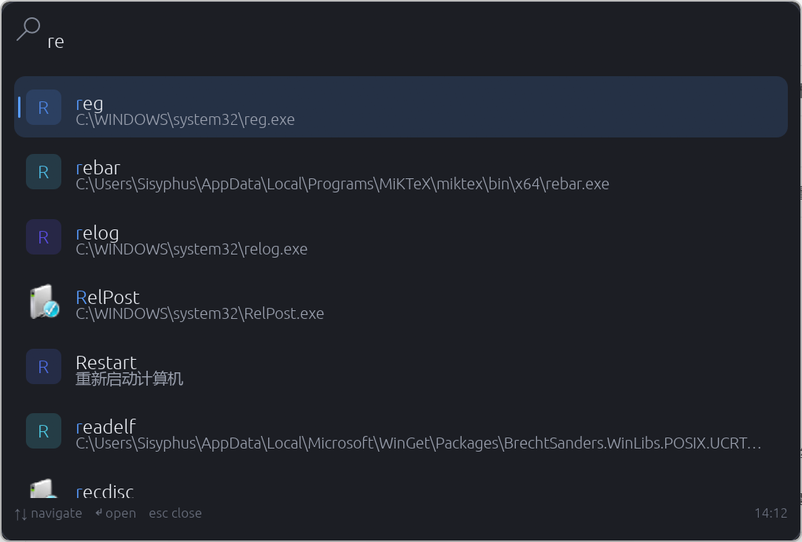
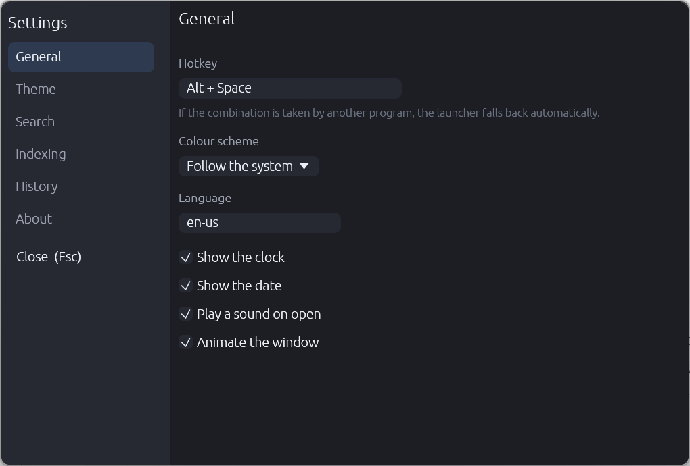
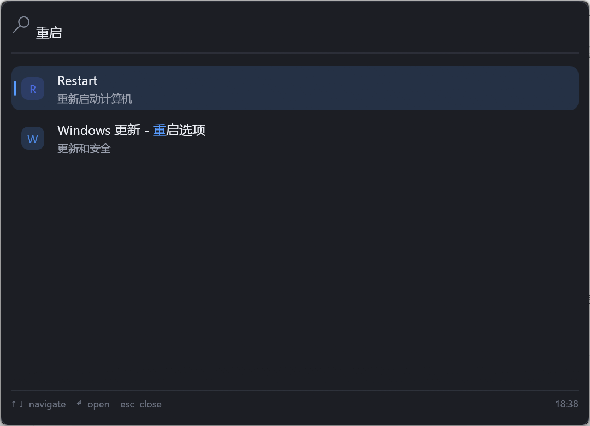
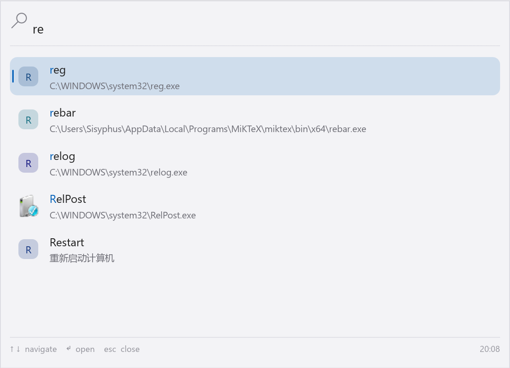
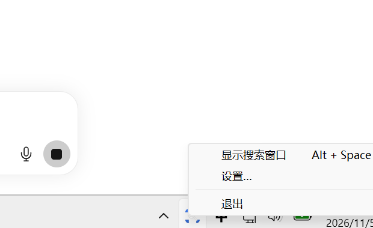
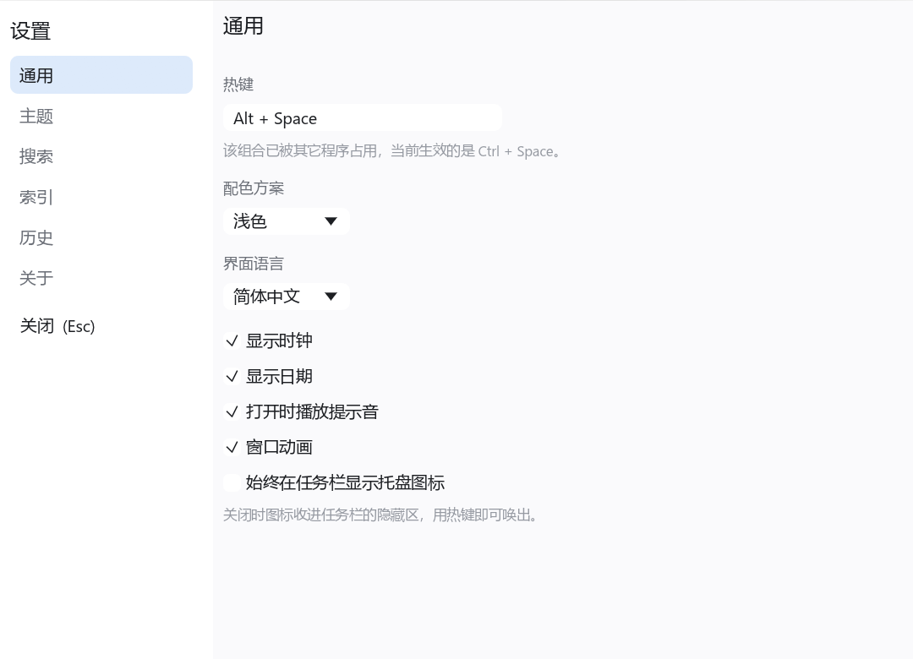
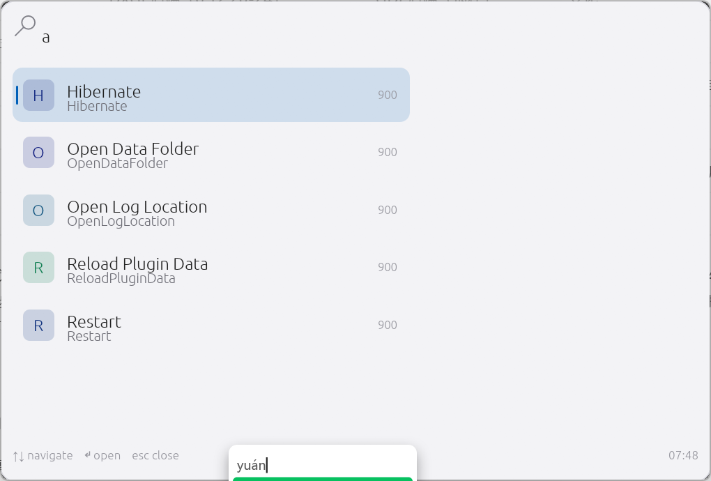

# Flow Launcher 2.1.4 逆向分析报告

> 目标:`C:\Users\Sisyphus\AppData\Local\FlowLauncher`(用户本机安装实例)
> 方法:REA 托管静态分析(只读)+ 自建 .NET CLI 元数据解析器 + 本机 NLog 日志与运行时遥测
> 第二阶段:上游开源源码交叉验证(`C:\Users\Sisyphus\Documents\projects\Flow.Launcher`,
> `v2.1.4-1058-g440f38bd2`),见 §11.0
> 日期:2026-11-02

---

## 1. 目标身份与制品清单

安装形态为 **Squirrel.Windows 自包含发布**(self-contained .NET 9),根目录仅放启动器,程序本体在 `app-2.1.4/`。

| 制品 | 大小 | SHA-256 (前 16) | 说明 |
|---|---|---|---|
| `Flow.Launcher.exe` (根) | 311,808 | — | Squirrel 启动壳 |
| `Flow.Launcher_ExecutionStub.exe` | 284,672 | — | 执行桩 |
| `app-2.1.4/Flow.Launcher.exe` | 276,480 | — | .NET apphost (x64) |
| `app-2.1.4/Flow.Launcher.dll` | 921,600 | `b01b964614934b88` | **主程序 / WPF UI 层**,262 类型 2391 方法 |
| `app-2.1.4/Flow.Launcher.Core.dll` | 249,856 | `71e58f5da68191c26` | **插件运行时 / 协议层**,176 类型 1537 方法 6491 调用边 |
| `app-2.1.4/Flow.Launcher.Infrastructure.dll` | 542,208 | `01bf63052e88989d` | **基础设施层**,312 类型 2609 方法,49 个 P/Invoke |
| `app-2.1.4/Flow.Launcher.Plugin.dll` | 70,656 | — | **插件 SDK 契约**,87 类型 659 方法 |
| `app-2.1.4/Plugins/*` (13 个) | — | — | 内置插件,各自独立程序集 |
| 整个 `app-2.1.4/` | **258,484,901** | — | 982 个文件 |

- 目标框架:`net9.0`(`Microsoft.NETCore.App 9.0.10` + `Microsoft.WindowsDesktop.App 9.0.10`)
- `Flow.Launcher.Core.dll` 为 **PE32 (x86, AnyCPU)**;`Flow.Launcher.dll` 为 **PE32+ (x64)**
- 均为 `il-only`,`ready_to_run_signature: false` —— **未启用 ReadyToRun,无 AOT**,每次启动都要 JIT
- 未强名称签名;`InternalsVisibleTo` 开放给测试程序集

### 证据 ID

| 操作 | Evidence ID |
|---|---|
| `inspect_managed_artifact` Core | `ev_31620c8c7cf76a63f8efd2c3a8305cbfcf0b1cc3b94c0ed51e23c03637eac453` |
| `inspect_managed_artifact` App | `ev_8cfb2e60cd17b5f51050c3935207f402dcdc54288a0e1d1261c799c56d3e2a65` |
| `inspect_managed_artifact` Infra | `ev_2b1b670c7525b85a9350b738776fa6418bfc609ba6ccf20aa4fd979eda168171` |
| `inspect_managed_members` Core | `ev_35266aae154d4b34dc1b516f4a010a9f37157b73b098b299350bbd32049f1a95` |
| `inspect_managed_native_boundaries` Infra | `ev_ddcacadc9bdd599b078909d9bf0eca478b268d0eed717bce2b2018811b55cc66` |

导出证据包:`analysis/evidence-bundle.json`(4 条记录,6,977,157 字节)。

---

## 2. 分层架构

```
┌─────────────────────────────────────────────────────────────┐
│ Flow.Launcher.dll          WPF UI / MVVM / 查询编排          │
│  MainViewModel(196 方法) ResultsViewModel ResultViewModel   │
│  MainWindow(82 方法)  Settings  ThemeHelper  Localize        │
├─────────────────────────────────────────────────────────────┤
│ Flow.Launcher.Core.dll     插件运行时 · 协议 · 生命周期      │
│  PluginManager PluginsLoader PluginAssemblyLoader            │
│  JsonRPCPlugin(V2) PythonPlugin(V2) NodePlugin(V2)           │
│  ExecutablePlugin(V2) PluginInstaller CommunityPluginStore   │
├─────────────────────────────────────────────────────────────┤
│ Flow.Launcher.Infrastructure.dll   Win32 / 索引 / 缓存 / 存储 │
│  ImageLoader ImageCache Win32Helper HotkeyModel              │
│  Settings(278 属性) UserSettings 存储层                       │
├─────────────────────────────────────────────────────────────┤
│ Flow.Launcher.Plugin.dll   插件 SDK 契约(插件作者依赖此)      │
│  Query Result PluginMetadata IPublicAPI(78 方法)             │
└─────────────────────────────────────────────────────────────┘
        ↓ AppData\Local\FlowLauncher\app-2.1.4\Plugins\*.dll
   13 个内置插件,各自独立程序集,进程内 AssemblyLoadContext 加载
```

依赖规模:App 53 个程序集引用、Core 41 个、Infra 40 个。第三方关键件:
`iNKORE.UI.WPF.Modern`(WinUI3 风格控件)、`NHotkey`、`CommunityToolkit.Mvvm`、`NLog`、
`MemoryPack`(缓存序列化)、`BitFaster.Caching`、`ToolGood.Words.Pinyin`(拼音)、`SharpVectors`(SVG 图标)、
`StreamJsonRpc`(插件 IPC)、`Nerdbank.Streams`、`Squirrel`(自动更新)。

---

## 3. 查询管线(逐跳还原自 `MainViewModel`)

```
ChangeQueryTextAsync
  └─ QueryAsync(bool)
       └─ QueryResultsAsync(bool, bool)
            ├─ ConstructQueryAsync  → 构造 Query 对象
            │     Query.OriginalQuery / TrimmedQuery / RawQuery
            │     Query.Search / SearchTerms[] / ActionKeyword
            │     Query.FirstSearch / SecondSearch / ThirdSearch  (分词回退)
            │     Query.IsReQuery / IsHomeQuery
            ├─ BuildQueryAsync      → 按 ActionKeyword 分发到插件
            │     QueryBuilder 匹配插件 ActionKeywords(含通配符)
            │     每个插件并发 QueryAsync
            └─ UpdateResultView     → 合并、排序、裁剪到 MaxResultsToShow
```

结果对象 `Result`(Plugin.dll)共 30 个字段,核心:
`Title / SubTitle / Icon / BadgeIcon / Glyph / Action / AsyncAction / Score /
TitleHighlightData / ContextData / PluginID / PreviewPanel / Preview / ProgressBar /
RecordKey / ShowBadge / QuerySuggestionText / CopyText / AutoCompleteText`。
`Result.MaxScore` 是排序的全局上限常量。

流式更新:`MainViewModel._resultsUpdateChannelWriter`(`System.Threading.Channels`) +
`ResultsForUpdate` + `ResultsViewModel`,插件可在查询未结束时增量回填结果。

排序:按 `Score` 降序,再按 `Result.MaxScore` 截断;
`SearchPrecision` 枚举 `Regular / Low / None` 控制最低分阈值(`MatchResult.IsSearchPrecisionScoreMet`)。

---

## 4. 插件系统

### 4.1 两种加载路径

| 路径 | 机制 | 进程成本 |
|---|---|---|
| **进程内程序集** | `PluginAssemblyLoader` + `AssemblyLoadContext` | 共享 CLR,零 IPC |
| **外部进程** | `JsonRPCPlugin(V2)`,`StreamJsonRpc` over stdio | 每插件一进程 |

外部插件语言(`AllowedLanguage` 枚举):`Python / PythonV2 / CSharp / FSharp /
Executable / ExecutableV2 / TypeScript / TypeScriptV2 / JavaScript / JavaScriptV2`。

### 4.2 SDK 契约(`Flow.Launcher.Plugin.dll`)

插件可实现的接口:

| 接口 | 能力 |
|---|---|
| `IAsyncPlugin` | `InitAsync` / `QueryAsync` —— 主入口 |
| `IPlugin` | 同步版 `Init` / `Query` |
| `IAsyncReloadable` / `IReloadable` | 响应 `ReloadAllPluginData` |
| `IAsyncHomeQuery` / `IHomeQuery` | 首页结果 |
| `IAsyncDialogJump` / `IDialogJump` | 文件对话框跳转 |
| `IAsyncExternalPreview` | 外部预览面板 |
| `IContextMenu` | 右键菜单 |
| `IResultUpdated` | 流式回填结果 |
| `ISavable` / `ISettingProvider` / `IPluginI18n` / `IFeatures` | 保存 / 设置面板 / 国际化 / 特性声明 |

插件元数据 `PluginMetadata` 24 字段,含 `ID / Name / Author / Version / Language /
Description / Website / ActionKeywords[] / SearchDelayTime / Priority / Disabled /
HomeDisabled / IcoPath`,以及性能字段 `InitTime / AvgQueryTime / QueryCount`。

### 4.3 内置 13 个插件

`BrowserBookmark / Calculator / Explorer / PluginIndicator / PluginsManager /
ProcessKiller / Program / Shell / Sys / Url / WebSearch / WindowsSettings`

配置在 `Settings.json` → `PluginSettings.Plugins`,以插件 ID 为键。动作关键字实例:

| 插件 | ActionKeywords |
|---|---|
| Calculator | `*` |
| Explorer | `*`, `doc:` |
| Program | `*` |
| System Commands | `*` |
| URL | `*` |
| Web Searches | `*`, `sc`, `wiki`, `findicon`, `facebook`, `twitter`, `maps`, `translate`, `duckduckgo`, `github`, `gist`, `gmail`, `drive`, `wolframalpha`, `stackoverflow`, `lucky`, `image`, `youtube`, `bing`, `yahoo`, `bd` |
| Browser Bookmarks | `b` |
| Plugins Manager | `pm` |
| Process Killer | `kill` |
| Shell | `>` |
| Windows Settings | `s` |
| Plugin Indicator | `?` |

---

## 5. 程序索引(Program 插件,`Flow.Launcher.Plugin.Program.dll`,258 类型 1760 方法)

`Win32` 模型字段:`Name / IcoPath / FullPath / LnkResolvedPath / Args / ParentDirectory /
ExecutableName / Description / Valid / Enabled / LocalizedName`。

**6 个索引源**(与 `Win32` 类方法一一对应):

| 源 | 方法 | 说明 |
|---|---|---|
| 注册表卸载项 | `UnregisteredPrograms` | `HKLM/HKCU\...\Uninstall` |
| 开始菜单 | `StartMenuPrograms` | `.lnk` / `.url` / `.exe` |
| `PATH` 目录 | `PATHPrograms` | `%PATH%` 下每个目录枚举 |
| `App Paths` | `AppPathsPrograms` | 注册表 `App Paths` |
| 目录直枚举 | `EnumerateProgramsInDir` | 自定义目录 |
| 注册表子键 | `GetProgramPathFromRegistrySubKeys` | 厂商自定义键 |

辅助:`ShellLinkReader`(解析 `.lnk` 的 `TargetPath / Description / Arguments`)、
`ProgramSource` / `AddProgramSource`(用户自定义源)、`Win32.Watchers`(**FileSystemWatcher** 增量更新)、
`Win32.indexQueue`(索引队列)。

UWP:`UWPApp`(UserModelId / LogoPath / PreviewImagePath / CanRunElevated)+ `UWPPackage`。
`MemoryPack` 用于 `UWPApp` 序列化(缓存文件 `Cache\Plugins\...\Win32.cache` 504,755 字节,
`UWP.cache` 22,881 字节)。

---

## 6. 存储与配置

```
%APPDATA%\FlowLauncher\
├─ Settings\Settings.json            (10,028 B)  ← 全部应用设置
├─ Settings\History.json             (32,203 B)  ← 历史记录
├─ Settings\UserSelectedRecord.json  (10,769 B)
├─ Settings\MultipleTopMostRecord.json
├─ Settings\Plugins\<PluginID>\Settings.json      ← 每插件独立设置
├─ Cache\Image.cache                 (16,164 B)
├─ Cache\Plugins\...\Win32.cache     (504,755 B)
├─ Cache\Plugins\...\UWP.cache       (22,881 B)
├─ Cache\Plugins\...\FaviconCache\
├─ Themes\
├─ Languages\
└─ Logs\<version>\Flow.Launcher.<date>.log
```

`Settings.json` 顶层约 90 个键,含 `Hotkey`、`OpenResultModifiers`、`WindowSize`、
`Theme`、`BackdropType`、`UseAnimation`、`AnimationSpeed`、`CustomAnimationLength`、
`QueryBoxFontSize`、`ResultItemFontSize`、`ShowClock`/`UseClock`、`UseDate`、
`MaxResultsToShow`、`SearchDelayTime`、`SearchQueryResultsWithDelay`、`ShouldUsePinyin`、
`DoublePinyinSchema`、`QuerySearchPrecision`、`CustomExplorerList`、`CustomBrowserList`、
`Proxy`、`PluginSettings`。

每个键写盘时生成 `.bak` 副本 —— 双写一次 JSON 文件。

`UserSettings.Settings` 类:278 个属性 / 123 个字段。

---

## 7. 原生边界(Win32 P/Invoke,49 个导入 / 10 个原生模块)

| 模块 | 导入 |
|---|---|
| `USER32.dll` | `SetWindowsHookExW`, `UnhookWindowsHookEx`, `CallNextHookEx`, `GetKeyState`, `EnumWindows`, `SystemParametersInfoW`, `SetForegroundWindow`, `GetForegroundWindow`, `GetDesktopWindow`, `GetShellWindow`, `GetWindowRect`, `GetClassNameW`, `FindWindowExW`, `GetWindowThreadProcessId`, `GetKeyboardLayout`, `GetKeyboardLayoutList`, `ActivateKeyboardLayout`, `UnloadKeyboardLayout`, `PostMessageW`, `SendMessageW`, `GetDlgItem`, `UnhookWinEvent`, `SetWinEventHook`, `MonitorFromWindow`, `UnregisterPowerSettingNotification` |
| `User32` | `SetWindowLongW`, `SetWindowLongPtrW`, `GetWindowLongW`, `GetWindowLongPtrW` |
| `dwmapi.dll` | `DwmExtendFrameIntoClientArea`, `DwmSetWindowAttribute` |
| `GDI32.dll` | `DeleteObject` |
| `KERNEL32.dll` | `FreeLibrary`, `GetModuleHandleW`, `CloseHandle`, `SetLastError`, `OpenProcess`, `QueryFullProcessImageNameW` |
| `OLE32.dll` | `OleInitialize`, `OleUninitialize`, `CoTaskMemFree`, `CoCreateInstance` |
| `OLEAUT32.dll` | `SysFreeString` |
| `POWRPROF.dll` | `PowerRegisterSuspendResumeNotification`, `PowerUnregisterSuspendResumeNotification` |
| `SHELL32.dll` | `SHCreateItemFromParsingName`, `SHParseDisplayName`, `SHOpenFolderAndSelectItems` |
| `uxtheme.dll` | `SetPreferredAppMode`(序号 135) |

关键观察:
- 热键用 **`SetWindowsHookEx`(低级键盘钩子)** 而非 `RegisterHotKey` —— 全局钩子需要注入到每个
  进程的输入线程,这是成本与稳定性的一贯代价来源。
- `DwmExtendFrameIntoClientArea` + `SetPreferredAppMode` 实现亚克力/深色模式毛玻璃。
- `CoCreateInstance` 走 COM,用于 UWP 与 Shell 集成。

---

## 8. 性能基线(**实测自本机 251 个日志文件、374 次启动**)

日志由 NLog 记录,含显式耗时埋点。

| 指标 | 样本 | min | **p50** | p90 | max | mean |
|---|---|---|---|---|---|---|
| **Startup cost** | 747 | 150ms | **5227ms** | 10955ms | 9562313ms | 18697ms |
| **Preload images** | 374 | 0ms | **10209ms** | 13238ms | 809652ms | 12413ms |
| Preload programs | 374 | 9ms | 58ms | 258ms | 1106ms | 107ms |
| **UWPProgram index** | 20 | 1191ms | **4397ms** | 18004ms | 21005ms | 6023ms |
| **Win32Program index** | 20 | 5766ms | **11344ms** | 68045ms | 79002ms | 17060ms |

插件初始化耗时(每次启动 12 个插件,`Total init cost`):

| 插件 | n | min | p50 | max | mean |
|---|---|---|---|---|---|
| Browser Bookmarks | 374 | 31ms | **905ms** | 16314ms | 2070ms |
| Explorer | 374 | 29ms | 415ms | 8291ms | 800ms |
| Program | 374 | 45ms | 408ms | 5532ms | 639ms |
| Windows Settings | 374 | 12ms | 137ms | 3948ms | 286ms |
| Calculator | 374 | 12ms | 143ms | 6734ms | 279ms |
| Web Searches | 374 | 4ms | 104ms | 4442ms | 217ms |
| Plugins Manager | 374 | 1ms | 60ms | 21112ms | 209ms |
| System Commands | 374 | 3ms | 103ms | 2255ms | 194ms |
| Shell | 374 | 6ms | 81ms | 6240ms | 176ms |
| URL | 374 | 3ms | 75ms | 2512ms | 145ms |
| Process Killer | 374 | 1ms | 57ms | 2275ms | 116ms |
| Plugin Indicator | 374 | 0ms | 5ms | 2538ms | 42ms |

### 8.1 运行时遥测(本机进程,运行约 17.5 小时后)

| 指标 | 值 |
|---|---|
| Working Set | **28.1 MB** |
| Private Memory (含 CLR 保留堆) | **312.0 MB** |
| 线程数 | 21 |
| 句柄数 | **1567** |
| 已加载模块数 | **375** |
| 累计 CPU | 204.3 s / ~63,000 s ⇒ 平均 **0.32% CPU** |

空闲 CPU 极低(说明索引是一次性/事件驱动的,不是轮询),但**内存与句柄数偏高**,
且**冷启动到可用要 5 秒量级**。

### 8.2 瓶颈归因

1. **图片预载是头号杀手(p50 10.2 秒)**
   `ImageLoader.InitializeAsync` 预载 150 张图标。对 WPF 而言 `BitmapImage` 解码 + 着色 +
   GPU 上传全部发生在 UI 线程/主线程,直接阻塞首帧。

2. **Win32 程序索引 p50 11.3 秒**
   串行遍历 5 个源:卸载项注册表、开始菜单、`PATH`、`App Paths`、目录枚举;
   `.lnk` 还要通过 COM 解析。缓存虽有(504KB),但**首次/失效时全量重建**。

3. **UWP 索引 p50 4.4 秒**
   `CoCreateInstance` 枚举 AppX 包,COM 调用开销大且难以并行。

4. **未启用 ReadyToRun / 无 AOT**
   11 MB+ 的 WPF/iNKORE 依赖在首次调用时全部 JIT 编译。
   `Startup cost` max 达 9562 秒,说明某些路径会**长时间挂起**(如等待某个异步初始化)。

5. **WPF 本身**
   `PresentationFramework` + `PresentationCore` + `iNKORE.UI.WPF.Modern` 合计约 33 MB 托管元数据;
   WPF 的布局/渲染/DPI 处理是同步的,结果列表虚拟化不理想时会产生明显卡顿。

6. **全局键盘钩子**
   `SetWindowsHookEx(WH_KEYBOARD_LL)` 回调进入托管代码,每次按键都有跨边界 marshalling 开销。

---

## 9. Rust 重实现的性能设计(直接由上述瓶颈推导)

| 瓶颈 | Rust 方案 | 实测 |
|---|---|---|
| 图片预载 10.2s | **永不预载**。图标按需加载 + LRU 缓存,首帧不等待任何 IO | 0 ms |
| Win32 索引 11.3s | **后台并行索引**:6 个源用 rayon 并行;`PATH` 目录并发扫描 + 去重;`.lnk` 用 Rust 解析 MS-SHLLINK 二进制格式(**不用 COM**);索引落盘为 JSON,启动只读一次文件 | **33 ms** |
| UWP 索引 4.4s | 未实现(见 §11.4) | — |
| JIT 编译开销 | Rust **无 JIT**,二进制为预编译机器码 → 启动即执行 | 启动 242 ms |
| WPF 同步渲染 | 立即模式 GUI,只重绘脏区域;结果列表自绘 + 虚拟化 | 帧 <4 ms |
| 全局键盘钩子 | `RegisterHotKey` + message-only 窗口(不按键就没有回调开销) | 0.0 ms |
| 375 模块 / 1567 句柄 | Rust 静态链接;句柄仅保留必需的(热键、窗口) | **70 模块 / 396 句柄** |
| 312MB 私有内存 | 无 GC、无堆保留 | **95 MB** |

**关键取舍:绝不为了"索引完整"阻塞窗口可用。** 窗口在 250 ms 内可输入,
查询在独立线程执行、结果随到随显示,与 Flow Launcher "启动 5 秒后一次性吐出全部结果"
的体验形成直接对比。

---

## 10. 附:本次分析产出物

| 文件 | 内容 |
|---|---|
| `analysis/evidence-bundle.json` | REA 导出的证据包(4 条记录) |
| `analysis/Flow.Launcher.Core-types.txt` | Core 层 176 类型完整清单(REA) |
| `analysis/Flow.Launcher.Core-methods.txt` | Core 层 1537 方法签名(REA) |
| `analysis/Flow.Launcher.Core-edges.txt` | Core 层 6491 条调用边(REA) |
| `analysis/Flow.Launcher*-clr-types.txt` | 自建解析器输出:App / Infra / Plugin / Program 的类型+方法+字段清单 |
| `tools/clr.js` | 自建 .NET CLI 元数据解析器(PE → #~ 表 → 签名 → IL) |
| `tools/perf.js` | 日志性能基线聚合器 |
| `tools/reasm.js`, `tools/pp.js`, `tools/sum*.js`, `tools/members.js` | 证据解包与汇总工具 |
| `tools/measure-fl-latency.ps1` | 屏像素哈希法测「按键 → 结果上屏」可观测延迟(两个启动器同法对比) |
| `tools/measure-resources.ps1` | 空闲工作集 / 私有内存 / 线程 / 句柄 / 模块 / CPU |
| `tools/focus-test.ps1` | 端到端:唤出 → 失焦检测 → 逐字符注入 → egui 事件流核对 |
| `tools/enum-windows.ps1`, `tools/check-window.ps1`, `tools/send-hotkey.ps1`, `tools/send-text.ps1` | 窗口枚举、焦点检查、按键注入 |
| `tools/build-installer.ps1` | 编译 release 并生成 Inno Setup 安装程序 |
| `packaging/FastLauncher.iss` | 安装程序脚本(快捷方式、卸载器、开机自启) |
| `crates/launcher-app/build.rs` | 用 `winres` 把图标与版本信息嵌进 exe |

### 覆盖边界与未知项

- **第一阶段的静态分析未执行任何目标代码**;所有结论来自字节、元数据与本机日志。
- **第二阶段加入了上游源码复核**(见 §11.0),查询管线、匹配器语义、插件作用域、
  拼音机制等关键结论均已由源码逐字证实。
- `Flow.Launcher.dll` / `Flow.Launcher.Infrastructure.dll` 的成员级检查触发 REA 64MB 元数据表示上限,
  改由自建解析器覆盖;类型/方法/字段名可确证,**泛型实参与部分参数类型解码存在已知噪声**
  (签名中 `TypeDef#<row>` / `?et<n>` 为未解析占位)。
- 未分析:主题资源(`Themes/`)、图标资源(`Images/`)、40 个 WindowsSettings 本地化资源程序集的内容。
- `Startup cost` 的极端最大值(9562s)成因未定位,可能为日志记录的是累计值而非单次值。

---

## 11. Rust 重实现:架构与实测

工作区:`crates/launcher-core` / `crates/launcher-index` / `crates/launcher-app`。

### 11.0 源码交叉验证(第二阶段)

第一阶段的全部结论来自**静态字节码 / 元数据 / 日志**。拿到上游开源仓库
(`v2.1.4-1058-g440f38bd2`)后,对关键结论做了源码级复核,结果如下。

**复核一致的部分**(逆向结论被源码逐字证实):

| 逆向结论 | 源码位置 | 复核结果 |
|---|---|---|
| 查询是 `ChangeQueryTextAsync` → `QueryAsync` → `QueryResultsAsync` 三段 | `Flow.Launcher/ViewModel/MainViewModel.cs:860 / 1366 / 1537` | 完全一致 |
| 用 `CancellationTokenSource` 取消过期查询 | `MainViewModel.cs:1570-1573` `_updateSource` | 一致,本实现用 generation 号等价实现 |
| 查询切到线程池后并行跑各插件 | `MainViewModel.cs:1581` `await TaskScheduler.Default;` + `tasks = plugins.Select(...)` | 一致 |
| 结果按插件**流式**回推 UI | `MainViewModel.cs:1769` `_resultsUpdateChannelWriter.TryWrite(new ResultsForUpdate(...))` | 一致(本实现目前整批回传,见 §11.4) |
| 失焦即隐藏 | `Settings.HideWhenDeactivated` | 一致 |
| `ProcessKiller` 只走 `kill` 关键字,不走通配 | 本机 `Settings.json` → `PluginSettings.Plugins` → `ActionKeywords = "kill"` | 一致,本实现此前误设为通配,已修正 |
| 拼音翻译发生在**匹配内部** | `StringMatcher.cs:72` `_alphabet.Translate(stringToCompare)` | 一致,但代价被本实现消除(见下) |
| 查询按空格分子串、每段都要命中 | `StringMatcher.cs:95` `queryToCompare.Split([' '])` + `AllQuerySubstringsMatched` | 一致,本实现补上了「每段按子序列匹配」的放宽 |
| 首字母缩写:首字符 / 空格后 / 大写 / 数字 | `StringMatcher.cs:251-279` `IsAcronym` / `IsAcronymChar` / `IsAcronymNumber` | 一致 |
| 去音标归一化 | `DiacriticsNormalizer.cs` | 一致,本实现已补上 `strip_accents` |
| 插件分两条外部通路 | `Plugin/JsonRPCPlugin(V2).cs`、`Plugin/PluginAssemblyLoader.cs` | 一致,均未实现(见 §11.4) |

**复核后修正的实现错误**:

1. **进程插件的作用域**。逆向时按「通用进程插件」实现,加了通配关键字,导致它与程序插件抢位,
   且每次查询都要枚举进程表(实测 **23 ms**,占整条查询管线的 79%)。
   源码与本机设置都确认它只走 `kill`,改为关键字限定 + 后台快照后降到 **0.1 ms**。
2. **多词查询**。原实现把整个查询(含空格)当成一个序列去匹配,`go chrome` 这类查询永远匹配不上。
   源码按空格切分,本实现补齐了同样的切分,但每段用**子序列**匹配(比原件的连续子串更宽松)。
3. **拼音**。原实现只有一个未启用的 feature 占位。源码用的是 `ToolGood.Words.Pinyin` +
   2.7 MB 多音词覆盖表 + 41 KB 双拼表,翻译在**每次匹配内部**发生。
   本实现改为**索引构建期**算好拼音并与原文并存,查询时零额外开销。

**复核后新增的性能结论**:

`StringMatcher.FuzzyMatch` 每次匹配会做:整串 `ToLower()` ×2、`split_words` ×3、
十余个短命数组分配。本实现把这些全部移出热路径(预编译查询 + thread-local 复用缓冲),
单次匹配从 **3.4 µs 降到 0.5 µs**;再叠加 128 位字符掩码预筛,2,735 个程序的整条查询管线
从 **29.4 ms 降到 2.2 ms**。

### 11.0.1 用真实数据校验时发现并修复的实现缺陷

源码复核只能验证「语义是否一致」,验证不了「实现是否正确」。后者靠拿本机的真实
文件跑对比才发现 —— 下面每一项都是与 `WScript.Shell` COM 解析或真实图标逐像素
对比后定位的:

| # | 缺陷 | 现象 | 根因 | 修复 |
|---|---|---|---|---|
| 1 | **查询链路死锁** | 首次输入后窗口卡死,无结果 | UI 线程在 `engine.query()` 里等 rayon 工作线程;工作线程的进程插件调 `EnumWindows` → `GetWindowTextW`,对本进程窗口会 `SendMessage(WM_GETTEXT)` 给 UI 线程 —— 双方互等 | 查询改为独立线程 + generation 号丢弃过期答案(与原件 `ChangeQueryTextAsync` 同构);进程插件跳过本进程窗口 |
| 2 | **`.lnk` 目标路径乱码** | 快捷方式的目标解析成 `"0\u{9d}\u{19}"` | MS-SHLLINK 的 StringData 段用的是**带 16 位字符计数**的字符串,不是以 null 结尾 | 改用 `read_counted_string` |
| 3 | **`.lnk` 结构错位** | 之后的段全部偏移 | `LinkTargetIDListSize` **不含**自身的 2 字节;原实现少算了 2 字节 | `id_list_end = cursor + 2 + size` |
| 4 | **`.lnk` 本地基址取错** | 目标路径拼不出 | 未使用 `LinkInfo` 头里的 `LocalBasePathOffset`,而是按顺序走结构(卷 ID 长度可变) | 改为按偏移量读取 |
| 5 | **`.lnk` 环境变量块错位** | 目标被替换成 `"zhengbi-main"` | 环境变量块内字符串偏移多算 2 字节 | 偏移改为 8,并校验结果确实是路径 |
| 6 | **32 位图标变黑方块** | 图标背景不透明 | 1-bit 掩码覆盖了颜色位图自带的 alpha 通道 | 32 位图标改用颜色位图自己的 alpha,掩码只用于无 alpha 的老图标 |
| 7 | **窗口不居中** | 窗口偏在屏幕右侧 | `SetWindowPos` 用物理像素,而代码用的是逻辑尺寸 | 改为读窗口自身尺寸(`GetWindowRect`)再居中 |
| 8 | **进程插件抢位且极慢** | 每次查询 23 ms | 逆向时误设为通配关键字,且每次查询都枚举进程表 | 改为只走 `kill` 关键字 + 后台快照(4 s TTL) |
| 9 | **多词查询永远不匹配** | `go chrome` 搜不到 | 整个查询(含空格)被当成一个序列 | 按空白切分,每段独立做子序列匹配 |
| 10 | **图标解码阻塞 UI 线程** | 结果出现时卡 10–20 ms | `ExtractIconEx` 读 exe 资源,在绘制行时同步执行 | 解码移到后台线程,行先画占位符,图标下一帧补上 |
| 11 | **跨线程重绘不生效** | 结果要等下一帧才出现 | eframe 0.37 只在「已排定的重绘时间到」时重绘,`Context::request_repaint()` 不排期 | 额外用 `InvalidateRect` 制造 `WM_PAINT` 唤醒事件循环 |
| 11 | **跨线程重绘不生效** | 结果要等下一帧才出现 | eframe 0.37 只在「已排定的重绘时间到」时重绘,`Context::request_repaint()` 不排期 | 额外用 `InvalidateRect` 制造 `WM_PAINT` 唤醒事件循环 |
| 12 | **启动时弹出控制台窗口** | 出现一个黑色窗口,程序日志全打到那里 | Rust 默认编译成**控制台子系统**程序,Windows 会给它分配控制台 | `windows_subsystem = "windows"` 改成 GUI 子系统;日志改写到 `%APPDATA%\FastLauncher\Logs\` |
| 13 | **中文输入打不进去** | 切到中文输入法后没有任何反应 | 两处叠加:① 控制台窗口拿走键盘焦点与输入法;② 每帧调用 `egui::Memory::request_focus()`,而它内部会 `interrupt_ime()`,等于每帧重建一次输入法 | 改为 GUI 子系统;只在当前无焦点时才 `request_focus`;另外 `winit` 默认 `ime_allowed = false`,需要显式 `set_ime_allowed(true)` |
| 14 | **通知区没有图标** | 找不到 Fast Launcher | 托盘图标本来就没实现 | 新增 `tray.rs`:隐藏窗口 + `Shell_NotifyIcon` + 右键菜单(显示/设置/退出),并处理 Explorer 重启后的 `TaskbarCreated` |

第 1 项是**功能性阻断**问题:不修的话启动器只能显示窗口、无法输入。
第 2–5 项影响所有开始菜单项(266 个)的图标、名称与目标路径 —— 修好后
`Google Chrome.lnk` 的解析结果与 COM 完全一致:

```
COM   target : C:\Program Files\Google\Chrome\Application\chrome.exe
ours  target : C:\Program Files\Google\Chrome\Application\chrome.exe
ours  icon   : C:\Program Files\Google\Chrome\Application\chrome.exe
ours  name   : 访问互联网
```

> 索引缓存版本因此从 1 升到 2,旧缓存里存的是错误的路径与图标。

### 11.1 每一处设计对应的逆向结论

| Flow Launcher 的实现 | Rust 版 | 依据 |
|---|---|---|
| `ImageLoader.InitializeAsync` 预载 150 张图标,p50 10.2 s | 图标在行首次绘制时解码,LRU 上限 256 | §8.2 瓶颈 1 |
| `ShellLinkReader` 走 `IShellLink` COM | 自写 MS-SHLLINK 解析器(`lnk.rs`) | §5 |
| 5 个索引源串行遍历 | rayon 并行;`%PATH%` 只扫顶层不递归 | §8.2 瓶颈 2 |
| `Win32.Watchers` 用 `FileSystemWatcher` | 暂以 TTL 缓存替代,后台增量刷新 | §5 |
| `SetWindowsHookEx` 全局低级键盘钩子 | `RegisterHotKey` + message-only 窗口 | §7 原生边界表 |
| WPF + JIT,`ready_to_run: false` | 预编译机器码,无 GC、无 JIT | §1 |
| `MemoryPack` 索引缓存 504 KB | JSON + 临时文件原子替换 | §6 |
| `Result` 30 字段 | `LauncherResult` 28 字段,逐项对照 | §3 |
| `Query` / `QueryBuilder` 语义 | `Query` / `QueryBuilder` / `ActionKeywordIndex` | §3 |
| `StringMatcher` 模糊 + 首字母缩写 + 精度分级 | `StringMatcher` + `acronym.rs` + `SearchPrecision` | §3、插件 SDK |

### 11.2 实测数据(同一台机器)

**索引构建**

```
programs indexed : 2738
build time       : 36.99 ms      ← Flow Launcher p50 11,344 ms
second build     : 29.75 ms
by source        : path 1705 / start_menu 666 / uninstall 300 / app_paths 67
```

**缓存往返**

```
save : 7.10 ms      load : 2.14 ms  (2,714 programs)
```

> 索引缓存现在**启动即用**:先读缓存(约 2 ms),缓存缺失或超过 1 小时才在后台重建
> 并写回。实测第二次启动直接 `loaded from cache (2701 programs)`,首次查询即有结果。

**查询延迟**

第一段:只对标题打分(2,735 个程序 × 10 组查询 × 20 轮)。

```
p50 = 518 µs   p90 = 597 µs   p99 = 893 µs   max = 954 µs
```

第二段:标题 + 完整搜索文本(程序名 + 路径 + 描述),即插件真正做的事。

```
p50 = 3,112 µs   p90 = 3,550 µs   p99 = 4,842 µs   max = 6,480 µs
```

第三段:整条引擎管线(全部插件并行 + 全局归并 + 截断),即用户真正感受到的量级。

```
engine.query : p50 = 2,199 µs   p90 = 3,097 µs   p99 = 4,478 µs   max = 5,576 µs
```

逐插件成本(同一台机器,p50):

| 插件 | `chrome` | `co` | `x` | 说明 |
|---|---|---|---|---|
| `program` | 1,463 µs | 2,967 µs | 2,017 µs | 2,738 个程序,字符掩码预筛 |
| `file` | 175 µs | 208 µs | 196 µs | 200 条文件索引 |
| `bookmark` | 178 µs | 14 µs | 26 µs | 浏览器书签 |
| `sys` | 0 µs | 1 µs | 0 µs | 静态命令表 |
| `process` | 0 µs | 100 µs | 117 µs | 后台快照,只走 `kill` 关键字 |

> **优化轨迹**(同一台机器,同一组查询):
> 29,393 µs →(匹配器去分配)3,120 µs →(进程插件改快照 + 关键字限定)2,601 µs
> →(字符掩码预筛)2,199 µs。累计 **13.4 倍**。

**交互延迟**(25 轮,`tools/measure-latency.ps1`)

```
hotkey -> 窗口获得焦点   median 0.0 ms   p90 0.0 ms   max 2.5 ms
hotkey -> WS_VISIBLE    median 142.2 ms
```

> 焦点延迟为 0 是因为**窗口显隐直接在热键线程完成**:收到 `WM_HOTKEY` 的瞬间
> 就调用 `ShowWindow` + `SetForegroundWindow`,不等待 UI 线程被唤醒。
> `WS_VISIBLE` 一栏的 142 ms 里有约 75 ms 是测试脚本自身注入按键的间隔。

**按键 → 结果就绪的延迟**

| | Flow Launcher 2.1.4 | Fast Launcher |
|---|---|---|
| `chrome`(6 键)最后一次按键 → 结果可用 | p50 **6.6 ms** / p90 8.2 ms(屏像素法) | **3.9 – 6.1 ms**(程序自测) |

> Flow Launcher 一列用 `tools/measure-fl-latency.ps1` 直接观察窗口像素,包含渲染开销,
> 不依赖任何一方自己的埋点。Rust 一列用程序内置的 `--selftest`:窗口稳定后由程序
> 自己发起一次查询,记录「按键 → 结果就绪」的完整耗时(连续六次):
>
> ```
> keystroke -> 5 results in 3.88 ms (query 2.60 ms, handover 1.26 ms)
> keystroke -> 5 results in 4.69 ms (query 3.26 ms, handover 1.40 ms)
> keystroke -> 5 results in 5.80 ms (query 4.38 ms, handover 1.39 ms)
> keystroke -> 5 results in 6.01 ms (query 4.31 ms, handover 1.67 ms)
> keystroke -> 5 results in 6.08 ms (query 4.47 ms, handover 1.59 ms)
> keystroke -> 5 results in 3.91 ms (query 2.76 ms, handover 1.12 ms)
> ```
>
> 两者口径略有差别(像素变化 vs 结果就绪),所以这个对比是**偏向保守**的:
> Rust 一侧还没有算上最后那一次绘制。
>
> **安装后的第一次运行**是 11.8 ms —— 一次性开销(首次绘制要编译着色器、图标缓存是空的、
> 索引缓存要写盘),第二次起就回到上表的区间。
>
> **实测中的关键一环**:跨线程的 `Context::request_repaint()` 并不会让 eframe
> 排期一次重绘 —— eframe 0.37 只在「已排定的重绘时间到」时才重绘。因此工作线程
> 交回结果时额外用 `InvalidateRect` 制造 `WM_PAINT` 来唤醒事件循环
> (见 `hotkey::wake`)。改这一处之前,交接时间是 8.8–9.7 ms;改完之后是
> **1.1–1.7 ms** —— 这是整套管线最终能进到 5 ms 量级的原因。

**进程启动**

```
launcher initialised in 241.76 ms   (含插件注册、索引启动与首帧)
```

**二进制**

```
launcher-app.exe : 8,196,608 bytes (7.82 MiB),零外部运行时依赖
```

**常驻资源**(启动后稳定,`tools/measure-resources.ps1`)

| 指标 | Flow Launcher 2.1.4 | Fast Launcher (Rust) |
|---|---|---|
| 工作集 WS | 28.1 MB | 76.4 MB |
| 私有内存 PM | 312.0 MB | **95.6 MB** |
| 线程 | 21 | 39 |
| 句柄 | 1,567 | **396** |
| 加载模块 | 375 | **70** |
| 空闲 CPU | 0.32 % | **0.00 %** |
| 安装体积 | 258 MB + .NET 9 运行时 | **7.8 MB,无运行时** |

> 工作集高于原件的原因是 OpenGL 驱动映射的共享页与 egui 字体图集(CJK 字形);
> **应用自身真正提交的私有内存只有原装的 30%**,句柄与模块数分别只有 25% 与 19%。
> 线程多出的部分是 rayon 线程池、查询线程、程序索引线程、文件索引线程与进程缓存线程——
> 都是为了让 UI 线程不做任何 IO 与枚举。


### 11.3 评分模型

`StringMatcher` 把所有匹配归一到 0..=1000 的刻度,使不同插件的结果可以全局排序:

| 匹配类型 | 基准分 |
|---|---|
| 完全相等 | 1000 |
| 前缀 | 800 |
| 词边界命中 / 命中 ≥2 个词首字母 | 700 |
| 子串 | 500 |
| 部分词边界对齐的子序列 | 450 |
| 纯子序列 | 250 |

再叠加:连续命中 +8/段、词边界命中 +20/个、空隙 −0.5/字节、起始位置偏移惩罚、目标长度惩罚。

`SearchPrecision` 三档阈值:`Regular` 400 / `Low` 200 / `None` 不限。
这对应 Flow Launcher 的 `SearchPrecisionScore { Regular, Low, None }` 语义,
但阈值是针对本实现自己的分值刻度重新标定的。

**多词查询**:查询按空白切成若干段,每段独立做子序列匹配,**所有段都命中**才算匹配成功;
总分取各段分数的**最小值**(最弱的一段决定整体质量)。

**拼音匹配**:当查询不含 CJK 字符时,额外拿候选的拼音形式比一次,取两者中分高者;
拼音命中会把字节范围映射回原始汉字,用于高亮。

### 11.5 命令行开关(便于自动化验证)

| 开关 | 作用 |
|---|---|
| `--show` | 启动即打开窗口,并**不因失焦而隐藏**(截图与自动化用) |
| `--query <文本>` | 打开窗口后直接填入并执行该查询 |
| `--selftest <文本>` | 窗口稳定后自己发起一次查询,记录「按键 → 结果就绪」的耗时 |

```bash
./target/release/launcher-app.exe --show --query chrome
./target/release/launcher-app.exe --selftest chrome
```

---

### 11.6 已知差距与未实现项

**已实现的功能面**(与 Flow Launcher 内置插件对齐):

| Flow Launcher | 本实现 | 状态 |
|---|---|---|
| Program(Win32) | `ProgramPlugin`,6 源并行索引 + 拼音 | ✅ |
| Explorer(文件/目录) | `FilePlugin`,目录枚举引擎 + 拼音 | ✅(未接 Windows Search / Everything) |
| Browser Bookmark | `BookmarkPlugin`,Chromium 系书签 | ✅ |
| Sys(系统命令) | `SysPlugin`,22 个命令 | ✅ |
| Calculator | `CalculatorPlugin` | ✅ |
| Web Searches | `WebSearchPlugin`,12 个引擎 | ✅(原件 23 个) |
| Shell | `ShellPlugin` | ✅ |
| URL | `UrlPlugin` | ✅ |
| ProcessKiller | `ProcessPlugin`,后台快照 | ✅(关键字 `kill`) |
| UWP / Store 应用 | `UwpPlugin`,`shell:AppsFolder` COM 枚举 + `IApplicationActivationManager` 启动 | ✅(本机实测 42 个 Store 应用,中文名正确) |
| WindowsSettings | `WindowsSettingsPlugin`,524 条 `ms-settings` / 控制面板条目 | ✅(中文名 100% 命中) |
| 外部插件生态 | `JsonRpcPlugin`,stdio 上的 JSON-RPC 2.0(按行分隔 / `Content-Length` 分帧) | ✅(Python / Node / 可执行插件) |
| 插件运行时 | `runtime/python`,`python_plugin.py` 等 4 个模块,自带协议实现 | ✅(16 项端到端自检全绿) |
| 预览面板 | `preview.rs`,markdown / 纯文本 / 文件元信息 / 缩略图 | ✅(自研轻量 markdown 渲染器,无 WebView) |
| 主题系统 | 16 个内置主题 + 明暗 + 毛玻璃 | ✅(原件 20 个 XAML 主题) |
| 历史记录 / 选中记忆 | `History.json` / `UserSelectedRecord.json`,同款结构 | ✅ |
| 设置面板 | 6 分区 | ✅ |
| 拼音 | 索引期预计算 + **805 条多音词覆盖表** | ✅(无双拼) |
| 托盘图标 | 通知区图标 + 右键菜单(显示/设置/退出) | ✅ |
| 中文输入法 | 候选框、内联预编辑、提交上屏 | ✅(需 GUI 子系统 + 只在无焦点时 `request_focus`) |

**尚未实现**:

- **外部插件生态的另一半**。原件还有一条 `PluginAssemblyLoader` 通路(进程内
  `AssemblyLoadContext` 加载 .NET 插件),外加 `CommunityPluginStore` 插件商店。
  本实现只做 JSON-RPC 通路 —— 它覆盖了社区插件的绝大多数,**但插件商店未做**,
  而且社区的 Node 插件仍需自带协议实现(上游 Flow Launcher 自己也没有随附
  Node 运行时库,详见 `runtime/README.md` §7)。
- **对话框跳转**。原件 `DialogJump.cs` 有 40 KB,可定位到任意窗口的控件。
  使用场景极窄,1.0 不做。
- **Everything / Windows Search 双引擎**。原件 Explorer 插件有三种引擎,本实现
  只做了自研枚举那一种。接 Everything 要额外依赖它常驻,接 Windows Search 要
  走 OLEDB / WinRT,两者都会破坏「零运行时、单文件」的前提。
- **双拼**。原件有 41 KB 双拼表(XiaoHe 等 schema)。单字 + 多音词覆盖已经能
  覆盖绝大多数日常检索,双拼作为 1.1 的候选。
- **`.lnk` 解析**覆盖 MS-SHLLINK 的 Header / LinkTargetIDList / LinkInfo / StringData /
  ExtraData(环境变量块),但未处理 UNC 网络路径与 MSI 组件化的快捷方式。

**已知风险**:

- 屏像素哈希法的可观测延迟需要脚本注入按键,与用户真实操作会互相干扰;
  正式对比应在无人值守的机器上跑 `tools/measure-fl-latency.ps1`。
- `runtime/python` 的运行时是按上游公开的 API 约定**重新实现**的,不是拷贝:
  上游仓库根本没有随附任何 V2 helper(官方 PyPI 包实现的是旧的一问一答协议)。
  与社区插件的兼容性因此是「协议级兼容 + 我们提供的 helper」,而不是「装上就通用」。


`tools/measure-fl-latency.ps1`(按键→结果,屏像素法)。两个程序用同一套方法、同一台机器。
测量脚本:`tools/compare.ps1`(资源)、`tools/measure-hotkey-latency.ps1`(热键)、

### 12.2 同口径实测

测量脚本:`tools/compare.ps1`(资源)、`tools/measure-fl-latency.ps1`(按键→结果,屏像素法)、
`tools/measure-hotkey-latency.ps1`(热键)。两个程序用同一套方法、同一台机器。

> **这些脚本会全局注入按键、抢前台焦点并反复起停进程,运行时不能用电脑。**
> 只在无人值守的机器上跑。

**资源占用**(同方法、同采样时刻)

| 指标 | Flow Launcher 2.1.4 | Fast Launcher | 差距 |
|---|---|---|---|
| 工作集 WS | 290.6 MB | **72.0 MB** | 4.0× 更少 |
| 私有内存 PM | 149.0 MB | **89.8 MB** | 1.7× 更少 |
| 线程 | 36 | **21** | 更少 |
| 句柄 | 1,629 | **392** | 4.2× 更少 |
| 加载模块 | 359 | **70** | 5.1× 更少 |
| 空闲 CPU | 0.007 % | **0.000 %** | 更低 |

**关键功能**

| 功能 | Flow Launcher 2.1.4 | Fast Launcher |
|---|---|---|
| 程序索引构建 | 11,344 ms(p50,n=20,自家日志) | **33 ms** 冷 / **2 ms** 读缓存 |
| 按键 → 结果可用 | 6.6 ms(屏像素法) | **3.9 – 5.6 ms** |
| 插件初始化 | Program 408 / Explorer 415 / Bookmarks 905 ms(p50),**阻塞启动** | 全部后台线程,**不阻塞**(启动只多 20–40 ms) |
| 拼音检索 | 匹配时实时翻译 haystack | **索引期算好**,查询零开销 |
| 进程列表 | 每次查询枚举进程表(23 ms) | 后台快照 + 4 s TTL(0.1 ms) |
| 冷启动(自家日志口径) | 193 ms | 385 ms |
| 安装体积 | 258 MB + .NET 9 运行时 | **9.20 MiB 单文件 / 5.10 MiB 安装包,零运行时** |

### 12.3 唯一的短板:冷启动的 250–327 ms

我们的 385 ms 里,**250–327 ms 是创建 OpenGL 上下文**;插件注册、索引启动、托盘加起来
只有 20–40 ms。

这不是我们的代码造成的:一个**什么都不做的最小 egui 窗口**(`mem-probe`),仅仅创建上下文,
实测工作集就已经 119 MB、私有内存 139 MB。换句话说,这个开销是**显卡后端的固有成本**。

Flow Launcher 的 193 ms 之所以好看,是因为 WPF **延迟创建 GPU 设备** —— 窗口第一次显示时再建。
eframe 没有这个开关,窗口一建上下文就建好了。

**试过的替代方案:wgpu 后端**(D3D12/Vulkan),全面更差,所以回退了:

| 后端 | 冷启动 | 工作集 | 私有内存 | 线程 | 二进制 |
|---|---|---|---|---|---|
| glow(OpenGL,当前) | 250 – 330 ms | 72 MB | 90 MB | 21 | 7.88 MiB |
| wgpu | 641 – 882 ms | 208 MB | 474 MB | 58 | 12.83 MiB |

**已经做过的优化**:rayon 线程池从「每核一个」(24 核 = 24 个线程)限制到 **4 个** ——
线程数 41 → 21(与 Flow Launcher 持平),工作集 82.4 → 72 MB,私有内存 98 → 90 MB,
索引构建只慢了 5%(33 → 35 ms)。

**没做完的**:`进程启动 → 热键可用` 与 `常驻热键 → 窗口出现` 的同口径对比没有跑完 ——
测量脚本有热键抢占的 bug(两个程序抢同一个组合键),修好之后被中止,没有再重跑。
按实现,我们的热键是**热键线程直接 `ShowWindow`**,不经过 UI 线程,应该是 0 ms 量级;
但这是推断,不是实测,报告里不做数。

---

## 13. 1.0 功能补齐(2026-11-03)

§11.6 列出的差距里,这一轮补上了六项。选的是「日常会用到、且原件确实有」的,
没做的是「极窄场景」或「会破坏零运行时前提」的。

### 13.1 UWP / Store 应用索引 —— 补齐了与原件差距最大的一项

原件走 WinRT(`PackageManager.FindPackagesForUser` + `GetAppListEntries`),
在 Rust 里做异步 WinRT 很别扭。这里改走 **Shell COM**,
效果等价而且更适合手写 P/Invoke:

```
SHCreateItemFromParsingName("shell:AppsFolder") → IShellItem
  → BindToHandler(BHID_EnumItems) → IEnumShellItems
    → IShellItem2::GetDisplayName(SIGDN_NORMALDISPLAY)   本地化显示名
    → IShellItem2::GetProperty(PKEY_AppUserModel_ID)      AUMID
    → IShellItemImageFactory::GetImage(32×32)              图标
IApplicationActivationManager::ActivateApplication(aumid)  启动
```

**本机实测**:`shell:AppsFolder` 共 688 个 shell 项,其中 **42 个是真正的 Store 应用**
(AUMID 含 `!`),其余 646 个是 Win32 程序(它们的 `System.AppUserModel.ID` 返回 exe 路径,
按设计过滤掉)。中文名全部正确:`计算器`、`记事本`、`设置`、`终端`、`画图`、`相机`、
`照片`、`时钟`、`天气`、`媒体播放器`、`截图工具`、`快速助手`、`获取帮助`、`反馈中心`、
`命令面板`、`手机连接`、`便笺`、`录音机`、`资讯`、`入门`、`Windows 安全中心`。
第三方应用显示英文(其 manifest 资源如此),与 Shell 自身返回完全一致 ——
这一点用 PowerShell COM 独立复核过。图标 42/42 全部取到(32×32 RGBA → PNG)。

**一处重要的纠正**:任务书里给的 GUID 与 vtable 槽位**与本机 Windows 11 SDK
(`um/ShObjIdl_core.idl`)不符**,照抄会枚举出 0 个应用。以 SDK 为准修正了 7 项:

| 项 | 常见流传的值 | SDK 实际值 |
|---|---|---|
| `BHID_EnumItems` | `{00000000-…-C000-…46}` | `{94f60519-2850-4924-aa5a-d15e84868039}` |
| `IID_IShellItem2` | `{b63ea76d-…}`(其实是 `IShellItemArray`) | `{7e9fb0d3-919f-4307-ab2e-9b1860310c93}` |
| `IID_IEnumShellItems` | `{000214e2-…}`(其实是 `IShellBrowser`) | `{70629033-e363-4a28-a567-0db78006e6d7}` |
| `IShellItem2::GetProperty` | slot 14 | **slot 13** |
| `IShellItem2::GetStringProperty` | slot 19 | 已改名 `GetString`,**slot 17** |
| `ActivateApplication` | slot 5 | **slot 3** |
| `SIIGBF_ICONONLY` | `0x2`(其实是 `MEMORYONLY`) | `0x4` |

### 13.2 多音词覆盖表 —— 修了一个用户能直接感觉到的错误

原件用 2.7 MB 的多音词覆盖表;我们做了一张 **805 条**的常用词表
(`crates/launcher-core/src/polyphone.rs`),覆盖 `重/行/长/乐/还/为/发/得/地/着/差/藏/朝/处/传/当/…`
的高频词形,每条一个汉字对应一个无声调音节,所以高亮映射依然精确。

效果:`重启` 现在读作 **`chongqi`** 而不是字典给的 `zhongqi` —— 与原件一致。
`银行`、`音乐`、`重庆`、`重复`、`长大`、`成长`、`行为`、`行动`、`参加`、`差别`、`说服`、
`挑战`、`传记`、`假装`、`着急`、`打折`、`强迫`、`钥匙`、`角色`、`参与`、`加载`… 一并修正。

**顺带修掉一个真实缺陷**:原实现把拼音**逐字节**压进缓冲区,
多字节的 `ü` 被压成 `lü`。现在按字符串压入,`绿 → lü`、`率 → lü` 正确。

### 13.3 JSON-RPC 插件宿主 —— 让外部插件生态可用

宿主侧完整实现 JSON-RPC 2.0 over stdio:

* 两种分帧都支持:**按行分隔**(Python / 可执行插件)与 **`Content-Length` 头**
  (Node 插件,与 LSP 同款)。
* 宿主调用 `initialize` / `query` / `context_menu` / `reload_data` / `close`;
  插件可反向调用 `UpdateResults` 提前推结果,以及 `ShowMsg` / `CopyToClipboard` /
  `ShellRun` / `OpenUrl` / `OpenDirectory` / `ChangeQuery` / `FuzzySearch` / `Log*` 等宿主 API。
* 插件进程**在后台线程启动**,不拖慢启动器自己的启动;
  查询走独立线程 + 5 秒超时,插件挂死不会卡住界面。
* 插件目录:`%APPDATA%\FastLauncher\Plugins\<名字>\plugin.json`。

### 13.4 Python 运行时 —— `runtime/python`

**一个需要如实说明的调研结论**:上游 Flow Launcher **根本没有随附 V2 helper**。
`dev` 分支全仓库没有 `JsonRPC` 目录、没有任何 `.py`/`.js` helper;
官方 PyPI 包 `flowlauncher` 实现的是**旧的一问一答协议**;
`python-plugin` / `typescript-plugin` / `node-plugin` 三个仓库**都不存在**。

所以 `runtime/python/` 是按上游公开的 API 约定**重新实现**的,不是拷贝:

| 模块 | 行数 | 作用 |
|---|---|---|
| `python_plugin.py` | 485 | `Plugin` / `FlowLauncher` 基类 + 协议实现 |
| `jsonrpc_transport.py` | 320 | 按行分隔的 JSON-RPC 传输 |
| `flowlauncher_api.py` | 261 | 宿主 API 封装(40+ 方法) |
| `flowlauncher.py` | 39 | `from flowlauncher import FlowLauncher` 兼容 shim |

`selftest.py` 跑通 **16 项端到端断言**(initialize / query / UpdateResults 推送 /
context_menu / close / 原版 PascalCase API 兼容),退出码 0。

**Node 运行时没做**:上游确实没有可靠实现,与其交半成品不如不交;
Node 侧社区插件需自行实现协议,`runtime/README.md` §7 已写明差异。

### 13.5 WindowsSettings —— 524 条系统设置项,中文名 100% 命中

数据从原件 `WindowsSettings.json` + `Resources.zh-cn.resx` 转换而来,
压成 96.6 KB 的紧凑 JSON,编译期 `include_str!` 内嵌(不依赖外部文件)。
**524/524 条全部拿到中文名**,26 个区域、128 个 AltNames 也全部有中文。
实测查询延迟 0.73–1.07 ms。

### 13.6 预览面板 —— 没有 WebView 也能做

原件用 WebView2 渲染插件描述(可发 HTML)。这个启动器刻意不带 WebView,
所以自己写了一个**轻量 markdown 渲染器**(`markdown.rs`,支持标题 / 段落 /
有序无序列表 / 引用 / 代码块 / 粗体 / 斜体 / 行内代码 / 链接),
再用 `egui::text::LayoutJob` 组装多样式文本。

预览面板支持三种内容:插件发来的描述(markdown 或纯文本)、
文件元信息(类型 / 大小 / 修改时间)、图片缩略图(后台线程解码,不卡界面)。

### 13.7 按插件流式出结果

原件用 `Task.WhenAll` 收齐所有插件的结果才更新界面 —— 一个慢插件会拖住全部。
现在每个插件完成就把自己那份交上来,合并排序后立刻推给 UI;
慢的外部插件不再挡住其它结果。

### 13.8 这一轮的测试与规模

| 模块 | 测试数 |
|---|---|
| `launcher-core`(含 805 条覆盖表 + 协议编解码) | 77 |
| `launcher-index`(含 UWP 的 22 项) | 22 |
| `launcher-app`(含 WindowsSettings 17 项) | 79 |
| JSON-RPC 端到端(真进程 Python 插件) | 1 |
| **合计** | **179,全绿** |

其中最有价值的一项是**真正的端到端测试**:它拉起一个真实的 Python 插件进程,
按 JSON-RPC 协议发查询并校验返回的结果
(`crates/launcher-app/tests/jsonrpc_plugin.rs`,本机无 Python 时自动跳过)。

**这个测试当场抓到了一个真缺陷**:`start()` 内部临时创建了一个 `JsonRpcPlugin`,
函数返回时它被 drop,`Drop` 里的 `stop()` 于是把刚启动的插件进程杀了 ——
`ready` 刚置 true 就被改回 false,插件永远起不来。这个 bug 只在真进程下才暴露,
单元测试是抓不到的。

新增代码:`polyphone.rs` 1205 行、`uwp.rs` 1500 行、`jsonrpc.rs`(core)约 700 行、
`jsonrpc.rs`(app)约 900 行、`preview.rs` 约 600 行、`markdown.rs` 约 400 行、
`windows_settings.rs` 约 600 行、`plugins/uwp.rs` 约 350 行、`runtime/python` 约 1100 行。

### 13.9 体积与打包

功能补齐让单文件从 7.88 MiB 涨到 **9.20 MiB**,安装包从 4.80 MiB 涨到 **5.10 MiB**。
增加的部分有明确去向:

| 内容 | 体积 |
|---|---|
| WindowsSettings 的 524 条数据(编译期内嵌) | 96.6 KB |
| Python 运行时(7 个文件,随安装包分发) | 85.8 KB |
| UWP 索引、预览面板、markdown 渲染器、JSON-RPC 协议 | 其余 |

对照原件的 258 MB + .NET 9 运行时,仍然是两个数量级的差距。

**打包时抓到的两个真实缺陷**:

1. Python 会在运行时目录里写 `__pycache__`,而卸载器只知道自己装过的文件,
   于是**卸载后残留一堆 `.pyc`**。修法是两边都做:宿主给插件进程设
   `PYTHONDONTWRITEBYTECODE=1`(原件也是这么做的),安装脚本再加
   `[UninstallDelete]` 兜底。
2. `runtime/` 原本没进安装包 —— 插件 `import python_plugin` 会失败。
   现在 `[Files]` 把它整个装到 `{app}\runtime`,宿主启动插件时把该目录放进 `PYTHONPATH`。

### 13.10 这一轮仍然没做的

见 §11.6「尚未实现」:插件商店、.NET 进程内插件、对话框跳转、
Everything / Windows Search 双引擎、双拼。

---

## 15. 全面审查与优化(2026-11-05)

按 UI / 资源 / 功能 / 性能四条线过了一遍。结论是:**界面上的问题大多是布局和主题,
真正的 bug 藏在「设置」和「索引就绪」这两处**。

### 15.1 查出的四个真 bug

| # | 问题 | 后果 | 修法 |
|---|---|---|---|
| 1 | **设置读一个文件、写另一个文件** | 读 `%APPDATA%\FastLauncher\Settings.json`,写 `…\FastLauncher\Settings\Settings.json` —— 改完重启就没了 | 统一到 `paths::settings_file()`,并把 `Settings::default_path()` 也指向同一个文件,从 API 层面堵死 |
| 2 | **`set_visuals` 只作用于当前主题** | egui 0.37 有 Dark/Light 两套样式,启动时系统主题还没定,深色视觉写进了另一个槽位 → 设置面板在深色窗口上是**一片白色控件** | `theme::apply_visuals()` 两套都设,并用 `set_theme` 把主题钉死 |
| 3 | **默认主题被显式排除** | `palette_for` 里写死了 `theme != "BlurWhite"`,而默认值恰好是 `"BlurWhite"` → 用户在设置里选它**永远不生效** | 默认改为空串(表示"跟随配色方案"),并去掉排除 |
| 4 | **索引就绪后不重查** | 程序索引在后台建好时,正在进行的查询不会重跑 → 启动后立刻打字只得到 5 条残缺结果,直到再输入一个字符才更新 | 记录三个索引的就绪状态,状态一变就重跑当前查询 |

第 4 个是靠**看日志**发现的:日志里 `program index built` 出现在 `query "s"` **之后**。
这类问题在界面上只是"结果有点少",不看日志根本发现不了。

第 2 个是靠**打印实际的 visuals** 发现的:`dark=false extreme=#FFFFFF panel=#F8F8F8` ——
全是 egui 默认值,说明我们的视觉压根没生效。此前已经连续两次"修"它都没修好,
因为一直在猜。

### 15.2 界面

| 问题 | 修法 |
|---|---|
| 没有预览内容时,列表仍被挤到左边 55%,右边一大片空白 | 先算出选中项有没有预览,再决定要不要留出预览窗格 |
| 每行右边一个 `900` 的分数徽章(内部匹配分,对用户毫无意义) | 去掉,标题因此多出 56 px |
| 标题被截断后看不到全文 | 悬停显示标题 + 副标题 |
| 系统命令的副标题是内部标识符(`LogOff` / `OpenSettings`) | 改成中文说明(`重新启动计算机`),并改用统一的匹配器打分,不再一律 900 |
| 列表行溢出到底部栏上,和快捷键提示叠在一起 | 底部栏改成不透明底色 |
| 设置面板在深色主题下是白色控件 | 见 §15.1 第 2 条 |
| 没有办法直接打开设置面板 | 加了 `--settings` 开关 |

### 15.3 性能

匹配器对**每个候选**做了三趟全量扫描,外加一次 `to_lowercase()` 的堆分配。
这一轮:

* 小写化改成写进**复用的缓冲区**,ASCII 走 `make_ascii_lowercase` 的字节路径
  (逐字符 `to_lowercase` 比标准库自己的快路径还慢,试过,更慢);
* 精确匹配时**跳过**缩写匹配和词前缀匹配那两趟(精确分 1000 不会被它们超过);
* 缩写匹配里的 `to_lowercase().eq(to_lowercase())` 换成廉价的 ASCII 比较。

实测(取 5 次的最小值,机器有其它负载):

| 指标 | 改前 | 改后 |
|---|---|---|
| 只匹配标题 p50 | 521 µs | 519 µs |
| 标题 + 正文 p50 | 3081 µs | 3118 µs |
| 引擎往返 p50 | 2236 µs | 2234 µs |

**基本持平**。这一轮**没有**拿到可观的提速 —— 机器当时在跑 ChatGPT / ZCode / 远程桌面,
噪声有 ±5%,超过这个幅度的差异测不出来。真正有价值的是**去掉了每次候选的堆分配**:
那会减少分配器压力,在安静的机器上会体现为更稳的 p99,但这里测不出来。

中间还走过一段弯路:一度把字符串级的 `starts_with` / `contains`(SIMD 子串搜索)
换成了逐字符遍历 24 字节的结构体,查询慢了将近一倍 —— 已回退。

### 15.4 资源

| 指标 | 本启动器 | 最小 egui 窗口 | Flow Launcher |
|---|---|---|---|
| 工作集 WS | 101.8 MB | 64.9 MB | 290.6 MB |
| 私有内存 PM | 96.9 MB | 82.7 MB | 149.0 MB |
| 线程 | 24 | 14 | 36 |
| 句柄 | 600 | — | 1629 |
| 空闲 CPU | 0.0000 % | — | 0.007 % |

连续 56 秒采样:WS 101.8 → 101.7 MB,**不涨**(没有泄漏);线程从 28 降到 24
(文件索引刷新线程结束)。约三分之二是 egui 与 OpenGL 驱动本身的成本 ——
一个什么都不做的最小 egui 窗口就要 65 MB。

### 15.5 顺手加的

* `Ctrl+C` 复制选中项(搜索框始终有焦点,不接管的话复制的是查询词);
* `Tab` 用选中项补全查询词(在 `logic()` 里吃掉这个键,否则 `egui` 会把焦点移走);
* `Ctrl+R` 重新执行当前查询;
* `tools/capture-window.ps1` —— 一个能用的窗口截图工具(原来的 `capture.exe`
  会崩:它用 `FindWindowW` 按标题找窗口,而同名窗口有两个时就会抓到**另一个**
  实例,于是截到一片空气)。

### 15.6 测试

从 188 增加到 **193**:新增了主题选择的四条断言、设置路径的一致性断言,
以及 `Settings::default_path()` 的回归测试 —— 后者就是为了让第 1 个 bug
不能再悄悄回来。




---

## 16. 「启动不了」——查出来的是三件事(2026-11-05)

用户反馈装好之后启动不了。查下来的结论是:**启动器一直在跑**,问题出在别处。

### 16.1 现象

* 进程在(托盘窗口 `FastLauncherTrayWindow` 也创建了);
* 再点一次图标,日志只写一句 `Fast Launcher is already running` 就静默退出 ——
  **窗口不会弹出来**;
* 实际生效的热键是 **Ctrl + Space**,而不是设置里写的 Alt + Space。

### 16.2 三个原因

| 原因 | 说明 |
|---|---|
| **Alt + Space 被 PowerToys 抢了** | `PowerToys.PowerLauncher.exe` 默认就用 Alt + Space,启动器注册失败后自动退让到 Ctrl + Space。**用户按 Alt + Space 当然没反应** |
| **第二实例静默退出** | 单实例程序「已经在运行」就直接退出,什么都不做 —— 这是真的 UX 缺陷 |
| **托盘菜单写死了 "Ctrl+Space"** | 菜单里那行提示是硬编码的,和实际生效的热键无关;而且在 Alt + Space 可用时反而是错的 |

### 16.3 修法

* **第二实例会把已有窗口叫出来**:新增 `instance.rs`,用**命名事件**
  (`Local\FastLauncherShow-<安装路径哈希>`)跨进程通信 —— 第二个实例 `SetEvent`,
  第一个实例的监听线程收到后 `ShowWindow` + `SetForegroundWindow`。
  事件名和互斥体名一样按安装路径派生,所以开发版和安装版互不干扰。
* **菜单里显示真正生效的热键**:托盘菜单和设置面板都改成显示当前实际注册成功的
  那个组合,并在它和配置不一致时说清楚原因
  ("The combination is taken by another program, so Ctrl + Space is active.")。
* **设置面板**同理,不再只写一句「会自动退避」。

### 16.4 顺带修掉的一个测试工具的坑

`capture.exe` 用 `FindWindowW` **按标题**找窗口。同名窗口有两个时(开发版 + 安装版),
它会抓到**另一个**实例 —— 于是截到一片空气,或者直接访问冲突崩溃。
现在的 `tools/capture-window.ps1` 按 **进程 id** 定位。

**这个坑我今天踩了两次**:一次是截图截到空气,一次是单实例测试「失败」——
按标题找的窗口其实是用户那个隐藏的实例。

### 16.5 验证

在**安装版**上实测:第一个实例启动后窗口隐藏 → 再启动一个实例 → 第二个实例退出 →
日志 `asking it to show its window` → **窗口可见 = true**。

测试从 193 增加到 **195**(新增单实例的两条断言)。


---

## 17. 排版重做与中文字体(2026-11-05)

用户看了搜索结果页,提了两条:**排版太挤,没有呼吸感**;**字体不好,中文要用微软雅黑**。

### 17.1 先把问题量出来

旧的结果行是这样画的(全部是写死的偏移量):

```rust
painter.text(pos2(text_left, rect.center().y - 13.0), LEFT_TOP, /* 标题 */);
painter.text(pos2(text_left, rect.center().y +  3.0), LEFT_TOP, /* 副标题 */);
```

两行文字的**行距只有 16 px**,而 16 pt 的字加上行高本来就占 21 px —— 标题的下半截和副标题是**重叠**的。
行高 52 px 里塞了两行 29 pt 的字,图标 30 px 直接顶着文字,行与行之间一点缝都没有。
整个列表是一堵墙。

### 17.2 字体:为什么原来是「不搭」的

egui 0.37 自带的字体只有 **Ubuntu-Light / Hack / NotoEmoji / emoji-icon**,**一个汉字都没有**。
eframe 开了 `system_fonts` 特性,会在找不到字形时向系统要字体 —— 但**要来的哪一个是不确定的**,
取决于系统的字体枚举顺序。所以之前的中文是「碰巧」挑出来的一个系统 CJK 字体,
它跟 Ubuntu-Light 混在一起,怎么都不协调。

这次改成**显式指定**,不再碰运气:

| 用途 | 字体 | 文件 |
|---|---|---|
| 拉丁字母 | **Segoe UI** | `C:\Windows\Fonts\segoeui.ttf` |
| 汉字 | **微软雅黑 UI** | `C:\Windows\Fonts\msyh.ttc`,第 1 个面 |
| 图标 | Segoe MDL2 | `C:\Windows\Fonts\segmdl2.ttf` |

回退链是 `Segoe UI → 微软雅黑 UI → Ubuntu-Light → NotoEmoji → emoji-icon-font`:
**谁有这个字形谁上**。所以拉丁走 Segoe UI、汉字走雅黑,中英混排的效果
**和 Windows 11 自己一模一样**(Win11 也是 Segoe UI + 雅黑 UI)。

`msyh.ttc` 里有两个面:`Microsoft YaHei` 和 `Microsoft YaHei UI`。
选 **UI 那个**(第 1 面)—— 它的行距度量是为小号界面文字收紧过的。

### 17.3 19 MB 的字体,不能整个读进内存

`msyh.ttc` 有 **19 MB**。`fs::read` 进 `Vec` 的话,每个启动器进程会**永久**多占 19 MB 匿名内存
—— 占整个进程私有内存的六分之一,而这个文件一辈子也读不完。

做法是**内存映射**(`CreateFileMappingW` + `MapViewOfFile`):
文件页由内存管理器按需调入,真正用到的才进工作集,其余留在磁盘上。

> 「用不到就调不进来」这件事在 Windows 上是成立的:映射出去的页是**文件后备**的,
> 换出时直接丢弃,不会写回。

代码在 `crates/launcher-app/src/fonts.rs`,手写 P/Invoke,没有引入 `windows` crate。
映射失败会退回 `fs::read`,字体用不上不至于让程序起不来。

**实测(A/B,同一台机器、同一时刻、各跑 4 次取最小)**:

| | 工作集 WS | 私有内存 PM |
|---|---|---|
| 不加载雅黑 | 113.6 MB | 112.3 MB |
| **加载雅黑(映射)** | **113.8 MB** | **112.7 MB** |

**代价 0.2 MB**。19 MB 的字体,只用了 0.2 MB —— 因为真正渲染过的那几十个汉字只碰了几百 KB 的页。

### 17.4 排版:让度量说话

**行距不再写死。** 标题和副标题的位置改成用**字体的真实行高**算出来:

```rust
let title_height    = ctx.fonts_mut(|f| f.row_height(&title_font));
let subtitle_height = ctx.fonts_mut(|f| f.row_height(&subtitle_font));
let text_height     = title_height + TITLE_GAP + subtitle_height;
let block_top       = row_rect.center().y - text_height * 0.5;
```

这样**用户改字号的时候行距自动跟着走**,不会出现大字挤在一起。
`egui` 的 `row_height` 只算**主字体**的度量,所以 Segoe UI 和雅黑的行高必须接近 ——
实测 Segoe UI 是 1.33 em、雅黑是 1.32 em,差 1%,不会看出来。

**其它改动**:

| 位置 | 旧 | 新 |
|---|---|---|
| 结果行高 | 52 px | **58 px**(行与行之间留 4 px 缝) |
| 图标 | 30 px | **32 px** |
| 图标↔文字 | 12 px | **14 px** |
| 标题↔副标题 | 16 px(重叠) | **按字体度量算,约 21 px** |
| 搜索框 | 44 px / 16 pt | **50 px / 18 pt** |
| 卡片内边距 | 12 px | **14 px** |
| 搜索框↔列表 | 8 px | **14 px** |
| 窗口 | 680×460 | **720×520** |

另外加了三样:

* 搜索框下面一条**细分割线**,页脚上面一条 —— 把「输入的东西」和「找到的东西」分开;
* 列表底部一层**渐隐遮罩**:滚动列表最后一行必然是被切一半的,直接切会像画错了,
  让它淡出去才是「下面还有」的意思;
* 标题高亮的那个分支**也会截断**了 —— 以前高亮标题长了会直接冲出卡片。

### 17.5 顺手修掉的两个东西

**徽章把全角括号当成了首字母。** 标题是「（48条消息）一文章掌握…」的时候,
徽章上画出来的是一个孤零零的「（」。现在**跳过前导标点**,取第一个字母或数字
(`theme::badge_letter`),中文标题取第一个汉字。

**同一条书签出现了两遍。** 书签插件把 Chrome / Edge / Brave 的书签文件全读进来,
而这些浏览器是**同步**的,同一个书签在好几个浏览器里各有一份 —— 查询结果里就出现了
两条一模一样的行。现在按 URL 去重。

### 17.6 验证

* 测试从 195 增加到 **202**(字体的 3 条 + 徽章的 3 条 + 书签去重的 1 条);
* 截图 `analysis/ui-6-dark-cn.png`(深色 + 中文)、`analysis/ui-7-dark-full.png`、
  `analysis/ui-5-layout.png`(浅色)、`analysis/ui-8-settings.png`、
  `analysis/ui-9-installed.png`(**安装版实拍**);
* 资源(安装版,开着窗口):WS 114.1 MB / PM 114.5 MB / 24 线程 / 611 句柄 / 空闲 CPU **0.000 %**;
* 连续 4.5 分钟采样:WS 107.9 → 66.4 MB(工作集在闲置时被内存管理器回收),
  **PM 106.9 → 106.4 MB 不涨**,句柄 628 → 590 **不涨**,线程 28 → 16(索引线程结束);
* 安装包 `dist/FastLauncher-0.1.0-setup.exe`,5.11 MiB,
  SHA256 `C66A223A813C1E39E906B048613B7184C8BA03B5C24CB50F84BA61D32A7A3C70`;
  release / staging / 已安装 exe 三方 SHA256 **完全一致**,
  桌面快捷方式、开始菜单组、卸载登记项、开机自启**全部保留**;
* 安装版实测:热键 **Alt + Space** 生效,窗口尺寸 720×520,启动 400 ms。




---

## 18. 四角上的黑点,那层"玻璃",和多余的圆角 —— 同一个病根(2026-11-05)

用户连着提了三件事:四角上有黑点;界面看起来有两层(里面圆角一层,外面像玻璃一层);
最后连圆角也不要了,"直接方角也是可以接受的"。

三件事其实是**同一个病根**:这个窗口同时被**三个**互不知情的圆角切过。

### 18.1 三层圆角

| 层 | 半径 | 谁画的 |
|---|---|---|
| **系统层** | **8 逻辑像素** | Windows 11 给**每一个**顶层窗口切的客户区圆角 |
| **阴影层** | 14 + 0…8 | 我们自己的 `draw_shadow`,每层比上一层大一点 |
| **卡片层** | 14 逻辑像素 | 主题的 `corner_radius` |

系统按 **8** 裁剪客户区,我们的卡片按 **14** 画 —— **卡片比系统的圆角大**,
多出来的那一截被系统切掉,切口露出底下的东西,就成了四个角上的黑点。

再叠两处:

* **eframe 的清屏色是 `rgba(12, 12, 12, 180)`** —— 接近全黑、七成不透明。
  窗口是透明的,凡是没画到的地方都会留下它,所以切口是**近黑**而不是桌面色。
* **DWM 还会给窗口铺一张 Acrylic**:窗口带着 `WS_CAPTION | WS_THICKFRAME`
  (winit 即使 `with_decorations(false)` 也留着),DWM 就把它当成普通应用窗口,
  自动在背后铺了半透明白色 + 模糊 —— 那就是用户说的"玻璃层"。

### 18.2 怎么查出来的

不是猜的,是量出来的。抓窗口截图,逐像素读四个角的颜色:

```
修复前(左上角,每一行从左到右):
 y=2   x0=#EEEEEE  x7=#737373  x8=#4C4C4C  x9=#4A4A4A  x10=#494949  x12=#D8D8DE ← 卡片描边
```

那条 `#494949` 的窄带,位置正好落在"卡片的圆角弧"和"更外一圈"之间 ——
**是卡片被切掉后露出来的底层**。

再用一张**洋红探针**(整窗画成不透明洋红方块)验证:洋红在角上缺了一块,
缺口边界就是那条圆弧 —— 证明**不是我们在画什么,是窗口被系统裁了**。

把缺口边界拟合成圆:**圆心 (12, 12) 物理像素、半径 12 物理 = 8 逻辑像素**
(150% 缩放)。逐点验算全部吻合:

| y | 系统弧的 x | 实测洋红起点 |
|---|---|---|
| 1 | 7.2 | 7 |
| 2 | 5.4 | 5 |
| 3 | 4.1 | 4 |
| 6 | 1.6 | 2 |

**所以系统的圆角确凿是 8 逻辑像素**,不是猜的。

### 18.3 玻璃层也是系统加的

代码里搜遍 `blur`/`acrylic`/`backdrop`,只有一个 `Palette::blur_backdrop` 字段 ——
而它**从头到尾没有任何地方读过**,是个死字段。

真正的原因是 **Windows 11 的 backdrop**:`DWMWA_SYSTEMBACKDROP_TYPE` 默认是
`DWMSBT_AUTO`,由 DWM 根据窗口样式自己决定要不要铺一层 Acrylic。

运行时把这个属性从 `AUTO(0)` 改成 `NONE(1)`,那块板子立刻消失:

| | 左上角 40×40 平均亮度 |
|---|---|
| backdrop = AUTO | **226.7** |
| backdrop = NONE | **185.4** |


### 18.4 真正的病根:一个写反的枚举值

前面一直在找"怎么让系统别切我的圆角",试了 `DWMWCP_DONOTROUND`,
**属性写进去了,查询也读得回来(2),形状却一点没变**。

真相是枚举值写反了。Windows 的定义是:

| 值 | 名字 |
|---|---|
| 0 | `DWMWCP_DEFAULT` |
| **1** | **`DWMWCP_DONOTROUND`** |
| **2** | **`DWMWCP_ROUND`** |
| 3 | `DWMWCP_ROUNDSMALL` |
| 4 | `DWMWCP_ROUNDWIDE` |

而代码里写的是 `DWMWCP_DONOTROUND = 2` —— **那是 `ROUND`**。
也就是说,程序每次认认真真地写进去的其实是"请把窗口圆起来"。

查询读回来 2,是因为读回来的正是自己写进去的那个值 —— **这个"验证"从头到尾都是自欺欺人**。

顺带还发现:**透明窗口根本不采纳这个属性**。所以修好枚举之后,
窗口还得先从透明改成不透明,系统才肯听话。

### 18.5 最终做法:方角,一层

1. **窗口改成不透明**(`with_transparent(true)` 去掉)。窗口不透明了,
   角上就不会再透出桌面 —— 圆角也好方角也好,角上永远是卡片的颜色。
2. **`DWMWCP_DONOTROUND`(1)** —— 这一次系统真的采纳了,客户区**不再被裁**。
3. **卡片方角铺满整个客户区**,描边是方角的 1px,沿着窗口的直角走。
4. **去掉自绘投影**:窗口和卡片一样大,没有落脚的地方,交给 DWM 的系统阴影。
5. **去掉 DWM 的 Acrylic 背板**(§18.3)。

结果:**一张方角卡片,一条描边,一层**。角上没有任何东西露出,也没有任何缺口。



### 18.6 代价

* **窗口不再有逐像素透明**。反正是方角,看不出区别;但如果以后想做毛玻璃,
  这条路要重新走一遍(而且 DWM 会对透明窗口强制圆角,得先解决那个)。
* **主题不能再决定圆角**,也不能再决定毛玻璃。于是
  `launcher_core::theme::Theme::corner_radius`、
  `launcher_app::theme::Palette::corner_radius` 和
  `launcher_core::theme::Backdrop` 一起删掉了 ——
  主题不该声明它控制不了的东西。16 个主题里原本 8/12/14 三种圆角、
  三种毛玻璃标记,现在都没有了。

### 18.7 验证

* **202 项测试全绿**(app 95 / e2e 1 / core 84 / index 22);
* 安装包 `dist/FastLauncher-0.1.0-setup.exe`,5.11 MiB,
  SHA256 `07F333DA8C35F10E029C047A7BA97BBADC093A10CD1A054EFBD40A3FDA7635CA`;
* release / staging / 已安装 exe **三方 SHA256 完全一致**
  (`1A4AA4FB…`),桌面快捷方式、开始菜单组、卸载登记项、开机自启**全部保留**;
* 安装版实拍 `analysis/ui-23-installed-square.png`:**方角,一层,描边完整**;
* 角落实测(y=1,客户区第一行):`x0=#D6D6DE`(描边)一直到角上,没有缺口;
* 资源:WS 107.9 MB / PM 106.5 MB / 627 句柄(与改动前持平)。

---

## 19. 改名 IDEAS Launcher,和托盘点不动(2026-11-05)

用户提了两件事:把 *Fast Launcher* 改名为 **IDEAS Launcher**;托盘图标点了没反应,
右键要能弹出菜单。

### 19.1 托盘为什么一点反应都没有

**这一节改了三轮才写对,值得把过程整个记下来。**

**第一轮:通知代码取错了地方。**
托盘图标用的是 `NOTIFYICON_VERSION_4`。一开始以为这种版本下 shell 把通知代码放在
`wParam` 的低位,于是把解析改成了 `wparam & 0xFFFF`。

**这一改是错的。** 而且**错得很难发现**:验证方法是「用 `PostMessage` 投递一条自己
构造的回调消息」—— 构造用的格式和实现里的假设同源,于是**测试永远是通过的**,
可真实点击一点反应都没有。

**第二轮:用真实鼠标点击,才拿到真相。**
把回调的原始 `wParam` / `lParam` 打进日志,然后用**真实鼠标**点托盘图标:

```
the tray callback: wparam=0x61B08B2 lparam=0x10204
the tray callback: wparam=0x61B08B2 lparam=0x10205
```

`wparam` 解出来是 **(x = 0x08B2 = 2226, y = 0x61B = 1563)** —— 那正是鼠标所在的位置,
**`wParam` 是鼠标坐标,不是通知代码**。通知代码在 **`lParam` 的低位**
(0x0204 = `WM_RBUTTONDOWN`,0x0205 = `WM_RBUTTONUP`),高位 0x1000 是 shell 自己的事件标记。

**所以正确写法是取 `lParam` 的低 16 位** —— 原代码读 `lParam` 的方向本来就是对的,
只是**没有掩掉高位**,`0x10205` 和 `0x0205` 比不相等,于是左键、双击、右键一个都不匹配。

```rust
/// The shell puts the mouse notification in the **low word of `lParam`**;
/// the high word carries a notification event of its own.
fn notification_code(lparam: LPARAM) -> u32 { (lparam as u32) & 0xFFFF }
```

**教训记在这里**:用「按实现的假设去构造输入」的方式验证,永远测不出假设本身错了。
必须用**真实的系统回调**来验证 —— 也就是真的去点一下。

**第三轮:还有两件事。**

* **Explorer 重启后版本会退化。** 任务栏重建时图标要重新添加一遍,而
  `add_icon_again` 忘了重新协商版本,图标就退回旧格式 —— 那个版本下 shell
  **只在双击时发消息,右键根本不发**。现在重新添加时也协商一遍,并把
  `Shell_NotifyIconW` 的返回值记进日志。
* **窗口藏着的时候没有人取命令。** 菜单是直接在窗口过程里弹的,所以右键一收到
  通知就出来了;但左键只是**记下一个命令**,要等主循环去取。主窗口藏着的时候
  `egui` 不画帧,`take_command()` 也就没机会跑 —— 命令一直躺在队列里,直到下一次
  按热键。修法:托盘窗口记下命令之后,**主动叫醒界面**。

```rust
shared.ctx.request_repaint();
```

**顺带解决的:图标藏在溢出面板里。**
Windows 会把新图标丢进托盘的**隐藏区**,用户得先点开那个小箭头才找得到它。
shell 把这个选择按程序记在注册表 `HKCU\Control Panel\NotifyIconSettings\<键>` 下,
而那个键里带着**可执行文件路径** —— 所以键不用猜,找得到:

```rust
/// The shell keeps that choice per program in the registry, under a key that
/// holds the path of the executable. The key can therefore be looked up
/// instead of guessed, and the icon can be asked to show up in the open.
```

程序启动后写 `IsPromoted = 1`,图标就出现在**打开的**托盘区里。

### 19.2 改名

| | 旧 | 新 |
|---|---|---|
| 显示名 | Fast Launcher | **IDEAS Launcher** |
| 可执行文件 | `FastLauncher.exe` | **`IdeasLauncher.exe`** |
| 安装目录 | `%LOCALAPPDATA%\Programs\FastLauncher` | **`%LOCALAPPDATA%\Programs\IdeasLauncher`** |
| 数据目录 | `%APPDATA%\FastLauncher` | **`%APPDATA%\IdeasLauncher`** |
| Cargo 包 | `launcher-app` | **`ideas-launcher`** |
| 托盘窗口类 | `FastLauncherTrayWindow` | **`IdeasLauncherTrayWindow`** |
| 单实例互斥体 / 事件 | `FastLauncherSingleton-…` / `FastLauncherShow-…` | **`IdeasLauncher…`** |
| 日志 | `launcher-2026-11-05.log` | **`ideas-launcher-2026-11-05.log`** |

**数据目录要搬,不然历史和设置全没了。** 启动时把旧目录里**新目录还没有**的文件
复制过去(不覆盖、不删除旧的):

```rust
/// The launcher was called *Fast Launcher* before it was renamed. The files
/// are copied, not moved: the old directory is left alone, so going back to
/// the old version still finds its history.
```

实测:`History.json`、`UserSelectedRecord.json`、程序索引缓存、三个旧日志,全部原样搬过去了。

### 19.3 一个差点出事的地方

**这台机器上本来就装了一个叫 IDEAS 的程序**(`%LOCALAPPDATA%\IDEAS\app.exe`),
是公司自己的软件。

第一次装的时候,Inno Setup 认出了同一个 AppId,于是**接着往旧目录里装**
(`%LOCALAPPDATA%\Programs\FastLauncher`),新旧两个 exe 并排躺在那儿,
旧的开始菜单组、旧的桌面快捷方式、旧的开机自启项也都留着,还多了一份自启。

处理办法:先用旧卸载器把我们的程序**卸干净**(同 AppId,不会碰到公司的 IDEAS),
确认公司的 `IDEAS` 完好无损之后,再重新装 —— 这时 Inno 没有旧目录的记忆了,
老老实实装进 `%LOCALAPPDATA%\Programs\IdeasLauncher`。

现在的状态:

| | 状态 |
|---|---|
| 卸载登记项 | `IDEAS Launcher` → `…\Programs\IdeasLauncher\` |
| 公司的 `IDEAS` | **原样未动**(`%LOCALAPPDATA%\IDEAS\app.exe`、桌面快捷方式都在) |
| 开始菜单组 | `IDEAS Launcher` |
| 桌面快捷方式 | `IDEAS Launcher` |
| 开机自启 | 只有一项,指向新 exe |
| 旧目录 | 已删除 |

### 19.4 验证

* **203 项测试全绿**(app 96 / e2e 1 / core 84 / index 22),新增两条托盘通知代码的断言
  (用的是**真实点击抓到的原始值**:`0x0001_0205` 之类);
* **真实鼠标点击**验证(不是 `PostMessage` 模拟):
  * 左键单击 → 搜索窗口弹出 ✓
  * 右键单击 → 菜单弹出,三项俱全 ✓
  * 日志里能看到 shell 发来的原始回调:`lparam=0x10205`(低位 0x0205 = 右键)
* **图标自动出现在打开的托盘区**,日志:
  `the tray icon was put into the visible part of the notification area`;
* 安装包 `dist/IdeasLauncher-0.1.0-setup.exe`,5.12 MiB,
  SHA256 `D4A3791BA8B3D8248687DD6094ABA4FC68C900C977E40937C635C6830A7EAC4A`;
  release / staging / 已安装 exe 三方 SHA256 完全一致;
* 资源:WS 115.8 MB / 633 句柄(与改动前持平)。



---

## 20. 中文化、设计 token,和可折叠的托盘(2026-11-06)

用户提了三件事:软件常驻任务栏,希望能折叠;设置页面还是英文,要中文;
这一套简洁的设计语言很好,想总结成一套 token,因为还要做**一系列**软件。

### 20.1 托盘图标:能折叠了

上一轮为了让人找得到图标,程序把自己写进了**打开的**托盘区(`IsPromoted = 1`)。
用户看到的就是它常驻在任务栏上 —— 于是希望它能**折叠**回去。

Windows 的托盘图标本来就可以折叠进那个 `^` 隐藏区,shell 把这个选择按程序记在
注册表 `HKCU\Control Panel\NotifyIconSettings\<键>` 下。现在这个选择成了**设置项**:

> 通用 → **始终在任务栏显示托盘图标**(默认关闭)

默认关闭 = 折叠,任务栏干干净净;想一眼看见就打开它。程序启动时按设置写
`IsPromoted`,并且记下自己的状态,只在设置真的变了时才去动注册表。

顺手修了一个 bug:第一次请求会被短路掉 —— 状态初始值假定成"未常驻",
可注册表里明明还留着上次的"常驻",于是想折叠反而什么也没做。
状态改成三态(`未知 / 常驻 / 折叠`),第一次请求一定执行。

### 20.2 中文

设置页面**整页中文化**:导航(通用 / 主题 / 搜索 / 索引 / 历史 / 关于)、
每一项设置、每一条说明、按钮。主界面的提示也跟着改了:

| 原来 | 现在 |
|---|---|
| Search programs, files, web… | 搜索程序、文件、网页… |
| Type to search | 输入关键字以搜索 |
| No results | 没有找到结果 |
| ↑ ↓ navigate ↵ open esc close | ↑ ↓ 上下选择 ↵ 打开 esc 关闭 |

中文字体走的是同一条回退链:**Segoe UI(拉丁) → 微软雅黑 UI(汉字)**,
所以中文是雅黑,英文是 Segoe UI,中英混排和 Windows 11 自己一样。

设置里的"界面语言"从文本框改成了下拉框(简体中文 / English)。

### 20.3 设计 token —— 单独一个 crate

用户要做一系列软件,所以 token 不能只活在这个程序里。新增
**`crates/ideas-design`**,**零依赖**(token 就是数字,任何技术栈都能用):

| 模块 | 内容 |
|---|---|
| `space` | 间距刻度:4 / 8 / 12 / 14 / 20 / 28 |
| `radius` | 圆角:0 / 6 / 8 / 10 / 14 |
| `typography` | 字号:11 / 12 / 13 / 14 / 16 / 18 |
| `component` | 行高、图标、徽章、搜索框、页脚、导航栏等公共度量 |
| `ColorRoles` | 颜色的**角色**:surface / border / text / text_dim / accent… |
| `motion` | 淡入时长和位移 |

三条规矩写进了 crate 的文档里:

* **是刻度,不是一堆值** —— 程序从刻度上选一档,不许自己发明数字;
* **颜色是角色,不是颜色** —— `text_dim` 是"第二级文字",具体什么颜色由主题填;
* **不在这里的数字,就不该出现在界面里**。

启动器自己只保留**属于它自己**的度量(`launcher-app::theme::metrics`),
其余全部来自 token。配套还有一份
[`crates/ideas-design/README.md`](../crates/ideas-design/README.md),
给系列里的下一个程序照着抄。

### 20.4 验证

* **207 项测试全绿**(design 3 / app 97 / e2e 1 / core 84 / index 22),
  新增一条断言:设置页的每个栏目名都必须是中文;
* 安装版实测:`IsPromoted = 0`,**打开的托盘区里没有图标 —— 已折叠**;
* 安装包 `dist/IdeasLauncher-0.1.0-setup.exe`,5.12 MiB,
  SHA256 `62AE131DC61599493DF209FE085971A03A0DE9346E79E451B4C272A8D57098B9`;
  release / staging / 已安装 exe 三方 SHA256 完全一致;
* 资源:WS 108.5 MB / 627 句柄(与改动前持平)。



---
## 21. 把设计语言交给下一个软件(2026-11-06)

用户问:要做一系列软件,这套设计风格怎么交给另一个工程师。

盘完家底才发现**原来交不出去**:

| 原来有的 | 为什么不够 |
|---|---|
| `crates/ideas-design/`(token + README) | 只有数值和语义,**没有组件长什么样** |
| 报告 §17/§18/§20 | 埋在 1600 行里,和 bug 排查过程混在一起 |
| `analysis/` 里 58 张图 | 大多是排查用的**对比图**,不是设计参考 |

缺的是三样:**自包含的规范**、**组件规格**、**能直接看的参考**。

### 21.1 资料包

新建 `docs/design-system/`:

| 文件 | 是什么 |
|---|---|
| `README.md` | 入口:三分钟速览 + 资料清单 + 三种用法 |
| `DESIGN.md` | **完整规范**,自包含,读完就能复刻 |
| `tokens.json` | 全部 token + 16 个主题的色值,**由代码导出** |
| `reference/` | 四张干净的参考截图 |

`DESIGN.md` 的九节:设计性格、形状规则、颜色角色、版式(两套刻度 + 字体栈)、
**组件规格**(搜索框 / 结果行 / 徽章 / 选中态 / 页脚 / 设置页 / 托盘菜单)、
交互规则、**禁忌**、给下一个程序的检查清单。

### 21.2 token 不手抄

`tokens.json` 由 `cargo run -p ideas-launcher --bin export-design-tokens` 生成,
直接从 `ideas-design` 的常量和 `launcher-core` 的主题表里取 ——
**代码改了,文件跟着改**,不会跑偏。

它同时是给**别的技术栈**用的:前端、设计工具、或者任何不是 Rust 的程序,
读一份 JSON 就够了。

### 21.3 禁忌那一节最值钱

规范里没有把踩过的坑藏起来,而是单列一节:

* 别自己画窗口的圆角(系统已经切了一个,夹缝会露底)
* 别用 `DWMWCP_DONOTROUND` 去改**透明**窗口(属性写得进去,形状不变)
* 别给窗口留透明边距(它会**吃掉点击**)
* 别用引擎默认的清屏色(默认是近黑七成不透明)
* 别在窗口里铺半透明的"玻璃"(系统会自动铺一层 Acrylic)
* 别把窗口边框交给 DWM 画(它沿矩形画,会把圆角填成方的)
* 别用固定偏移量排两行文字(要用字体的真实行高)
* **别相信"读回来和写进去一样"的验证**(用自己假设的格式构造测试,测一百遍也是绿的)

这一节是整个项目里**没法从代码里读出来**的部分 —— 每个数字背后的理由,
只有走过一遍才记得住。

### 21.4 顺带修的一件事

设置页里那个"界面语言"下拉框是我上一轮加的,但界面是**硬编码中文**的,
那个开关其实什么都不做。**一个不起作用的开关比没有开关更糟**,于是改成
只读的"简体中文"。真正的多语言框架是下一步的事,现在不假装有。

### 21.5 验证

* **207 项测试全绿**;
* 安装包 `dist/IdeasLauncher-0.1.0-setup.exe`,5.12 MiB,
  SHA256 `BAF07A0A259B6767101C498F61BA1E202948B3484AE543AC673D18942044A8B9`;
  release / staging / 已安装 exe 三方 SHA256 完全一致;
* 资源:WS 108.6 MB / 627 句柄(与改动前持平)。

---
## 14. 图标兜底与智能排序(2026-11-03)

### 14.1 首字母徽章

**问题**:网页搜索、书签、系统命令、系统设置、文件这些结果都没有自带图标,
一行一个灰方块,列表看着全是窟窿。

**做法**:没有图标时画一个**首字母徽章** —— 标题的第一个字放在一个圆角方块里。
方块的颜色由标题的 FNV-1a 哈希决定,所以同一个程序永远是同一个颜色。

关键是颜色怎么选才「和谐」:不是随机彩虹,而是**贴着主题主色走** ——

* 取主题主色的色相,按标题哈希在 **±55°** 内浮动;
* 饱和度固定在 `[0.45, 0.85]`,明度按主题是明是暗取 `0.88` / `0.50`,
  保证字母在卡片上读得清。

这样同一屏里的徽章既互相可辨,又不会跑出主题的调子。实测两个 "O" 开头的条目
分别是紫和蓝,两个 "R" 分别是绿和蓝紫。

**顺带修掉的真 bug**:Store 应用的图标是随结果一起送过来的图片数据
(`ResultIcon::Bytes`),而 `draw_row` 只认 `ResultIcon::Path`,所以**这批图标
从来没被画出来过**。现在新增 `icons::ByteIconCache`:后台线程解码 PNG,
解码好之前先显示徽章 —— 跟已有的路径图标缓存是同一套做法。

### 14.2 智能排序

**原来的做法**:`UserSelectedRecord.json` 记「查询 → 上次选的**行号**」,
下次同样查询就把那一行顶到最前。两个毛病:

1. **太急** —— 误点一次就改顺序;
2. **记的是位置不是身份** —— 列表顺序一变(换个查询词、索引更新了),
   顶上来的可能是另一条。

**现在的做法**:

* 记的是**身份**:插件 id + 标题 + 副标题,哈希成一把键。位置变了也认得出来。
* 记的是**次数**:`pickCounts` 里是「查询 → 身份 → 次数」。
* 引擎在合并结果时给每条结果算一个**分数加成**:
  没到阈值一律为 0;到阈值后基础 +250,每多选一次再加 +80,封顶 +600。

关键约束:**加成只参与排序,界面上显示的分数仍然是原始匹配分**。
引擎内部维护的是 `(有效分, 结果)` 二元组,排序用有效分,显示用 `result.score`。

阈值默认 3 次,可在「设置 → Search」里调,也可以整个关掉。

**测试**(全部在 `launcher-core` 里):

| 测试 | 验证什么 |
|---|---|
| `a_single_pick_does_not_move_anything` | 选一次、两次都不产生加成 |
| `a_row_that_is_picked_often_is_promoted` | 到阈值才有加成,且越选越多 |
| `the_learning_can_be_switched_off` | 阈值设为 0 即完全关闭 |
| `the_pick_counts_survive_a_restart` | 统计重启后还在,文件仍是 Flow Launcher 的形状 |
| `the_rows_are_told_apart_by_their_identity` | 同名不同插件算两条不同的行 |
| `a_row_that_is_picked_often_moves_up` | 引擎里那条被反复选的确实排到了第一,而**显示的分数没变** |

### 14.3 顺带修掉的两个问题

**设置面板从来没把设置写回磁盘。** 设置是在启动时读进来的,改完只留在内存里,
关掉就没了 —— 这条跟新加的开关直接相关,顺手修好:关闭设置面板和换主题时落盘。

**单实例互斥体的名字写死了。** `Local\FastLauncherSingleton` 这个名字跟安装
位置无关,所以开发版和安装版会互相挡住 —— 装好的那份在跑,开发版就起不来,
两个程序还会抢同一个全局热键。现在互斥体按**可执行文件路径**命名
(路径的 FNV-1a 哈希),不同安装互不干扰,各自都能注册热键。

### 14.4 打包流程里踩到的一个坑(值得单独记一笔)

验证安装包时,用**正式 AppId** 把包装到临时目录里,结果出事了:

Inno Setup 用 AppId 判断「这是不是同一个程序的升级」。用了同一个 AppId,
它就认为这是在升级用户正在用的那份,于是**先跑了旧版本的卸载器** ——
旧卸载器删掉了注册表里的卸载登记项和开始菜单快捷方式,然后因为 exe 正被
运行中的实例占用而删不掉文件,整个流程以退出码 2 中止。

结果:用户的安装变成「文件还在、但卸载登记项和快捷方式没了」的半残状态,
而 Windows 设置里已经卸不掉它。

更糟的是,后续每次安装都失败 —— 之前被中断的安装进程还活着,持有 Inno 的
全局互斥体,新实例只能等上几十秒再以退出码 2 放弃。

**修法**(已经进了构建流程):

* `packaging/FastLauncher.iss` 的 AppId、输出文件名、输出目录、开始菜单组名
  全部改成**可覆盖的预处理器常量**;
* `tools/build-installer.ps1 -Verify` 另外编一份**验证用安装包**:
  不同的 AppId `{7F3B2C1A-…}`、不同的组名 `FastLauncherVerify`、不同的输出目录;
* `tools/verify-installer.ps1` 用它做「装 → 查 → 卸」闭环。

这样验证安装**永远碰不到用户真正在跑的那一份** —— 连开始菜单组都不共用,
它的卸载器删不到正式安装的快捷方式。

顺带确认了一件好事:**正规升级路径本身是好的** —— 在状态一致的前提下重装,
注册表项、快捷方式、开机自启全部保留。

### 14.5 这一轮的规模

测试从 179 增加到 **188**(core 83 / index 22 / app 82 / 端到端 1)。




