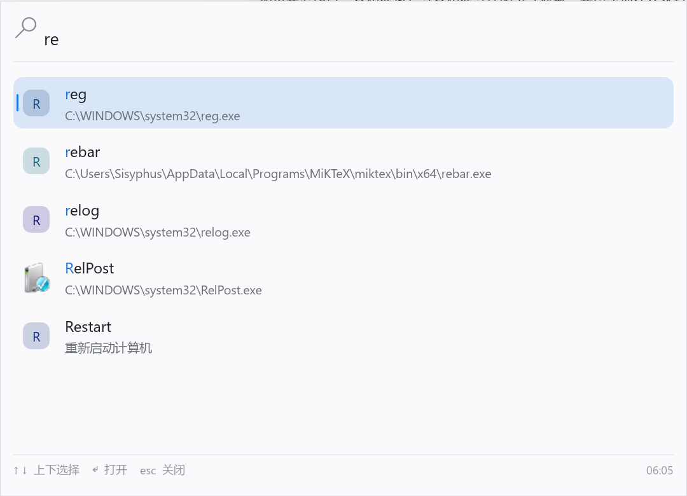
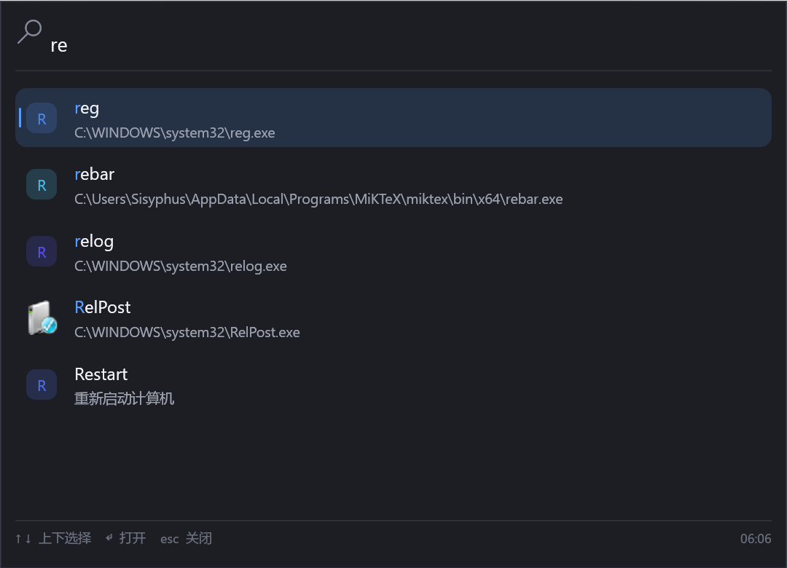
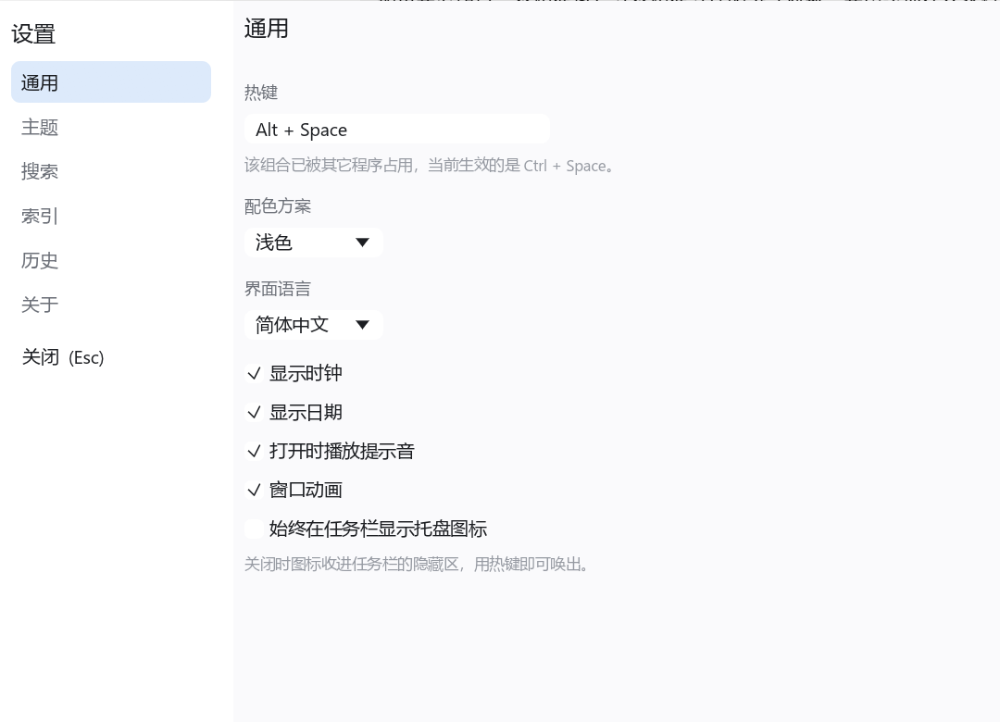
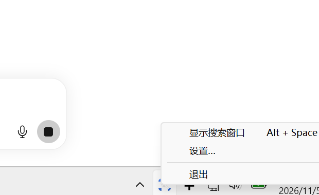

# IDEAS 设计系统

这一套资料是给**下一个要写的 IDEAS 软件**的。

读完之后，另一个工程师不需要看任何代码，就能做出一个和 IDEAS Launcher
看起来是同一个家族的软件 —— 同样的呼吸感、同样的克制、同样的分寸。

---

## 三分钟速览

如果只有三分钟，看这一节就够了：

1. **形状是方的。** 窗口和卡片都是直角，圆角只用在小组件上。
   想要圆角窗口，就交给系统去切，别自己画。
2. **颜色是角色。** `text_dim` 是"第二级文字"，不是"灰色"。
   主题负责给角色填色。
3. **两套刻度。** 间距 6 档（4/8/12/14/20/28），字号 6 档（11~18）。
   **不许自己发明数字。**
4. **字体是一条链**：拉丁 → Segoe UI，汉字 → 微软雅黑 UI。
5. **留白是主要的分隔手段**，线和色块是补充。

---

## 资料清单

| 文件 | 是什么 | 谁看 |
|---|---|---|
| **[`DESIGN.md`](DESIGN.md)** | **完整规范**：设计性格、形状规则、颜色角色、版式、每个组件的尺寸、交互、禁忌 | 所有人，**先读这个** |
| [`tokens.json`](tokens.json) | 全部 token + 16 个主题的完整色值 | 要写代码的人、工具链、设计工具 |
| [`reference/`](reference/) | 参考截图：浅色搜索页、深色搜索页、设置页、托盘菜单 | 要看效果的人 |
| `crates/ideas-design/` | 同一套 token 的 Rust 实现（零依赖） | Rust 程序，直接依赖 |
| `crates/ideas-design/README.md` | token 的速查表 | Rust 程序 |

---

## 三种用法

### 用文档（任何语言）

读 `DESIGN.md`，照着实现。你需要的所有数值都在里面。

### 用机器可读的 token（任何语言）

```js
// tokens.json 直接 import
import tokens from './tokens.json';

const gap = tokens.space.LG;          // 14
const titleSize = tokens.typography.TITLE;  // 16
const accent = tokens.themes.find(t => t.name === 'Midnight').colors.accent;
```

### 用 Rust crate

```toml
[dependencies]
ideas-design = { path = "../crates/ideas-design" }
```

```rust
use ideas_design::{component, space, typography};

ui.add_space(space::SM);
ui.label(RichText::new("热键").size(typography::LABEL));
```

token 变了重新导出：

```bash
cargo run -p ideas-launcher --bin export-design-tokens
```

---

## 参考截图

| | |
|---|---|
|  |  |
| 浅色主题的搜索结果 | 深色主题的搜索结果 |
|  |  |
| 设置页 | 托盘右键菜单 |

---

## 一句话记住

> **安静、方正、克制。** 它应该看起来像 Windows 自己的一部分，
> 而不是���个装在 Windows 里的东西。
